# Gallery

One benchmark example for every status, every way of reaching it and every resonance type, each with its one-page
verdict figure. The figures are drawn by the package itself from the saved integrations; the verdict line under
each caption is the package's verdict on that record (`status` · `angle_status` · `reason` · `confidence`), so a
caption and its figure always agree. Click a figure to open it at full size.

A resonance key lists integer coefficients: first those of the mean longitudes of the planets (J Jupiter, S Saturn,
E Earth, M Mars, V Venus, N Neptune) and of the body, then those of the longitudes of perihelion in the same order
(and of the nodes, when present): `4J-2S-1+0+0-1` is $4\lambda_J - 2\lambda_S - \lambda - \varpi$. See
[Resonance matrices](../matrix.md). Secular keys name the frequencies ($g - g_6 + s - s_6$ is z1), `LK` is the
Lidov-Kozai angle $\omega$.

## How to read the figure

**Mean-motion resonances.** The left half holds the time series, all on one time axis:

| panel | what it shows |
|---|---|
| (a) | $\sigma$ unwrapped: osculating (grey) and filtered $\sigma_f$ (black), centre, episodes (numbered), turning points |
| (b) | $\sigma$ in a 360° window around the centre: every osculating sample and $\sigma_f$ |
| (c) | $\dot\sigma / 2\omega_{0,\rm ref}$ on a symmetric-log axis; $\omega_{0,\rm ref}$ is the decisive episode's (else the longest librating episode's, else theory), and dashed lines mark each episode's own $\pm 2\omega_0$. These are cosine-equivalent scales: for a cosine well $2\omega_0$ is the speed on the separatrix at the bottom of the well; a non-cosine or co-orbital well has its own $\sqrt{2(E_{\rm sep} - V_{\rm min})}$ |
| (d) | $a$ in au: osculating, filtered, the exact resonance $a_*$, the catalogue value and the band of the resonance's half-width |
| (e) | $\dot a$ with the fitted force law $R \sin(\sigma_f - \phi_0) + C$ in windows, with its $R^2$ |
| (f), (g) | $e$ and $i$ |
| (h) | the pendulum's energy $h$ of every cycle (log axis), the separatrix zone and $h = 1$ |
| (i) | the slow centre of $\sigma$ over $\sigma_f$ |
| (j) | the centres of the other members of the multiplet and of an owner resonance: a flat line is the member that librates |

Below them: (k) the phase portrait of the whole record coloured by time, (l) the portrait of the accepted episodes,
(m) the FAIR portrait of two-body angles, and the legend. The right half is the verdict: the plaque with the
status, the verdict explained in words, the steps of the [status tree](status-tree.md), the margins and caps of the
[confidence](confidence.md) (✓ passes, ⚠ thin, ✗ fails, – not applicable, ? not measured) and the numbers behind
them. Every number there is a column of the [output files](../output.md).

**Secular and Lidov-Kozai.** (a) $\sigma$ unwrapped, filtered at the scale the verdict rests on, with turning
points and episodes; (b) $\sigma$ modulo 360°; (c) its rate; (d), (e) $e$ and $i$; (f) for a secular angle the
rate of the element the angle contains against $A \sin\sigma_f + B\cos\sigma_f + C$, for Lidov-Kozai the free
$\omega$ against the osculating one (a free $\omega$ that winds makes the libration kinematic); (g) the centre of
$\sigma_f$; (h) the portrait $(e\cos\sigma, e\sin\sigma)$; (i) $\sigma_f$ against its rate (secular) or the free
eccentricity vector (Lidov-Kozai). The right half is as above.

## Resonant

The angle librates over the whole record and the libration belongs to this resonance.

### A two-body resonance: the textbook pendulum {#resonant-two-body}

$\sigma$ librates about a fixed centre over the whole record, $a$ oscillates in step with it, and every test of the force law and of the pendulum's energy passes.

**1921**, `2J-1+0-1`: `resonant` · `libration` · `dynamic_libration` · `certain`. Record: 100 kyr, step 1 yr, SABA(10,6,4).

[{ loading=lazy }](../img/gallery/mmr2__1921__2J-1+0-1.png)

### A three-body resonance with Jupiter and Saturn {#resonant-three-body}

The same reading for a three-body angle: $\sigma$ librates over the whole record and $a$ follows it as the pendulum of this resonance requires.

**2487**, `4J-2S-1+0+0-1`: `resonant` · `libration` · `dynamic_libration` · `certain`. Record: 100 kyr, step 1 yr, SABA(10,6,4).

[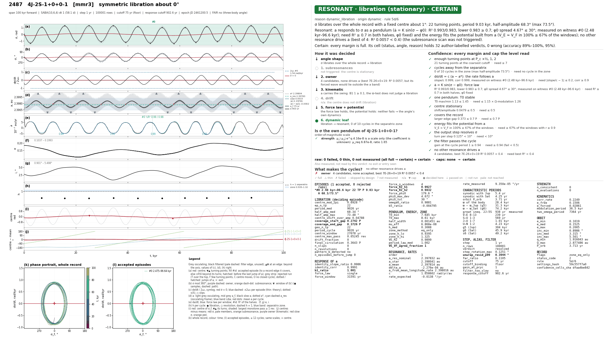{ loading=lazy }](../img/gallery/mmr3__2487__4J-2S-1+0+0-1.png)

### The body of the quick start {#quick-start-463}

The resonance checked in the [Quick start](../quick-start.md). The libration is as clear as above; one margin is thin, so the confidence is high rather than certain.

**463**, `4J-2S-1+0+0-1`: `resonant` · `libration` · `dynamic_libration` · `high`. Record: 100 kyr, step 1 yr, SABA(10,6,4).

[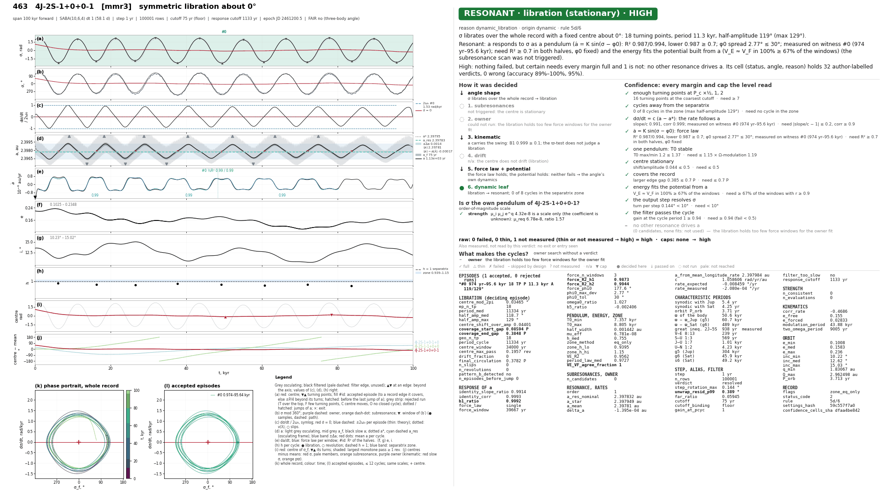{ loading=lazy }](../img/gallery/mmr3__463__4J-2S-1+0+0-1.png)

### An Earth co-orbital {#resonant-coorbital}

The angle $\lambda - \lambda_E$ alternates between horseshoe and quasi-satellite motion and never circulates. A 1:1 angle is judged by its own force law, from the averaged direct and indirect potential of the planet.

**2002 AA29**, `1E-1+0+0`: `resonant` · `libration` · `dynamic_libration` · `high`. Record: 1 kyr, step 0.05 yr, ias15 + Moon.

[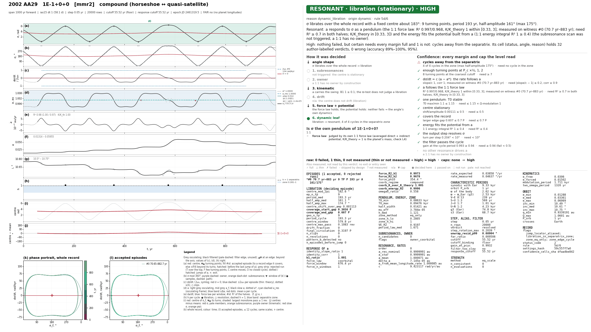{ loading=lazy }](../img/gallery/coorbital__2002_AA29__1E-1+0+0.png)

### Two co-orbital regimes in turn {#coorbital-regime-change}

Quasi-satellite motion, then horseshoe motion: two regimes of the same 1:1 resonance follow each other without a circulation in between, so together they cover the record (subtype regime_change).

**164207**, `1E-1+0+0`: `resonant` · `libration` · `dynamic_libration` · `high`. Record: 1 kyr, step 0.05 yr, ias15 + Moon.

[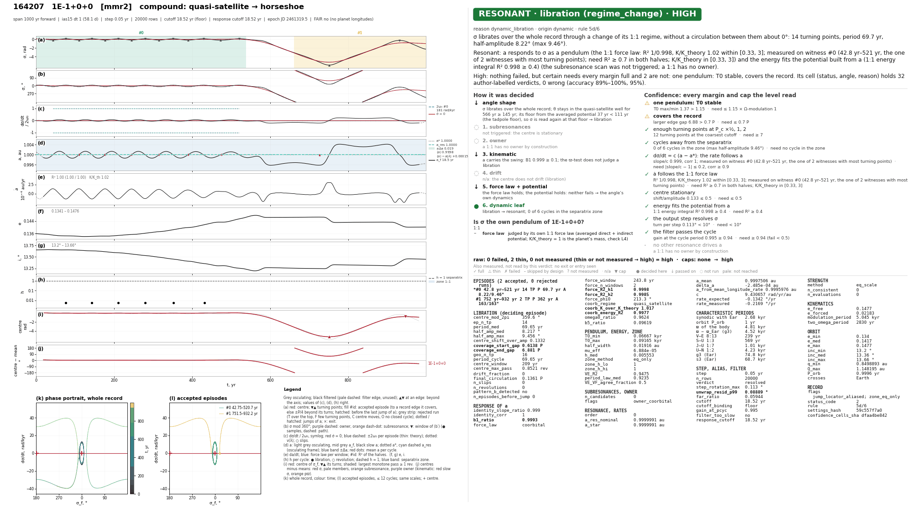{ loading=lazy }](../img/gallery/coorbital__164207__1E-1+0+0.png)

### Libration about a moving centre {#moving-centre}

The centre of libration follows the slowly moving minimum of the averaged potential; the libration is tested in $\psi = \sigma - \sigma_c(t)$. The output step folds short periods, which holds the confidence at medium and asks for a resample.

**2013 AS27**, `31E-36+0+5`: `resonant` · `libration` · `dynamic_libration` · `medium`. Record: 20 kyr, step 5 yr, ias15.

[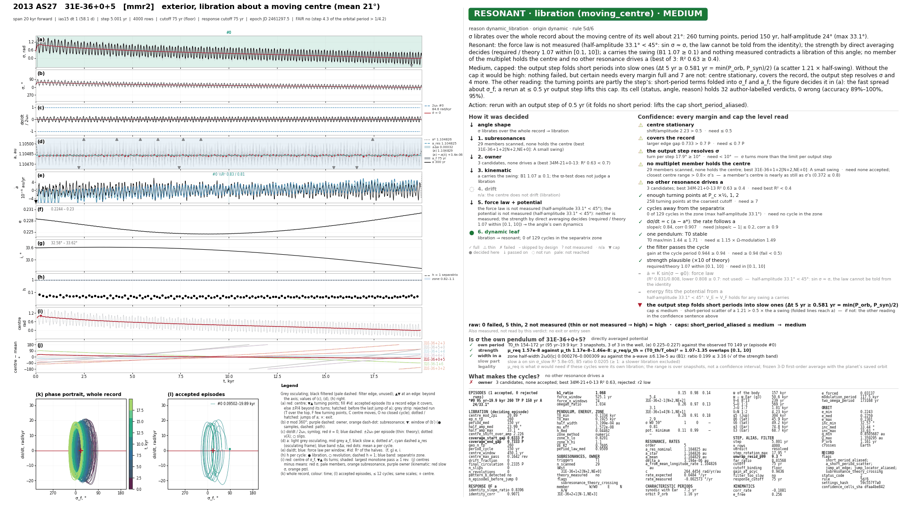{ loading=lazy }](../img/gallery/mmr2__2013_AS27__31E-36+0+5.png)

### A slow libration on a long record {#centre-scale}

A high-order resonance with Neptune whose libration period is long: over this record the angle closes enough cycles to be called resonant. The same body on a shorter record is [uncertain](#insufficient-time).

**385458**, `9N-17+0+8`: `resonant` · `libration` · `dynamic_libration` · `high`. Record: 300 kyr, step 1 yr, SABA(10,6,4).

[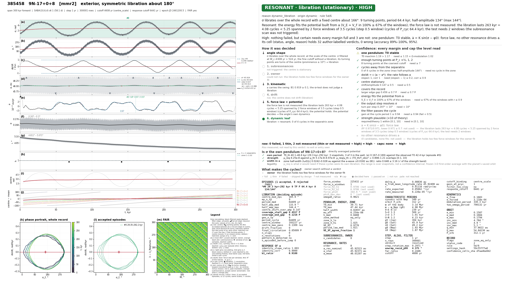{ loading=lazy }](../img/gallery/mmr2__385458__9N-17+0+8__300kyr.png)

### Libration decided by the geometry alone {#geometric-libration}

$\sigma$ librates over the whole record, but neither the force law nor the energy of the pendulum could be measured: only the geometry decided (reason geometric_libration, origin unknown), and the confidence is at most medium.

**2348**, `4J-2S-1+0+0-1`: `resonant` · `libration` · `geometric_libration` · `medium`. Record: 100 kyr, step 1 yr, SABA(10,6,4).

[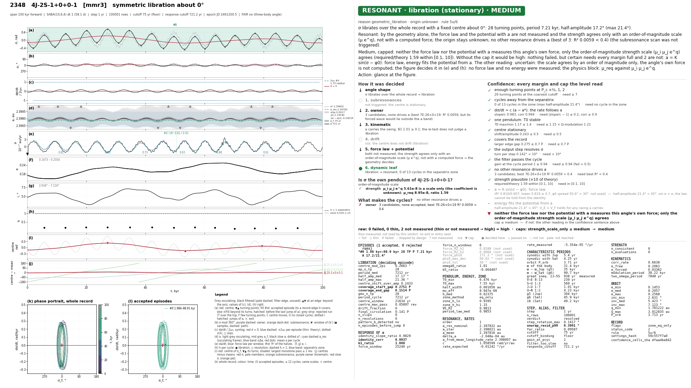{ loading=lazy }](../img/gallery/mmr3__2348__4J-2S-1+0+0-1.png)

## Transient

Librating episodes in part of the record, circulation or a drift in the rest.

### Repeated capture and release {#transient-recurrent}

Librating episodes alternate with circulation (subtype recurrent). The episodes stay close to the separatrix, which caps the confidence.

**52356**, `5J-2S-2+0+0-1`: `transient` · `episodic` · `dynamic_episode` · `medium`. Record: 100 kyr, step 1 yr, SABA(10,6,4).

[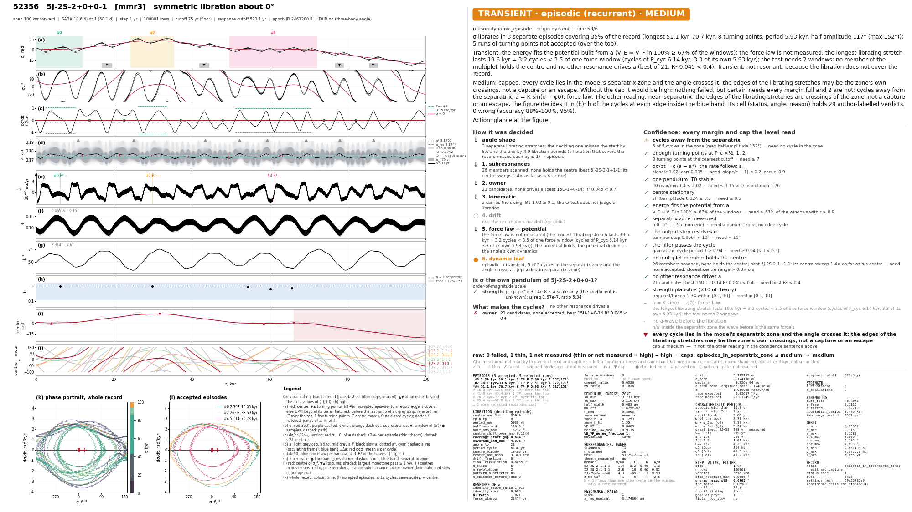{ loading=lazy }](../img/gallery/mmr3__52356__5J-2S-2+0+0-1.png)

### A co-orbital that leaves the 1:1 resonance {#transient-exit}

The exit is seen in the orbit-averaged angle: after it $\lambda - \lambda_E$ circulates to the end of the record (final_regime circulation).

**2017 UM52**, `1E-1+0+0`: `transient` · `episodic` · `ends: circulation` · `dynamic_episode` · `high`. Record: 1 kyr, step 0.05 yr, ias15 + Moon.

[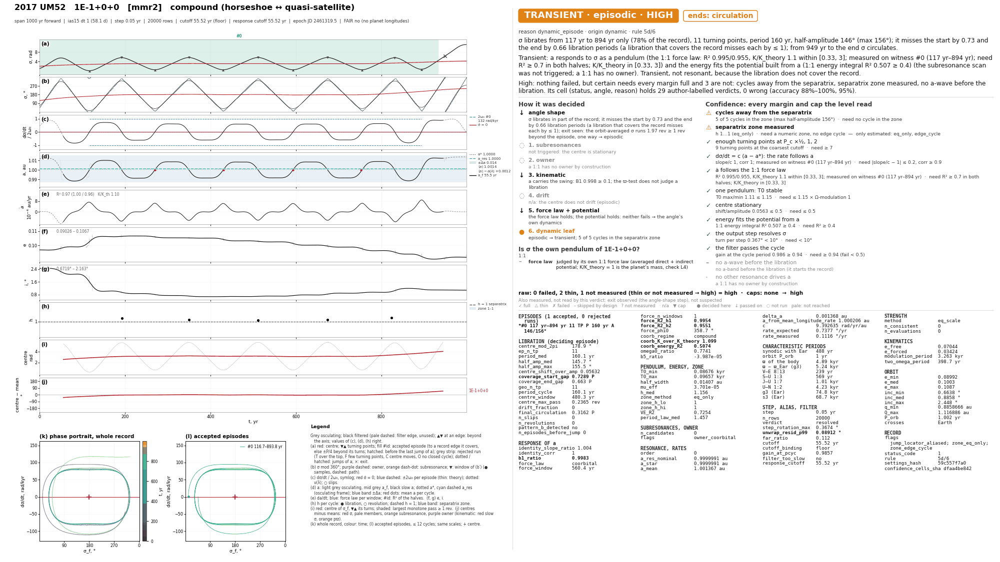{ loading=lazy }](../img/gallery/coorbital__2017_UM52__1E-1+0+0.png)

### An episode, then circulation {#transient-capture-exit}

A libration episode followed by circulation to the end of the record. The episode closes only about one cycle, which caps the confidence.

**115978**, `11M-19+0+8`: `transient` · `episodic` · `ends: circulation` · `dynamic_episode` · `medium`. Record: 50 kyr, step 0.6 yr, ias15.

[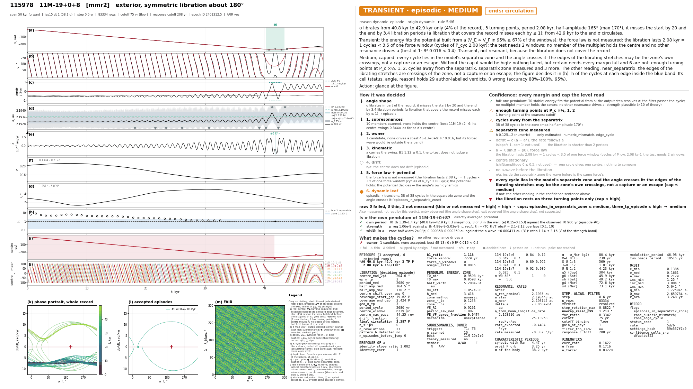{ loading=lazy }](../img/gallery/mmr2__115978__11M-19+0+8.png)

### An episode ended by a jump of the semi-major axis {#transient-before-jump}

The episode ends where $a$ jumps (a kick, as at a close approach to a planet); after the jump the angle no longer librates. An episode that ends at a jump caps the confidence.

**2003 UG22**, `10E-17+0+7`: `transient` · `episodic` · `ends: circulation` · `dynamic_episode` · `medium`. Record: 40 kyr, step 0.25 yr, ias15.

[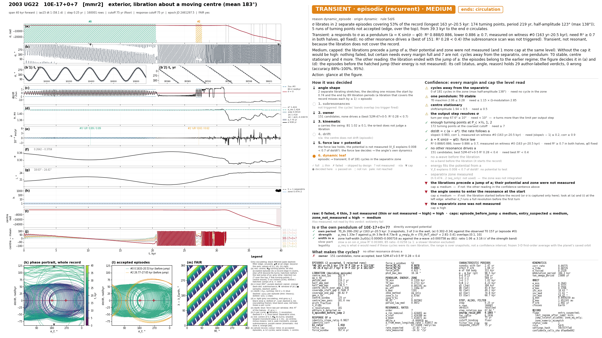{ loading=lazy }](../img/gallery/mmr2__2003_UG22__10E-17+0+7__40kyr.png)

### Episodes made by a member of the multiplet {#transient-subresonance}

The catalogue angle drifts with $\varpi$, but its member $\sigma + 2(\varpi_M - \varpi)$ (13M-24+2+9) librates about a fixed centre: the episodes belong to that member (reason subresonance_librates). The second figure is the member's own verdict.

**82831**, `13M-24+0+11`: `transient` · `episodic` · `ends: circulation` · `subresonance_librates` · `high`. Record: 100 kyr, step 0.5 yr, SABA(10,6,4).

[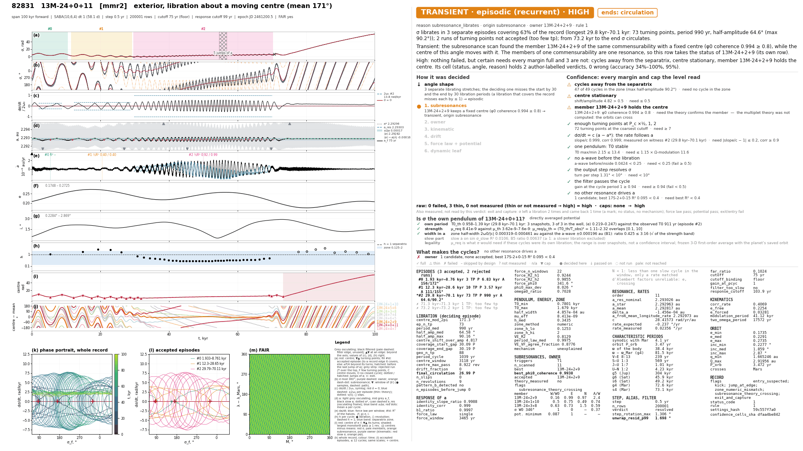{ loading=lazy }](../img/gallery/mmr2__82831__13M-24+0+11.png)

**82831**, `13M-24+2+9`: `transient` · `episodic` · `ends: circulation` · `dynamic_episode` · `high`. Record: 100 kyr, step 0.5 yr, SABA(10,6,4).

[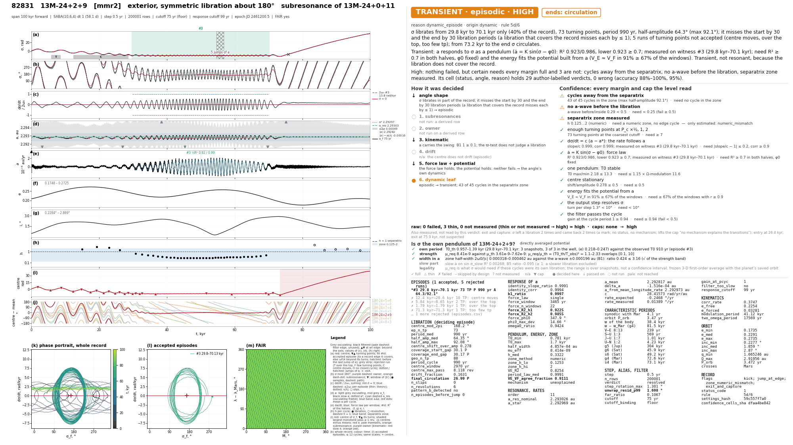{ loading=lazy }](../img/gallery/mmr2__82831__13M-24+0+11__13M-24+2+9.png)

### An episode decided by the geometry alone {#geometric-episode}

A librating episode in part of the record; no force could be measured, so the geometry alone decided (reason geometric_episode, origin unknown).

**24820**, `3J-1S-1+0+0-1`: `transient` · `episodic` · `ends: circulation` · `geometric_episode` · `medium`. Record: 100 kyr, step 1 yr, SABA(10,6,4).

[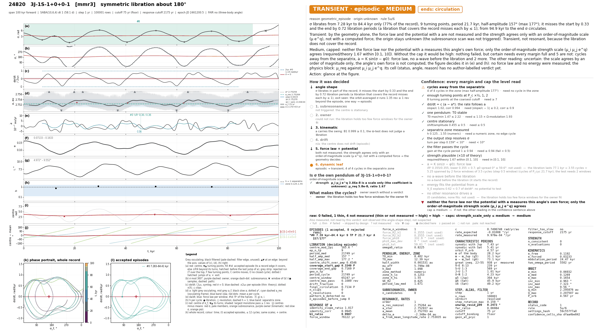{ loading=lazy }](../img/gallery/mmr3__24820__3J-1S-1+0+0-1.png)

## Near the separatrix

No closed libration cycle, but the angle stalls at the top of its own well.

### Stalls at the top of the well {#near-separatrix}

No closed libration cycle, but $\sigma$ repeatedly stalls near the top of its own potential well while $a$ responds (pattern B): motion close to the separatrix. This status is rare.

**523899**, `3N-5+0+2`: `near_separatrix` · `near_separatrix` · `separatrix_zone` · `medium`. Record: 100 kyr, step 1 yr, SABA(10,6,4).

[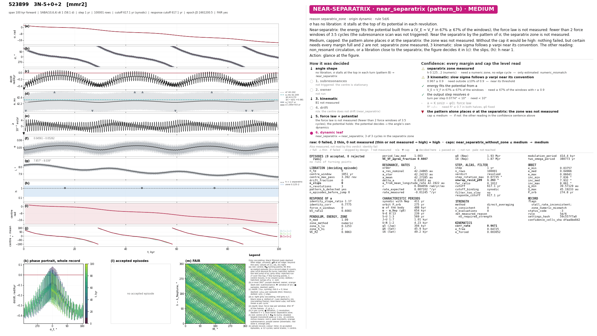{ loading=lazy }](../img/gallery/mmr2__523899__3N-5+0+2.png)

## Non-resonant

Circulation, or a bounded angle that this resonance does not make.

### Circulation {#circulation}

$\sigma$ circulates over the whole record: no libration anywhere.

**42355**, `3N-4+0+1`: `non_resonant` · `circulation` · `circulation` · `certain`. Record: 100 kyr, step 1 yr, SABA(10,6,4).

[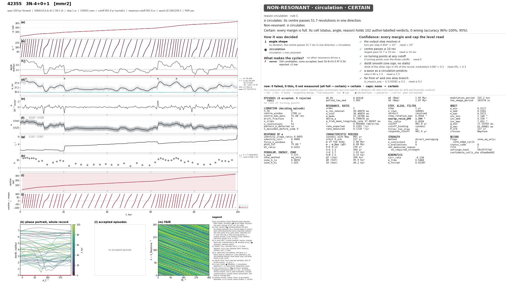{ loading=lazy }](../img/gallery/mmr2__42355__3N-4+0+1.png)

### A stroboscope: the output step aliases a fast angle {#alias}

The output step is close to a multiple of the fast period of $\sigma$, so the sampled angle seems to move slowly. The analysis finds the folded branch and reads the true motion as a fast circulation (reason alias).

**1999 UQ**, `7E+2M-9+0+0+0`: `non_resonant` · `circulation` · `alias` · `certain`. Record: 20 kyr, step 5 yr, ias15.

[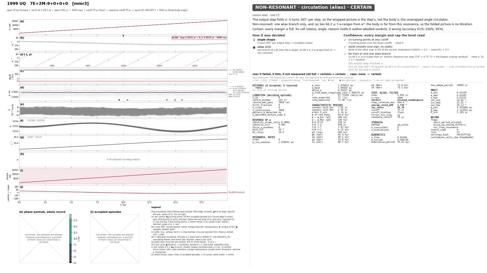{ loading=lazy }](../img/gallery/mmr3__1999_UQ__7E+2M-9+0+0+0.png)

### The same body at a fine step {#alias-fine-step}

Sampled finely, the angle circulates fast, as the alias analysis of the coarse record predicted.

**1999 UQ**, `7E+2M-9+0+0+0`: `non_resonant` · `circulation` · `circulation` · `certain`. Record: 20 kyr, step 1 yr, ias15.

[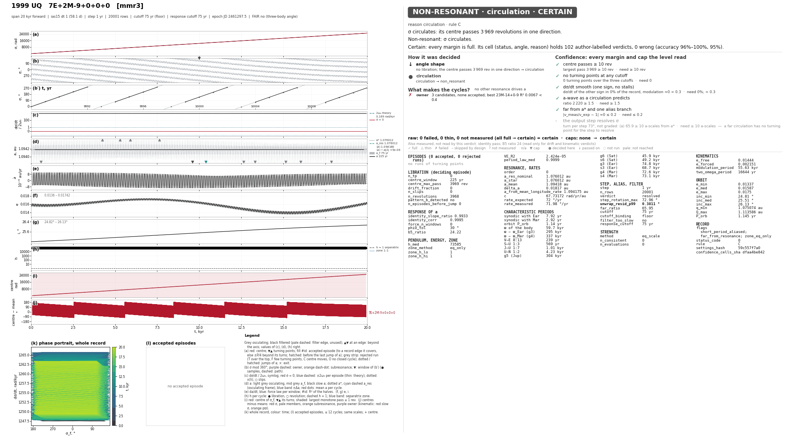{ loading=lazy }](../img/gallery/mmr3__1999_UQ__7E+2M-9+0+0+0__step1yr.png)

### A kinematic libration {#kinematic-libration}

$\sigma$ librates over the whole record, but $a$ does not follow it: the bound comes from the secular cycle of the elements, not from the resonant force (origin kinematic).

**285637**, `3M+7J-6+0+0-4`: `non_resonant` · `libration` · `kinematic_libration` · `medium`. Record: 50 kyr, step 0.6 yr, ias15.

[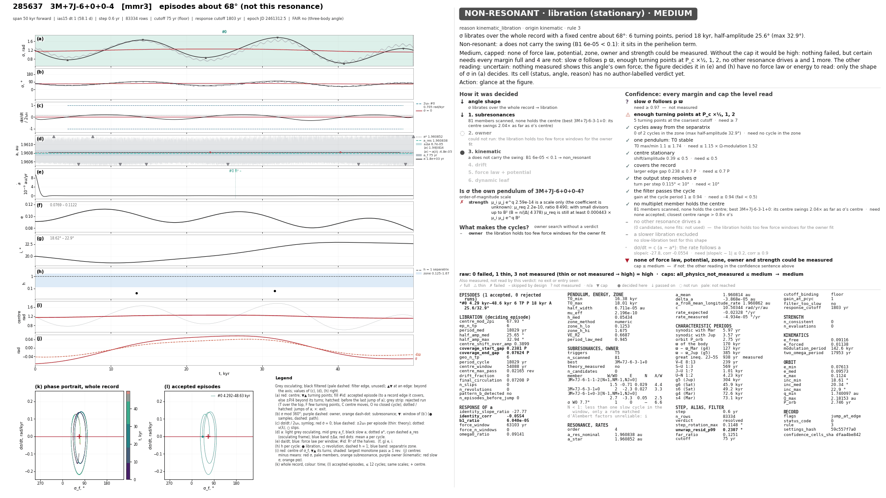{ loading=lazy }](../img/gallery/mmr3__285637__3M+7J-6+0+0-4.png)

### A kinematic drift {#kinematic-drift}

$\sigma$ drifts slowly with the secular terms of the angle while $a$ does not respond: no resonant force is at work.

**62243**, `1M-4J-1+0+0+4`: `non_resonant` · `drift` · `kinematic_drift` · `medium`. Record: 100 kyr, step 1 yr, SABA(10,6,4).

[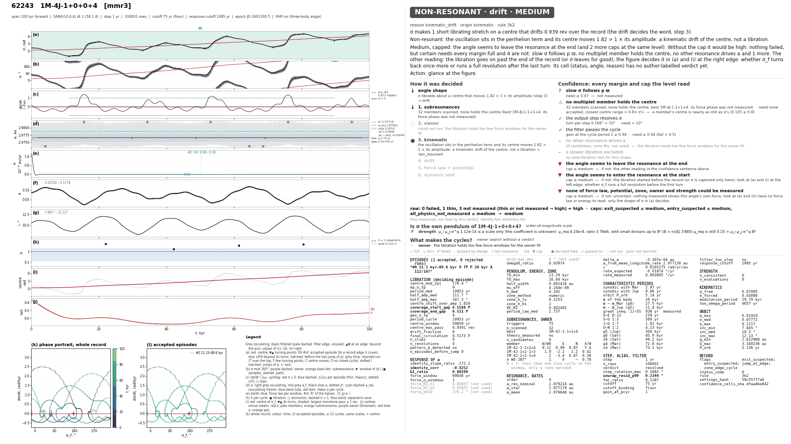{ loading=lazy }](../img/gallery/mmr3__62243__1M-4J-1+0+0+4.png)

### Episodes induced by another resonance {#induced-forced-wave}

$a$ oscillates because of another resonance (the owner, 11M-20+0+9), which circulates with the period of that oscillation; $\sigma$ follows $a$ only through its rate (origin induced, a forced wave).

**117306**, `1V+5J-7+0+0+1`: `non_resonant` · `episodic` · `ends: circulation` · `induced_libration` · `medium`. Record: 50 kyr, step 0.6 yr, ias15.

[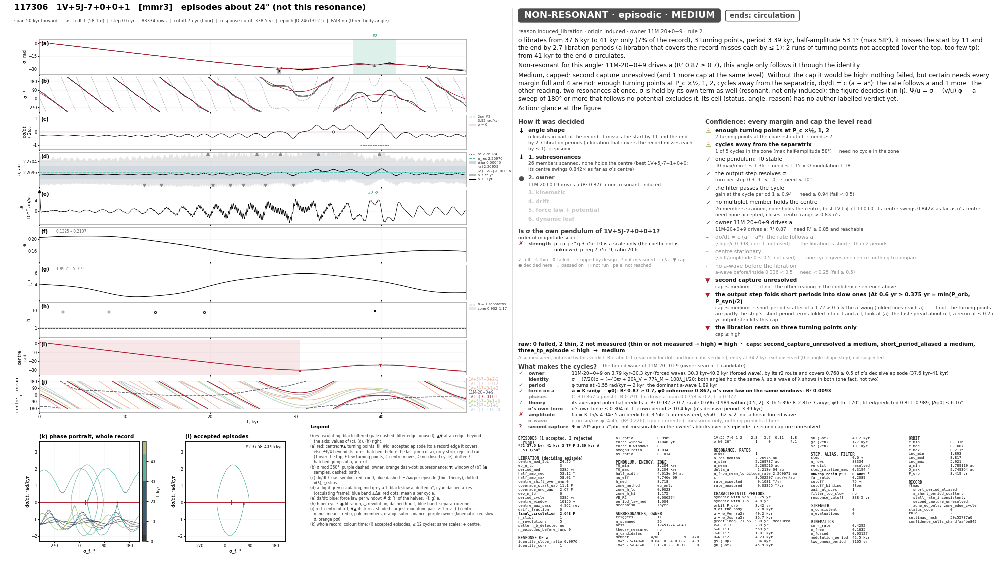{ loading=lazy }](../img/gallery/mmr3__117306__1V+5J-7+0+0+1.png)

### The owner librates {#induced-owner-librates}

Here the owner, the two-body resonance 10E-17+0+7 with Earth, librates itself and drives $a$; the episodes of the three-body angle are its consequence (origin induced).

**1997 GK3**, `3M+5S-3+0+0-5`: `non_resonant` · `episodic` · `ends: libration` · `induced_libration` · `medium`. Record: 20 kyr, step 5 yr, ias15.

[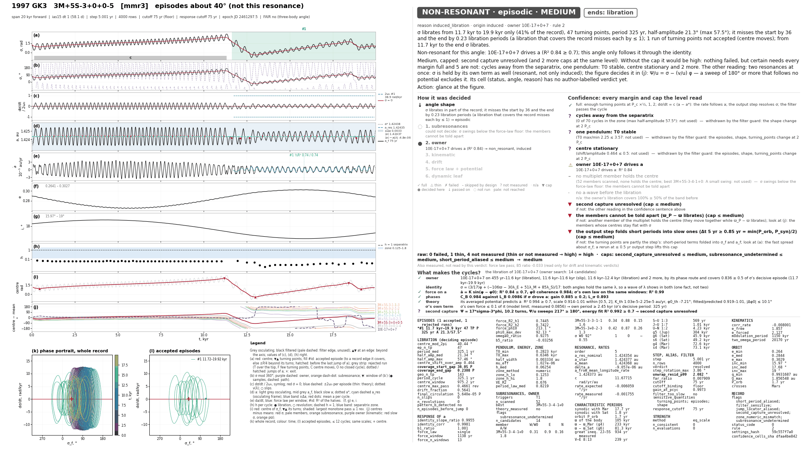{ loading=lazy }](../img/gallery/mmr3__1997_GK3__3M+5S-3+0+0-5.png)

### An implausible strength {#implausible-strength}

A resonance of order 31 with Saturn: its episodes would need a resonant force many orders of magnitude stronger than the averaged potential provides, so they are not this resonance.

**2897**, `35S-4+0-31`: `non_resonant` · `episodic` · `ends: circulation` · `implausible_strength` · `low`. Record: 50 kyr, step 0.6 yr, ias15.

[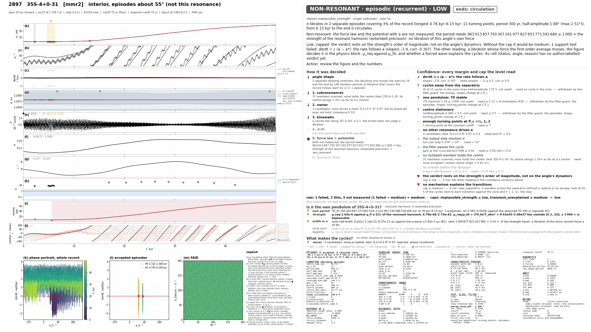{ loading=lazy }](../img/gallery/mmr2__2897__35S-4+0-31.png)

## Uncertain

The record cannot decide.

### The same body, too short a record {#insufficient-time}

The body of [the slow libration](#centre-scale) on a shorter record. The angle completes too few cycles to tell a libration from a slow circulation: uncertain, insufficient_time, and the action asks for a longer integration.

**385458**, `9N-17+0+8`: `uncertain` · `insufficient_time` · `baseline_needed`. Record: 100 kyr, step 1 yr, SABA(10,6,4).

[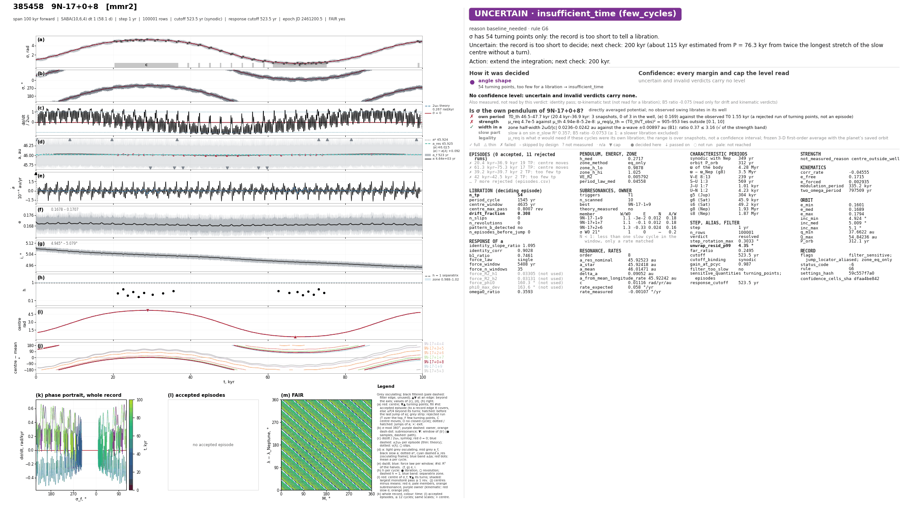{ loading=lazy }](../img/gallery/mmr2__385458__9N-17+0+8.png)

### An unexplained drift {#uncertain-drift}

$\sigma$ drifts, and neither a kinematic nor an induced explanation passes: uncertain, extend the integration.

**142694**, `1V+3S-7+0+0+3`: `uncertain` · `drift` · `drift_mechanism_unknown`. Record: 50 kyr, step 0.6 yr, ias15.

[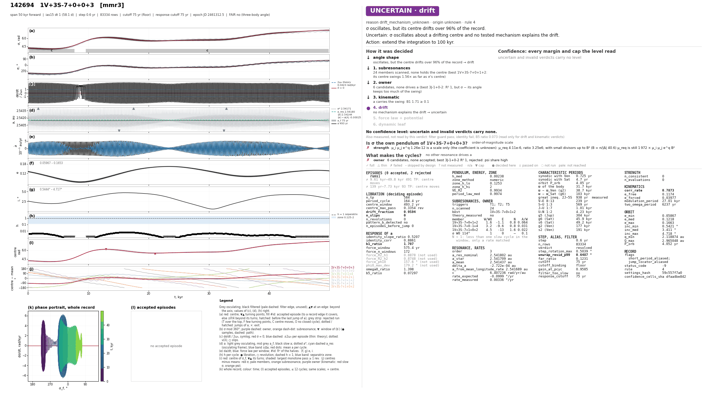{ loading=lazy }](../img/gallery/mmr3__142694__1V+3S-7+0+0+3.png)

### A libration the physics does not confirm {#uncertain-origin}

$\sigma$ librates about a moving centre, but the energy test of the pendulum fails and no other origin explains the libration: uncertain, origin_unknown, review.

**2003 TX9**, `3E+2J-10+0+0+5`: `uncertain` · `libration` · `origin_unknown`. Record: 20 kyr, step 5 yr, ias15.

[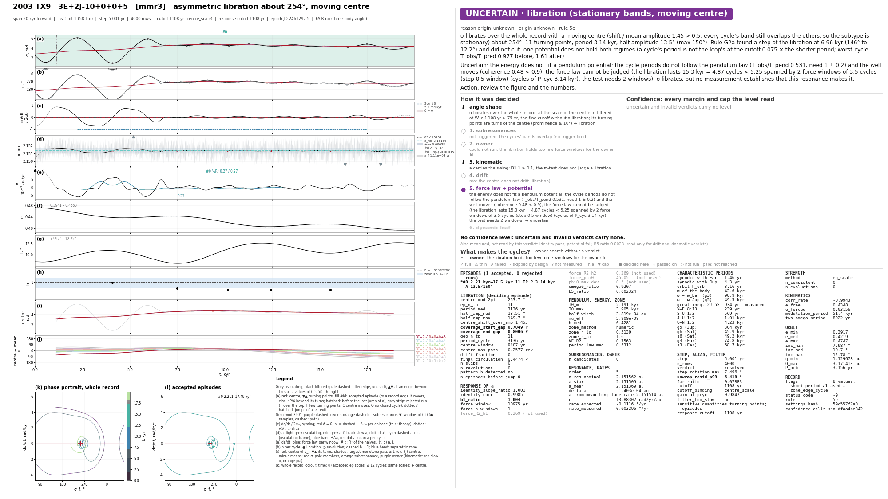{ loading=lazy }](../img/gallery/mmr3__2003_TX9__3E+2J-10+0+0+5.png)

## Invalid

The record cannot be measured at these settings.

### An ambiguous alias {#invalid-alias}

The output step folds the angle so that its alias branches cannot be told apart: the angle cannot be measured at this step, and the action asks for a resample at the step given in the right column.

**1864**, `51M-50+0-1`: `invalid` · `circulation` · `alias`. Record: 20 kyr, step 5 yr, ias15.

[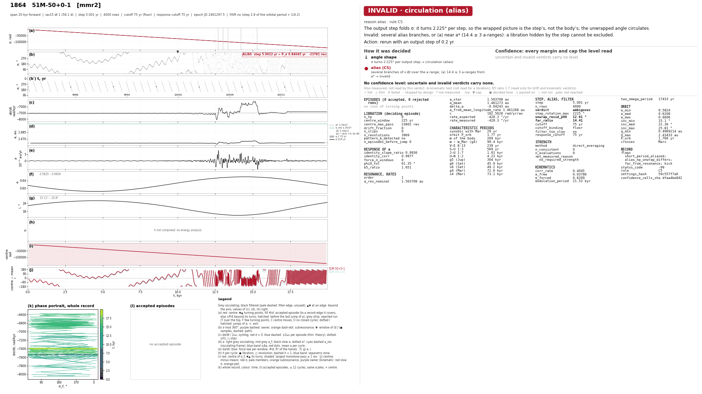{ loading=lazy }](../img/gallery/mmr2__1864__51M-50+0-1.png)

## Secular resonances

Angles of the proper perihelion and node against the planets' secular modes.

### The ν6 resonance {#secular-nu6}

The angle of the proper perihelion against the phase of Saturn's g6 mode librates over the whole record.

**1222**, `g-g6`: `resonant` · `libration` · `dynamic_libration` · `certain`. Record: 10 Myr, step 500 yr, SABA(10,6,4).

[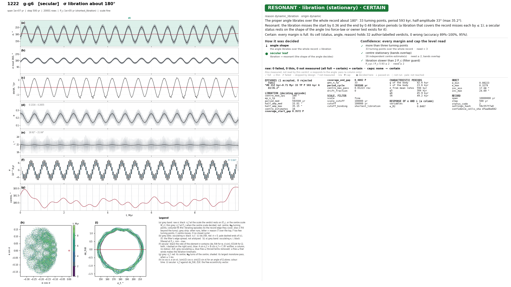{ loading=lazy }](../img/gallery/secular__1222__g-g6.png)

### The z1 resonance {#secular-z1-resonant}

A slow libration of g − g6 + s − s6: few cycles fit in the record, so the confidence is high rather than certain.

**1020**, `g-g6+s-s6`: `resonant` · `libration` · `dynamic_libration` · `high`. Record: 10 Myr, step 500 yr, SABA(10,6,4).

[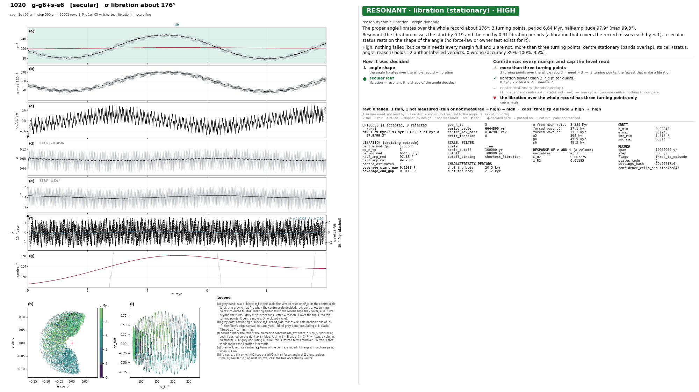{ loading=lazy }](../img/gallery/secular__1020__g-g6+s-s6.png)

### z1 in episodes {#secular-z1-transient}

The z1 angle librates in part of the record and circulates in the rest.

**2306**, `g-g6+s-s6`: `transient` · `episodic` · `dynamic_episode` · `certain`. Record: 10 Myr, step 500 yr, SABA(10,6,4).

[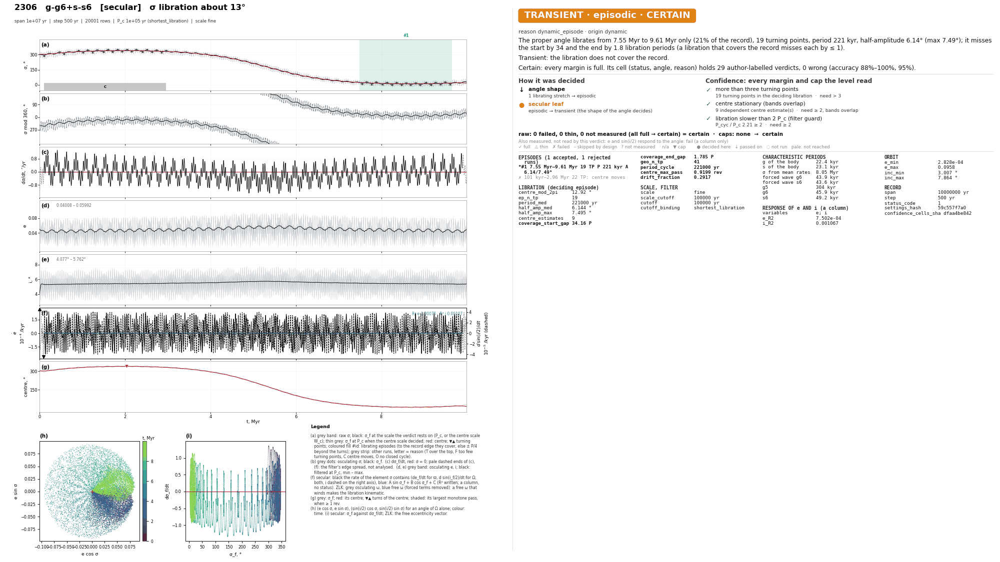{ loading=lazy }](../img/gallery/secular__2306__g-g6+s-s6.png)

### Just outside z1 {#secular-z1-circulation}

The z1 angle circulates slowly over the whole record: the body is close to the resonance but not in it.

**847**, `g-g6+s-s6`: `non_resonant` · `circulation` · `circulation` · `certain`. Record: 10 Myr, step 500 yr, SABA(10,6,4).

[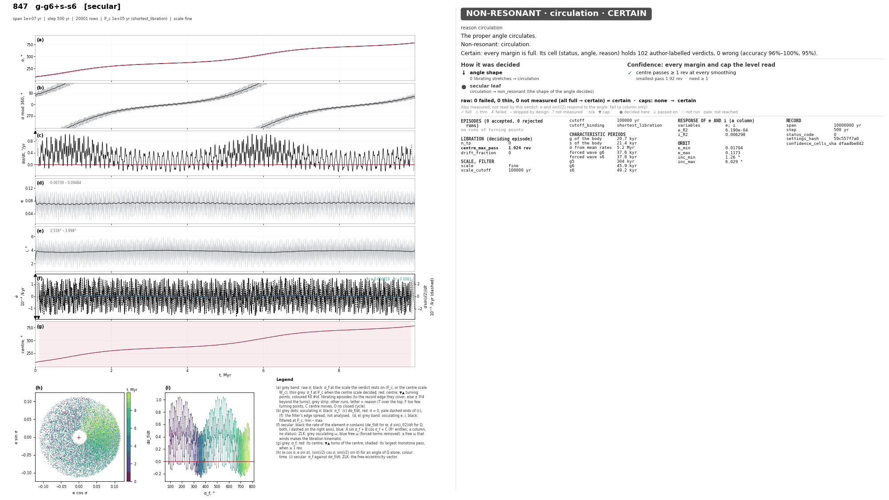{ loading=lazy }](../img/gallery/secular__847__g-g6+s-s6.png)

### Too few cycles {#secular-insufficient-time}

The period of the angle is comparable with the record: too few cycles to decide, extend the integration.

**363**, `g-g6+s-s6`: `uncertain` · `insufficient_time` · `baseline_needed`. Record: 10 Myr, step 500 yr, SABA(10,6,4).

[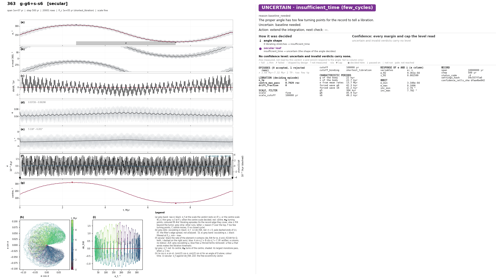{ loading=lazy }](../img/gallery/secular__363__g-g6+s-s6.png)

## Lidov-Kozai

The argument of perihelion $\omega$, judged together with its free part (the free-omega gate).

### A Lidov-Kozai libration {#zlk-resonant}

$\omega$ librates and its free part does too, so the free-omega gate confirms a Lidov-Kozai libration.

**3040**, `LK`: `resonant` · `libration` · `dynamic_libration` · `certain`. Record: 500 kyr, step 100 yr, mercurius.

[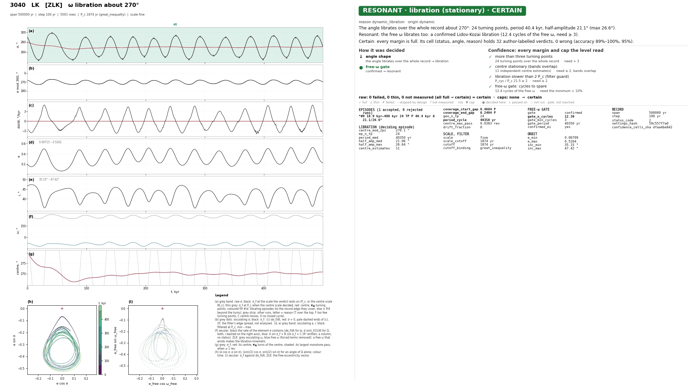{ loading=lazy }](../img/gallery/zlk__3040__LK.png)

### A kinematic libration of the argument of perihelion {#zlk-kinematic}

The osculating $\omega$ librates, but the free $\omega$ (the forced terms removed) winds: the forced eccentricity holds the osculating $\omega$, and the libration is kinematic.

**591986**, `LK`: `non_resonant` · `libration` · `kinematic_libration` · `certain`. Record: 500 kyr, step 100 yr, mercurius.

[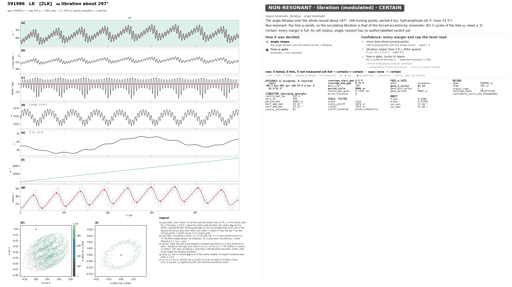{ loading=lazy }](../img/gallery/zlk__591986__LK.png)

### Lidov-Kozai episodes {#zlk-transient}

Two long episodes of libration of $\omega$, separated by an interval without libration.

**162474**, `LK`: `transient` · `episodic` · `dynamic_episode` · `certain`. Record: 1.5 Myr, step 10 yr, SABA(10,6,4).

[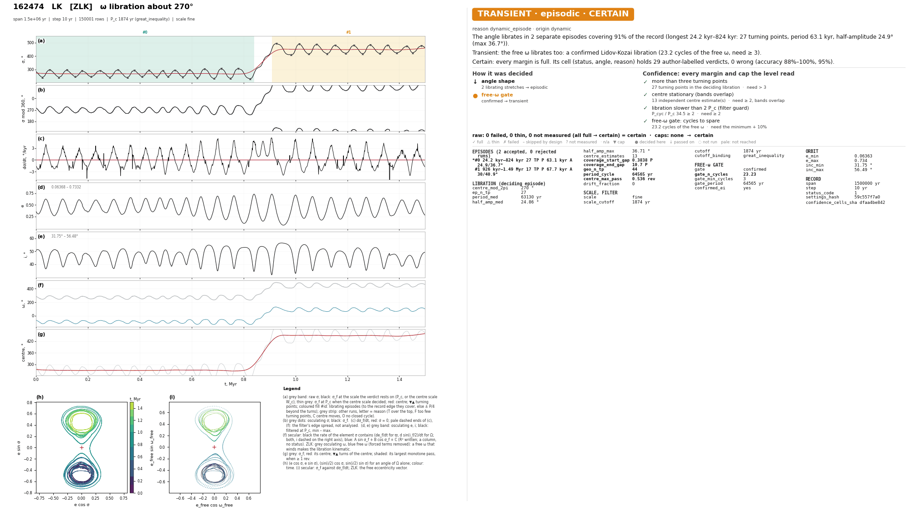{ loading=lazy }](../img/gallery/zlk__162474__LK__1500kyr.png)

### No verdict from the gate {#zlk-gate-unavailable}

$\omega$ librates, but the free-omega gate cannot be evaluated on this record: no verdict (uncertain, gate_unavailable).

**1981**, `LK`: `uncertain` · `libration` · `gate_unavailable`. Record: 500 kyr, step 10 yr, ias15.

[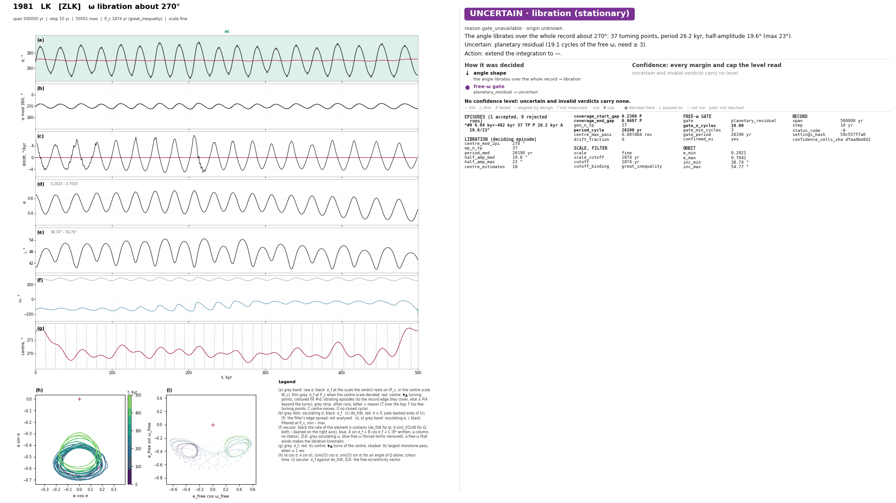{ loading=lazy }](../img/gallery/zlk__1981__LK.png)

### Circulation of the argument of perihelion {#zlk-circulation}

$\omega$ circulates over the whole record.

**15527**, `LK`: `non_resonant` · `circulation` · `circulation` · `certain`. Record: 500 kyr, step 10 yr, SABA(10,6,4).

[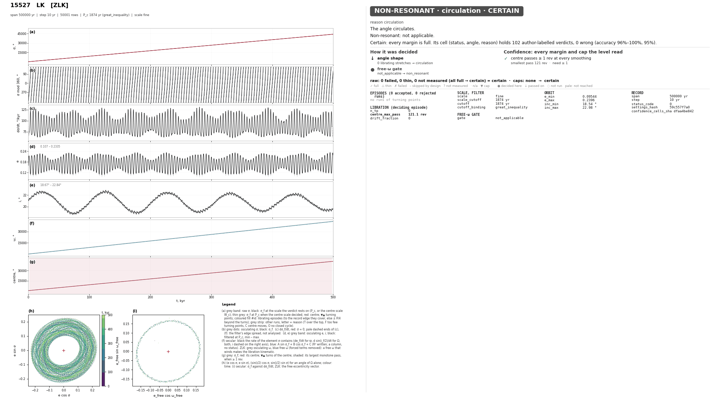{ loading=lazy }](../img/gallery/zlk__15527__LK.png)

### An unphysical orbit {#zlk-invalid}

The body is ejected: $e$ grows above 1 and $a$ becomes negative, so the record cannot be classified (reason unphysical).

**2010 HY22**, `LK`: `invalid` · `undefined` · `unphysical`. Record: 500 kyr, step 10 yr, ias15.

[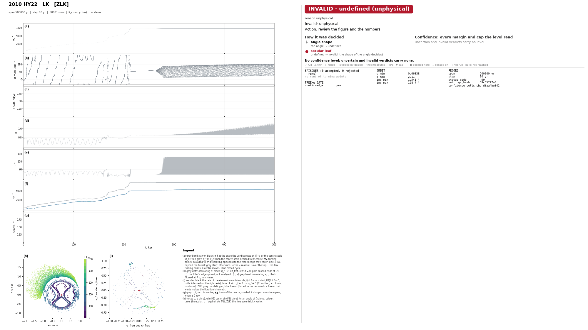{ loading=lazy }](../img/gallery/zlk__2010_HY22__LK.png)

## Regenerating the figures

Every figure of this documentation (this gallery and the schematic drawings of the physics pages) is made by one
command from the repository root:

```bash
make docs-figures                                  # everything (a few minutes, no integration)
make docs-figures ONLY=alias,pendulum_portrait     # some figures, by anchor or schematic name
uv run python docs/tools/build_figures.py --list   # the names
```

The script (`docs/tools/build_figures.py`) reads the saved series of the benchmark examples (`benchmark/data`, or
the folder in `RESONANCES_BENCHMARK_DATA`), analyses each again with the installed package and draws it with the
package's own figure code; nothing is integrated. It rewrites this page from the fresh verdicts and prints any
difference from the last saved benchmark run. Without the benchmark data the gallery figures are kept and only the
schematics are redrawn. Running it twice changes nothing: a file whose content is the same is not rewritten.
