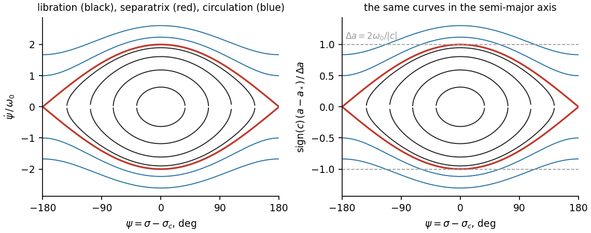
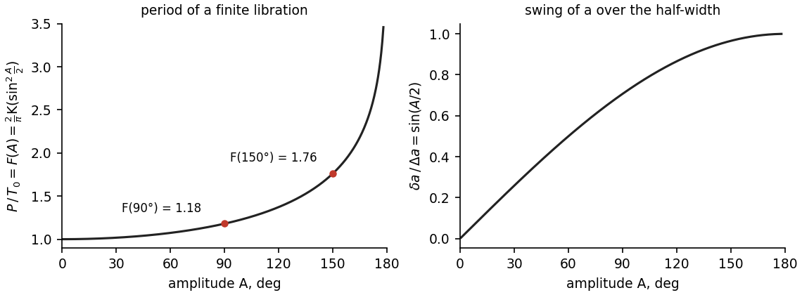

# The resonant pendulum

This page sets out the physical model every MMR test is built on: the resonant angle, the identity that ties its
rate to the semi-major axis, the averaged potential that drives $a$, and the pendulum that results. The tests
themselves are on [Is it this resonance?](response.md). Notation is that of the [Overview](overview.md#notation).

Three layers must be kept apart. The **classical model** (this page) is textbook celestial mechanics. The
**measurement** is what the package can read from a finite saved trajectory. The **classification** turns
measurements into statuses with thresholds that are conventions, all of them settings.

## The resonant angle and its rate

A mean-motion resonance of the body with one or two planets has the angle (Murray & Dermott 1999, eq. 8.18, p. 329;
for three-body angles Nesvorný & Morbidelli 1998, eqs. 1–2, p. 3029)

$$
\sigma = k\lambda + \sum_j k_j\lambda_j + p\varpi + \sum_j p_j\varpi_j + v\Omega + \sum_j v_j\Omega_j ,
$$

with integer coefficients that obey the d'Alembert rules: the coefficients sum to zero, and the nodal ones sum to
an even number. The catalogue name `4J-2S-1` stands for $4\lambda_J - 2\lambda_S - \lambda$ plus the perihelion term
that completes the sum ([Resonance matrices](../matrix.md)). Its rate (M&D eq. 8.22, p. 331) is modelled as

$$
\nu(a) = k\,n(a) + \sum_j k_j n_j + \nu_\text{slow}, \qquad n(a) = 2\pi a^{-3/2}\ \text{rad/yr},
$$

where $n_j$ are the planets' mean motions **measured in the run** (the slope of the saved $\lambda_j$, else a table
value) and $\nu_\text{slow} = p\dot\varpi + \sum_j p_j\dot\varpi_j + \dots$ collects the measured precession rates.
This is a *rate model*: the slow terms are held fixed and $n(a)$ is Kepler's law, so it is not an exact identity at
every sample.

The **exact resonance** $a_*$ solves $\nu(a_*) = 0$. Near it the rate is linear in $a$:

$$
\dot\sigma \simeq c\,(a - a_*), \qquad c = \frac{\partial\nu}{\partial a} = -\frac{3kn}{2a}.
$$

This is the **identity**. Its physical content is simple: $\sigma$ can turn back only when $a$ crosses $a_*$. A
libration of $\sigma$ therefore needs an oscillation of $a$ about $a_*$ with the right amplitude and the right phase.
Most catalogue angles have $k<0$, hence $c>0$. A retrograde orbit ($i > 90°$) uses its own angle convention built
from $\Omega,\omega,M$ ([Resonance matrices](../matrix.md)).

## The averaged potential and Lagrange's equation

The planet perturbs the body through the disturbing function, direct plus indirect part
(M&D eq. 6.13, p. 227):

$$
R = G m_P\left(\frac{1}{\lvert\mathbf r - \mathbf r_P\rvert} - \frac{\mathbf r\cdot\mathbf r_P}{r_P^3}\right) = G m_P\,D .
$$

Averaged over the fast angle at fixed $\sigma$ (the planet's longitude runs over $\lvert k\rvert$ turns while
$\sigma$ and the slow elements are held), it becomes a function $\bar R(\sigma)$ (Gallardo 2006, eqs. 1 and 6, p. 30).
The package computes this average by quadrature, with both orbits three-dimensional and the planet on its
eccentric, inclined orbit (its saved elements when the planet was saved, else its mean J2000 ellipse; see
[below](#how-strong-must-the-resonance-be)); no expansion in $e$, $i$ or the semi-major-axis ratio is made. Lagrange's equation for $a$
(M&D eq. 6.145, p. 251), at first order in the planet's mass, gives

$$
\dot a = \frac{2k}{na}\,\frac{\partial\bar R}{\partial\sigma}, \qquad
\ddot\sigma = k\dot n = -\frac{3k^2}{a^2}\,\frac{\partial\bar R}{\partial\sigma} \equiv -V'(\sigma),
\qquad V = \frac{3k^2}{a^2}\bar R ,
$$

using $\dot n = -\tfrac32 (n/a)\,\dot a$. With the positive disturbing function used here, **stable centres are the
minima of $\bar R$** (the common Hamiltonian convention writes the perturbation as $-R$; the physics is the same).
The minimum the body occupies, $\sigma_c$, need not be at $0$ or $\pi$: exterior $1{:}n$ resonances have asymmetric
wells, and the minima move when $e$, $i$, $\omega$ or the planet's perihelion change (Gallardo 2006, §3).

The average is frozen at the instantaneous slow elements and taken at first order in the mass. It fails at a close
encounter (inside a few Hill radii of the planet), where the package does not use it.

## The pendulum

Near a single well, $\ddot\sigma = -V'(\sigma)$ is a pendulum. Measured from its centre, $\psi = \sigma - \sigma_c$,
the cosine pendulum has (M&D eqs. 8.45–8.52, pp. 335–337)

$$
V = -\omega_0^2\cos\psi, \qquad
h = \frac{\dot\psi^2}{4\omega_0^2} + \sin^2\frac{\psi}{2} ,
$$

with $h<1$ for libration, $h = 1$ on the separatrix and $h>1$ for circulation. The package's energy variable is,
for any fitted $V$,

$$
h = \frac{\dot\sigma^2/2 + V(\sigma) - V_\text{min}}{V_\text{max} - V_\text{min}} ,
$$

normalised by the **global** minimum and maximum of $V$. For one harmonic this is the expression above. With two
harmonics and two wells the two maxima alternate with the wells, so both wells are bounded by the lower maximum, the
barrier between them, which lies below $V_\text{max}$: their separatrix sits at $h<1$, and $h<1$ alone does not say
which well the orbit is in. $h = 1$ stays the boundary of circulation: a loop between the barrier and $V_\text{max}$
librates around both wells; only $E > V_\text{max}$ lets the angle turn. The rules that read $h$ against 1 (crossings,
the filter guard, the turns' zone edge $h_\text{hi}$) mean circulation, and the global normalisation is the right one
there. The predicted period of a cycle is taken in the well
that holds it (the basin of the cycle's fastest sample), up to that well's own barrier, the lower of the two maxima
around it, and so is its action (below).

**Period.** A libration of amplitude $A$ (half the peak-to-peak swing) has the period

$$
P = \frac{4}{\omega_0}\,\mathsf K(m) = T_0\,F(A), \qquad m = \sin^2\frac A2, \qquad F(A) = \frac{2}{\pi}\mathsf K(m),
$$

with $T_0 = 2\pi/\omega_0$ the small-amplitude period and $\mathsf K$ taken with parameter $m$ (some authors use the
modulus $k$, $m = k^2$). Values: $F(30°) = 1.017$, $F(90°) = 1.180$, $F(120°) = 1.373$, $F(150°) = 1.762$,
$F(170°) = 2.44$. The period grows without bound at the separatrix. The package converts each observed cycle into
a small-amplitude period, $T_0 = P_i/F(A_i)$, and takes the median over the cycles of an episode.

*Libration (closed curves), circulation (open curves) and the separatrix, in $(\sigma,\dot\sigma)$ and in
$(\sigma, a)$; the half-width $\Delta a$ of the resonance is the separatrix's reach in $a$.*

*The period factor $F(A) = P/T_0$.*

**Width.** Through the identity, $\dot\sigma = c\,(a - a_*)$ maps the separatrix into a band of $a$. For the cosine
pendulum the half-width and the half-excursion at amplitude $A$ are (M&D eqs. 8.57–8.58, p. 338)

$$
\Delta a = \frac{2\omega_0}{\lvert c\rvert}, \qquad \delta a(A) = \Delta a\,\sin\frac A2 .
$$

This is the *cosine-equivalent* half-width, set by the curvature of the well. For a well of any shape the physical
half-width is

$$
\Delta a = \frac{\sqrt{2\,(E_\text{sep} - V_\text{min})}}{\lvert c\rvert} ,
$$

with $E_\text{sep}$ the well's own barrier. The two differ for a non-cosine well: for $V = -\cos 2\sigma$ and
$\lvert c\rvert = 1$ the curvature formula gives 4, the true half-width 2. The figure's "width in $a$" row uses the
cosine-equivalent scale.

**Action.** The action of a libration of energy $E$ in a well bounded by $\psi_-$ and $\psi_+$ is

$$
J(E) = \frac{1}{2\pi}\oint p\,d\psi = \frac{1}{\pi}\int_{\psi_-}^{\psi_+}\sqrt{2\,(E - V(\psi))}\;d\psi ,
\qquad \frac{dJ}{dE} = \frac{P}{2\pi}.
$$

For the cosine pendulum $J_s = 8\omega_0/\pi$ at the separatrix and (Wisdom 1985, §III, p. 277, with his modulus
translated to the parameter $m$)

$$
\frac{J}{J_s} = \mathsf E(h) - (1-h)\,\mathsf K(h) .
$$

At $\omega_0 = 1$, $h = 0.5$ a direct quadrature gives $J = 1.0787$, $J_s = 2.5465$, $J/J_s = 0.4236$, as the
closed form does. For a fitted potential with two harmonics the package evaluates the same integrals numerically
in the well the cycle occupies (the basin of its fastest sample, as for the period), up to the lower of that well's
two bounding maxima, with $J_s$ taken at that barrier: the action is the area of the cycle's own loop over $2\pi$
(M&D 1999, eq. 8.204, p. 376) and $J_s$ that of the separatrix that bounds it. With two harmonics both wells of a
double well share their two maxima, have one period at one energy, and differ in action by a constant,
$J_\text{deep}(E) - J_\text{shallow}(E) = J_\text{deep}(V_\text{shallow min})$ ($dJ/dE = P/2\pi$ in both). The
deepest well's ratio of a shallow-well cycle, $(J + C)/(J_s + C)$, would always be too large: for
$V = -\cos\sigma + 0.6\cos2\sigma - 0.25\sin\sigma$ at $h = 0.18$ it is 0.66 where the cycle's own is 0.10. In a slowly
changing well the action is the adiabatic invariant: the amplitude may change, the action does not, except near the
separatrix (Wisdom 1985, pp. 274, 279).

## How strong must the resonance be?

The pendulum frequency fixes the strength of the resonance. Writing $\omega_0 = \lvert k\rvert n\sqrt{3\mu_\text{eff}}$,

$$
\mu_\text{eff,th} = \frac{a\,\bar R''(\sigma_c)}{G M_\odot} = \mu_P\,a\,\bar D''(\sigma_c)
\qquad\text{(theory, from the averaged potential)},
$$

$$
\mu_\text{req} = \frac13\left(\frac{2\pi}{\lvert k\rvert\,n\,T_0}\right)^2
= \frac13\left(\frac{P_\text{orb}}{\lvert k\rvert\,T_0}\right)^2
\qquad\text{(required by the observed cycles)},
$$

with $T_0$ the median small-amplitude period of the decisive episode ($P_i/F(A_i)$ already corrects each cycle for its
amplitude, so $F$ enters only once). In these units the cosine half-width is
$\Delta a = \tfrac43 a\sqrt{3\mu_\text{eff}}$.

The **curvature**, not the first Fourier harmonic, is what sets the small-amplitude period, and the curvature is
taken at the minimum whose basin holds the measured centre. An evaluation counts only when the observed swing
librates in that well (it contains $\sigma_c$ and does not pass over the global maximum of $\bar R$). The theory is
evaluated at `MMR_STRENGTH_SNAPSHOTS` = 3 times in the episode, so it is a range, not a number. When the planet was
saved, each snapshot uses the simultaneous averaged elements of the body and the planet. Otherwise the planet's
phase is unknown: its mean J2000 ellipse is turned about the ecliptic pole to `MMR_STRENGTH_UNSAVED_PLANET_PHASES`
= 4 equally spaced orientations at each snapshot, and the range spans snapshot times and trial orientations
(`str_planet_elements` = `mean_orbit_phase_scan` instead of `saved`). This route still gives a direct strength.

At **high order** the resonant term is so weak (of order $e^q$ of $D$, $q$ the order of the resonance,
[Overview](overview.md#notation); not the sum of the slow coefficients of a multiplet member) that the curvature drowns in rounding. The
package then computes the resonant harmonic itself in extended precision,

$$
C = \left\langle D\,e^{-i\sigma}\right\rangle, \qquad \bar D(\sigma) = D_0 + 2\lvert C\rvert\cos(\sigma - \sigma_1) + \dots,
\qquad \mu_\text{eff,th} = 2\,\mu_P\,a\,\lvert C\rvert ,
$$

since a term $2\lvert C\rvert\cos$ has curvature $2\lvert C\rvert$ at its minimum.

The **strength check** compares the two: it passes when the range of $\mu_\text{req}/\mu_\text{eff,th}$ overlaps
$[1/x, x]$, $x$ = `MMR_STRENGTH_CHECK_RATIO` = 10, and fails when the whole range lies outside. A ratio beyond
`MMR_STRENGTH_IMPLAUSIBLE_RATIO` = 1000 either way is called **implausible**: the observed period would need a force a
thousand times larger (or smaller) than the resonance can give ([Is it this resonance?](response.md#strength)).
If the potential is resolved but none of its evaluations has the observed swing librating in its well, the check
**fails** (`centre_outside_well`), whatever the ratio: the range shown then covers every evaluation, also those outside
the occupied well, and is a diagnostic only. Not measured: no episode, no stable well near the measured centre, a quadrature that does not converge (nearly crossing
orbits), or the body within `MMR_STRENGTH_MIN_DISTANCE_HILL` = 3 Hill radii of the planet at the centre.

### Three-body resonances

A three-body term appears at second order in the masses (Morbidelli 2002, §9.3, p. 223; Nesvorný & Morbidelli
1998, §3, pp. 3031–3032). This implementation has **no directly averaged three-body potential**, and no centre track
for three-body angles; it uses only the order-of-magnitude scale

$$
\mu_\text{scale} = \mu_i\,\mu_j\,e^q ,
$$

which omits the coefficient of the term (that coefficient can reach $10^2$). The scale is used only when it is
legal: the record's median $e$ below `MMR_STRENGTH_E_MAX` = 0.3 (the same median gives $e$ in $e^q$) and no crossing of the term's planets. The check against it is a
support only, never a physics measurement. A second-order term can be enhanced by a near two-body commensurability
with one of its planets. Before calling a three-body strength implausible the package allows the generous
small-divisor envelope

$$
B = \frac{n}{\max\big(\lvert\Delta\rvert,\ 2\pi/\min(P, P_\text{cyc})\big)}, \qquad
\text{residual} = \frac{\mu_\text{req}/\mu_\text{scale}}{B^2} ,
$$

with $\Delta$ the smallest rate of a nearby two-body angle of those planets. The strength is implausible only when the
residual also stays $\ge$ 1000. The envelope is a diagnostic convention, not a bound on every three-body harmonic.

## Co-orbitals (1:1)

A 1:1 angle, $\theta = \lambda - \lambda_P$, is not a cosine pendulum: its averaged potential is singular at
$\theta = 0$ for $e = i = 0$ and far from harmonic over a horseshoe. The package averages the full direct plus
indirect disturbing function over the planet's longitude at fixed $\theta$ (softened at
`MMR_COORBITAL_SOFTENING_HILL` = 0.1 Hill radius) and writes, with $\tilde R = a\bar R/(G m_P)$ and
$\tilde F = a\langle\partial R/\partial\lambda\rangle/(G m_P)$,

$$
\dot a = 2\mu\,n\,a\,\tilde F(\theta), \qquad \tfrac12\dot\theta^2 + 3\mu n^2\,\tilde R(\theta) = E .
$$

For a circular coplanar orbit (M&D eqs. 3.178–3.179, p. 105)

$$
\tilde R(\theta) = \frac{1}{2\lvert\sin(\theta/2)\rvert} - \cos\theta, \qquad
\omega_\text{tad}^2 = 3\mu n^2\,\tilde R''(60°) = \frac{27}{4}\mu n^2 ,
$$

the small-mass limit of M&D eq. 3.151 (p. 94). The minima at $\theta = \pm 60°$ hold **tadpoles** about $L_4$ and
$L_5$; **horseshoes** pass over the maximum at $180°$; an eccentric or inclined orbit opens a well about $\theta = 0$
where **quasi-satellites** librate, much faster. A horseshoe that becomes a quasi-satellite without circulating is one
compound libration ([Gallery](gallery.md#coorbital-regime-change)).

The shortest co-orbital libration the analysis keeps is `MMR_COORBITAL_PERIOD_FLOOR_FACTOR` = 0.5 of the linear
tadpole period $P_\text{orb}/\sqrt{27\mu/4}$ (Jupiter 148 yr, Earth 222 yr). A quasi-satellite needs its own floor,
from the same averaged potential: $\omega_{QS}^2 = 3\mu n^2\tilde R''(\theta_c)$ in the well about 0. When the
orbit-averaged angle stays in that well for at least half `LIBRATION_MIN_TURNING_POINTS` small-amplitude periods
$P_{QS} = 2\pi/\omega_{QS}$ and the first pass found no libration, the record is analysed again with the floor
0.5 $P_{QS}$ (`MMR_COORBITAL_QS_FLOOR`).

The co-orbital law has **no free shape and a fixed scale**: fitting $\dot a_\text{data} = K\,\dot a_\text{model} + C$
should give $K/K_\text{theory} = 1$, the planet's own mass. That is the 1:1 force-law test
([Is it this resonance?](response.md#co-orbital-force-law)). The strength check is not applied to 1:1 angles.

!!! note "Limits of the model"
    The cosine pendulum is a local normal form: it assumes one dominant resonant term, nearly constant coefficients
    and slowly varying non-resonant variables (Henrard & Lemaître 1983; Lemaître 1984). At low eccentricity, high
    order, close encounters, overlapping multiplets or a quickly changing well a richer resonant Hamiltonian may be
    needed. The package measures geometry and the response of $a$ on the saved record and reports where the
    evidence ends. It does not solve every normal form, does not compute capture probabilities (Henrard 1982), and
    does not measure chaos: its energy, action and separatrix-zone numbers are diagnostics of a fitted model, not
    integrals of the full N-body motion.
