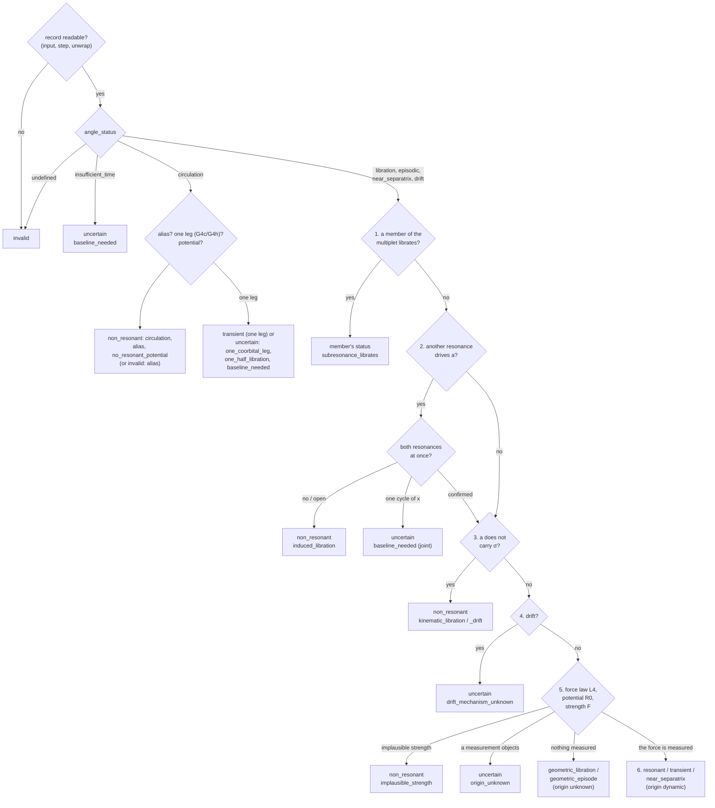

# The status tree

The geometry ([What the angle does](geometry.md)) says what $\sigma$ does over the record: `angle_status`. The
physics ([Is it this resonance?](response.md)) measures whether $a$ answers $\sigma$ as the pendulum of this
resonance requires. The status tree combines the two, always in the same order, into `status`, `reason` and
`libration_origin`. The first question that has an answer decides; the later ones are not asked.

The order follows one principle: **a cause outside this resonance is looked for before the libration is credited to
it.** A bounded $\sigma$ is first checked against the sampling (can the record be read at all?), then against
other resonances (a member of the same multiplet, another commensurability), then against pure geometry (the
perihelion term), and only then is its own force law measured.

This page describes mean-motion resonances (two-body, three-body, retrograde, co-orbital). Secular and Lidov-Kozai
angles use a shorter tree, given in [Secular and Lidov-Kozai](secular-zlk.md#geometry-and-status).

## Minimal policy (default) {#minimal-policy}

W29, agreed with the author 2026-11-02. The tree below runs first and measures
everything; a policy layer (`resonance/analysis/policy.py`) then re-reads the finished analysis by a few principles:

1. **Status from the geometry of $\sigma_f$.** libration → `resonant`, episodic → `transient`, near_separatrix →
   `near_separatrix`, circulation → `non_resonant`. A drift whose slow center passes ≥ one own revolution →
   `non_resonant`/`modulated_circulation`, less → `uncertain`. insufficient_time → `uncertain`, or
   `non_resonant`/`circulation` when the record ends in circulation ($\sigma_f$ travels ≥ one own revolution after the
   last turning point of an accepted or candidate run; a secular or ZLK travel below $1 +$ `CONFIDENCE_THIN_BAND`
   turns holds the level at medium). One own revolution is $2\pi$, for a ZLK $\omega$ too (W30:
   the half-turn symmetry of the quadrupole's $\cos 2\omega$ is not general; ZLK runs still break at half a turn).
   The geometry alone names no mechanism: a secular or ZLK libration is `geometric_libration`/`geometric_episode`,
   origin unknown, unless a confirmed ZLK gate makes it dynamic.
2. **Only a measured contradiction vetoes** a bounded angle (column `veto`): an owner that induces the episode (step
   2), a kinematic origin (step 3, K2, K3s), a two-body strength from the disturbing function far below the need
   (5s; the angle's word is then circulation or drift: no run is its libration), every counted episode below 45° being
   the forced wave its background carries (`forced_wave`, W31: at the episode's own period the envelopes of
   $\sigma$ and $a$ inside stay within the band the same steady wave shows within `MMR_FORCED_WAVE_REFERENCE_PERIODS`
   periods around it; a libration adds its own swing; some such episodes leave the count; 2012 KL9; runs found forced
   join the background of the others; when the slow center passes less than a revolution the drift rule decides
   instead: `uncertain` / `drift`), the ZLK gate measured kinematic on a libration, the free $e$ below the forced $e$ over the record
   (`zlk_free_e`; inside every episode or with an undefined free phase only when the $e$–$i$ integral is broken too),
   or the $e$–$i$ exchange of the deciding ZLK episode breaking $\sqrt{1-e^2}\cos i$ where the forced terms are small,
   $\rho_{\max} \ge$ `ZLK_RHO_KINEMATIC_EXCLUDED` (`zlk_integral`; with larger forced terms it is an objection,
   `ei_integral_not_held`; [Secular and ZLK](secular-zlk.md#zlk-free-omega)). Every
   other leaf that moved a status (5a, 5b, 5e, 5f, 5g, 5o, 5x, 5n, 5s three-body, 5s*, 2j, a ZLK gate without a
   verdict) gives the geometry's status back with a flag: `measured_objection` and `strength_scale_implausible` set
   the level to low, `gate_unavailable`/`gate_disabled` to at most medium (not when the integral holds and
   $\rho_{\max} \ge$ `ZLK_RHO_KINEMATIC_EXCLUDED`: flag `kinematic_excluded`, no cap, no extension). A veto within `CONFIDENCE_THIN_BAND` of
   its threshold still moves the status, at medium (`veto_thin`).
3. **The level from the evidence** ([Confidence](confidence.md#minimal-policy)); no caps.
4. **Everything else is a flag**: every W28 cap, zone, owner, subresonance and edge mark. The alias (C5) and the
   undersampled step stay.
5. **Extend** only for an unfinished libration at the record's end (an end-edge 1:1 leg `A1`, an end-edge
   half-swing `A2`, insufficient_time or a last counted episode at the end with fewer than
   `CONFIDENCE_HIGH_CYCLES` cycles `A`), a deciding period above $2T/$`LIBRATION_MIN_TURNING_POINTS` (`B`), or a
   needed veto not measured for lack of length (flag `veto_needs_length`: MMR L4 short of force windows, a ZLK gate
   `short_window`/`planetary_residual`) whose record `pol_veto_need_yr` is within the next-check budget
   `MMR_NEXT_CHECK_SPAN_FACTOR`$\,T$ (`C`, extend to that record). Never when the record ends in circulation or the
   level is `certain` (a certain row asks for nothing: action `none`; the author, 2026-11-05) (column
   `pol_extend_clause`). A needed veto beyond the budget keeps the flag and goes to review. The length asked for is
   the next check of the deciding period's missing cycles, at least of the baseline's estimate when that is a slow
   swing seen in part (`base_period_source` arc_slow, b5, two_omega, modulation: its slow cycles; the author, W30
   epext B), within `MMR_NEXT_CHECK_SPAN_FACTOR`$\,T$ (523683 2U-9: 400 kyr, three slow cycles of 112 kyr).
6. **Episodes**: the figure and `n_counted_episodes` show only the counted episodes; candidates are drawn faint.
   One clean 1:1 leg (G4c) is a transient of half a cycle; a half-swing between passages (G4h) is a candidate of a
   circulation; an end-edge one extends.
7. **ZLK and secular** follow the same rules; a secular swing below the mode-phase uncertainty stays
   `uncertain`/`phase_unresolved` (review), never non_resonant.

The W28 verdict of each row stays in `v2_verdict` (`status/confidence/reason/action/angle_status`); `pol_decided_by`
names the step that gave the final status (`tree` when the policy kept the tree's, `;not_upheld:<leaf>` when it did
not uphold the leaf's veto) and `pol_objection_check` the checks behind a measured objection ([Output](../output.md)).

## Policy v2: the W28 tree

The rest of this page is the tree itself: what `v2_verdict` reports, and what the minimal policy reads.

## The tree

## Before the tree: can the record be read?

These checks come before any geometry. A record that fails one of them gets `status = invalid`: the run says
nothing about the resonance at these settings, and the action says how to repair it.

| question | test | reason | action |
|---|---|---|---|
| Is the angle a resonance of this body at all? | the coefficient of the body's $\lambda$ is $k \ne 0$ | `invalid_input` | review |
| Is the orbit an ellipse? | $a > 0$, $0 \le e < 1$, all values finite | `unphysical` | review |
| Can the filter keep the shortest libration? | $P_c > 2\,\Delta t$ ([signal](signal.md)) | `undersampled` | resample |
| Can the angle be unwrapped without guessing turns? | unwrap residuals at most `MMR_UNWRAP_MAX_RESID_P99_DEG` = 45° (99th percentile) and `MMR_UNWRAP_MAX_RESID_DEG` = 135° (largest) | `alias` (`angle_status = undefined`) | resample (review when no finer step helps) |
| Is $\varpi$ defined? (very small $e$) | the $p\varpi$ part jitters by more than `MMR_JITTER_MAX_RAD` = 0.785 rad, the full angle cannot be unwrapped, and $\varpi$ is undefined over more than `MMR_VARPI_UNDEFINED_MAX_SHARE` = 0.5 of the record | `undefined_phase` | review |

## Steps in order

The tree reads the angle *as the status reads it*: a record that librates in episodes and then circulates, or
librates before a jump of $a$, or is captured after one, is judged as the episodic angle its episodes show. The
reported `angle_status` may then differ from the word the tree read; see [below](#the-reported-angle-word).
The episodes the tree counts are the geometry's: for an angle that is not 1:1, a center step or a stall between two
accepted pieces in one libration region is a mark of one episode, not a boundary (rule `regime_cut_mark`,
[geometry](geometry.md#runs-and-episodes)); a single half-libration between circulations is G4h below.

**G6. Too short.** `angle_status = insufficient_time` (too few turning points, an arc, a stall): `uncertain`,
`baseline_needed`, action `extend` ([Confidence](confidence.md#actions) gives the length asked for); action `review`
when the period that decides already fits the record (`base_cause`): more time would decide nothing.

*A ripple on an unfinished slow swing* (rule `ripple_on_arc`, `MMR_RIPPLE_ON_ARC`) does not stop G6. An accepted
episode is set aside before G2, as an *unconfirmed ripple* (`forced_wave` = `unconfirmed_ripple`), when its
half-amplitude stays below `MMR_A_RESPONSE_MIN_AMP_DEG` = 45° (there neither the force law nor $V_E pprox V_F$ can be
measured), its identity does not pass (fails, or cannot be measured on so few cycles: nothing confirms it), and the slow center turns back once or twice within one revolution
(fewer than three turns: no full slow cycle). A record-covering episode and a 1:1 angle are never set aside; a real small
libration keeps its passing identity. G6 then counts only the turning points outside the ripples; with none the slow
center decides: one turn → the G5a arc, else `arc` or `stall` by its range. 2004 YG1 9M-10J-4 over 20 kyr: a 3° ripple
at the turn of a 281° slow swing → `uncertain` / `insufficient_time` (`arc`), extend to 50 kyr; 2002 BG 1E-10S-1 over
20 kyr: a 2° 735-yr ripple (identity not measured) at the one turn of a 1.68-rad slow swing → the same, extend to
50 kyr (the slow swing's baseline, W33) (over 100 kyr its center drifts 1.6 revolutions: non_resonant).

*A slow swing in the resonance's own well* (rule G5w, `slow_swing_in_well`, `MMR_SLOW_SWING_IN_WELL`).
A drift needs a center that keeps going: G5a already reads one slow turn back as an arc. With two turns the record holds
one half-swing between them, and the author's drifts of 101703 and 142694 1V+3S-7 have two turns too, so the turns
alone decide nothing. The half-swing reads as part of a slow libration of this resonance, `insufficient_time` / `arc`
(instead of `drift`, or of `few_cycles` for the fast turning points riding on it), when it obeys the resonance's
pendulum: the identity $\dot\sigma_s = c\,(a_s - a_*)$ holds on σ and $a$ low-passed at W_c, and between the turns
both the $a$ swing (one side: $a_*$ to $a_* + 2\omega_0\sin(A/2)/|c|$) and the period $2(t_2-t_1)$ agree with the
directly averaged well at the half-swing's amplitude $A$ ($T_{0,\text{th}}$, $T = T_{0,\text{th}}F(A)$,
$F = \tfrac{2}{\pi}K(\sin^2\tfrac{A}{2})$) within $[1/\sqrt{x}, \sqrt{x}]$, $x$ = `MMR_STRENGTH_CHECK_RATIO`
(no new threshold). Anything unmeasured (three-body: no direct theory; 1:1; one or three turns) leaves the row as it
was. The extension asks for `MMR_EXTEND_SLOW_CYCLES` = 3 slow periods (a budget). 523683 2U-9 over 100 kyr (its
379-yr cycles are its own orbital period, cut off by the cutoff ≥ 1.5 $P_\text{orb}$): turns at 11.9 and 67.7 kyr,
$A$ = 114°, identity 1.00, $a$ swing 1.07 ×, period 1.00 × → `uncertain` / `insufficient_time`, extend to 400 kyr.
101703 and 142694 fail the slow identity (slope/c −0.27, −0.25) and stay `drift`.

*A cycle faster than the floor* (rule G1f, `MMR_SUBFLOOR_PASS`). The 150-yr floor stays, but a
two-body angle (not 1:1) without a libration over the record is analyzed once more at the floor of its own averaged
potential, $\max(T_{0,\text{th}}/\sqrt{x},\ 2\Delta t \cdot$ `FILTER_MIN_LIBRATION_CUTOFFS`$)$, $x$ =
`MMR_STRENGTH_CHECK_RATIO`, when that is below the floor. $T_{0,\text{th}}$ is the shortest small-amplitude period of
the directly averaged potential at the snapshots whose swings lie in its well (no episode needed; a pendulum only gets
slower with amplitude). The pass replaces the verdict only when its decisive cycle is faster than the floor, F passes by
direct averaging, the theoretical center lies inside every observed swing and L4 passes; otherwise the first verdict
stays (columns `geo_subfloor_*`). The cap `short_period_aliased` keeps reading the 150-yr floor; three-body angles have
no computed theory and are never eligible (the forced 115–121-yr waves of 52356 and 23240). 2001 VC2 16E-17:
$T_{0,\text{th}}$ = 112 yr, a 105-yr libration over 20 kyr → `resonant` / `libration` / medium (the alias cap).

**C. Circulation.** The center of $\sigma$ runs through a full turn.

- If the sampled angle is an *alias* (the true rate $\nu$ folded by the output step), the record can still exclude
  a libration when the alias branch is the same over the whole range of $a$ and the body is far from the
  resonance: the far ratio (the distance $|\langle a\rangle - a_*|$ over half the $a$-range, or over the offset of
  the $a$ implied by the measured mean motion when that is larger; [signal](signal.md#what-the-output-step-can-resolve))
  is at least `MMR_C5_FAR_RATIO_MIN` = 3 (rule C5). Then `non_resonant / alias`; otherwise a libration may hide
  behind the step: `invalid / alias`, action `resample`.
- If a member of the multiplet has a librating verdict of its own, the row takes the member's status (as in step 1
  below).
- If $\sigma$ turns back at times but the energy measured from $a$ does not follow a potential of $\sigma$ (R0 fails):
  `non_resonant / no_resonant_potential`.
- **G4c, one 1:1 leg** (`MMR_COORBITAL_SINGLE_LEG`). A co-orbital angle without a librating episode is judged on
  its single legs: the stretches of the orbit-averaged angle between two reversals, outside every accepted run, that
  do not sweep a turn and whose period $2L$ is at least the floor less `CONFIDENCE_THIN_BAND`. Each leg is read
  against the averaged potential ([Local force and energy on a single leg](response.md#local-force-and-energy-on-a-single-leg)):
  is it one swing of a co-orbital well (tadpole, horseshoe, quasi-satellite, not a lap past the planet), does its
  local 1:1 law hold with $K > 0$, is its energy conserved, and is each turn a reflection ($|\ln(\text{out}/\text{in})|
  \le$ `MMR_COORBITAL_TURN_ENERGY_TOL`, zone $\le$ `MMR_COORBITAL_TURN_ZONE_MAX`)?
  - everything holds → `transient / dynamic_episode`, cap `one_coorbital_leg` (≤ medium): 2023 OE5, 586–665 yr;
  - one discrepancy → `uncertain / one_coorbital_leg`, action `review` (2018 KS: a lap past the Earth at 779–934 yr);
  - a clean leg cut by the record edge whose observed turn reflects → `uncertain / baseline_needed`, angle word
    `insufficient_time`, action `extend`;
  - both turns are kicks → the circulation below, with the cap `near_episode` (1991 VG: out/in 0.61 and 1.59);
    a turn that would reflect but for a zone within `CONFIDENCE_THIN_BAND` above `MMR_COORBITAL_TURN_ZONE_MAX` is no
    kick: `uncertain / one_coorbital_leg`, review (W31, the author; 2020 FN3: zones 1.11 and 1.15 against 1.1);
  - no leg at all (one reflection between passages, 2008 EZ84) → the circulation below, unchanged.

  The strongest outcome among the legs decides (transient > uncertain > extend > near-episode). The legs of an
  accepted episode are never read again: its turns already closed a cycle. `MMR_COORBITAL_LEG_FORCE_GATE` (off)
  reads a failed 1:1 law as a kick instead of a discrepancy.
- **G4h, one half-swing of another resonance** (`MMR_SINGLE_HALF_LIBRATION`, not 1:1). A bounded half-swing between
  two passages over the top (or a passage and the record edge), at least the floor less the thin band long, that
  follows the resonance's own one-harmonic law ($\dot a = A\sin\sigma + B\cos\sigma + C$ with $R^2 \ge$
  `MMR_FORCE_R2_FAIL` on each half of its window, the force turning $\sigma$ back at both turns) →
  `uncertain / one_half_libration` (review); at the record edge `uncertain / baseline_needed`, extend (42946 43S-6).
  A slow wide turn of a circulation does not follow that law and stays a circulation.
- Otherwise `non_resonant / circulation`; an owner found for a circulating angle only names its origin.

**1. Is a member of the multiplet librating instead?** A resonance $k\lambda + \sum k_j\lambda_j + p\varpi + \dots$
comes with members that differ by $m(\varpi_P - \varpi)$ or by node terms (Morbidelli 2002, §9.3–9.4). If one
member has a fixed center while $\sigma$'s center moves with $\varpi_P - \varpi$, the libration belongs to that
member: the catalog row takes **the member's own status** (an `invalid` member makes it `uncertain`),
`reason = subresonance_librates`, origin `subresonance`, `owner` = the member, and also the member's confidence
([Confidence](confidence.md)); its `angle_status` stays its own. An accepted member without a verdict of its own gives
`non_resonant / subresonance_librates`. When the catalog angle and the member both librate over the record, each
keeps its own verdict. Example: [82831 13M-24](gallery.md#transient-subresonance).

**2. Does another resonance drive $a$?** The owner search looks for another commensurability $\phi_o$ whose force
explains $\dot a$ better than $\sigma$'s own term. Since $\dot\sigma \simeq c\,(a - a_*)$ holds for any oscillation of
$a$, an $a$ driven by $\phi_o$ makes $\sigma$ oscillate too: an *induced* libration. The owner is accepted only if its
intervals cover at least `MMR_OWNER_COVER_MIN` = 0.5 of $\sigma$'s decisive episode; then `non_resonant /
induced_libration`, origin `induced`. The detail says whether the owner librates (`owner_libration`) or circulates
at the oscillation's period (`owner_forced_wave`). Examples: [117306](gallery.md#induced-forced-wave),
[1997 GK3](gallery.md#induced-owner-librates). The exception: when the remainder $x = \Psi/u$ closes cycles of a well
of its own ('both resonances at once?' confirmed, [Response](response.md)), the tree goes on and the row keeps its own
reading with origin `joint`; one such cycle gives `uncertain / baseline_needed`, origin `joint`.

**3. Does $a$ carry the oscillation at all?** In a resonance the swing of $a$ follows from the swing of $\sigma$:
$\delta a \simeq \delta\dot\sigma/|c|$. If $a$ carries less than `MMR_B1_RATIO_MIN` = 0.1 of that (test B1), or the
cycle runs at a secular period of the body (the $e$-cycle $2\pi/|g - g_5|$ or the $2\omega$ cycle, within
`MMR_KIN_PERIOD_TOL` = 0.1) while the identity and every force law fail, the bound comes from the geometry of the
angle (its $p\varpi$ part, a secular cycle): `non_resonant / kinematic_libration`, origin `kinematic`. When the slow
center itself follows the $\lambda$ part plus the secular part (correlation of rates ≥ `MMR_KIN_CORR_MIN` = 0.9),
$a$ does not answer and the librating stretches are only a ripple on it (their swing below
`MMR_KIN_RIPPLE_SHARE_MAX` = 0.5 of the center's range), or a kinematic libration's center moves more than
`MMR_KIN_DRIFT_SHIFT_RATIO` = 1 amplitude: `non_resonant / kinematic_drift`. If a libration slower than the record
cannot be excluded and the center's rate is consistent with an exact commensurability (within
`MMR_B5_EXACT_SIGMA` = 2 standard errors, [B5](response.md#kinematic-origins)): `uncertain / baseline_needed`. The
kinematic drift is rule K2 (`rec_rule` 3k2), the exact commensurability `rec_rule` 3b5. Examples:
[285637](gallery.md#kinematic-libration), [62243](gallery.md#kinematic-drift).

**K3s, after the leaf: a circulation whose slow scale is a secular cycle.** A `non_resonant / circulation` (no
mechanism named, not 1:1) whose [slow scale](response.md#kinematic-origins) has the period of a secular cycle (within
`MMR_KIN_PERIOD_TOL`) and fails its own identity becomes `non_resonant / kinematic_libration`, origin `kinematic`,
detail `secular_cycle` (`rec_rule` K3s, `MMR_SECULAR_CYCLE_KINEMATIC`), whatever B1 or a thin L4. Only where the slow
libration is the record's regime: the center leaves it by slips of one turn (largest monotone pass ≤ 1 +
`LIBRATION_SLIP_TOLERANCE` rev); a center that circulates several turns in a row stays a circulation (285637 2 Myr,
4.7 rev). The status and the level stay those of the circulation; a librating row is never demoted. Example: 37087
3J+8S-3 (100 kyr and 1 Myr).

**4. A drift without a cause.** `angle_status = drift` with no kinematic explanation: `uncertain /
drift_mechanism_unknown`. Example: [142694](gallery.md#uncertain-drift).

**5. Is the libration this resonance's own force?** Three measurements can show it
([Is it this resonance?](response.md)): the force law L4 ($\dot a$ follows $\sin(\sigma - \varphi_0)$), the potential
R0 (the energy $\tfrac12\dot\sigma^2 + V(\sigma)$ built from $a$ is conserved cycle by cycle) and the strength F (the
force needed for the observed period against the force the disturbing function gives). Their combinations:

| leaf | measurements | status / reason | origin |
|---|---|---|---|
| 5f | L4 cannot be told from a forced line of the angle's lattice at the same period, and the $\sigma$-only potential test does not fail | uncertain / origin_unknown (flag `force_law_contaminated`) | unknown |
| 5s | L4 and R0 do not pass, and the period needs ≥ `MMR_STRENGTH_IMPLAUSIBLE_RATIO` = $10^3$ × the strength computed from the disturbing function (two-body: direct or harmonic, not `centre_outside_well` unless `MMR_STRENGTH_FIRST_OUTSIDE_WELL`; three-body: $\mu_i\mu_j e^q$ with the small-divisor residual still ≥ $10^3$); cap ≤ low | non_resonant / implausible_strength | unknown |
| 5a | L4 fails, R0 does not pass (5a\* when R0 is not measured rather than failed) | uncertain / origin_unknown | unknown |
| 5b | L4 passes, R0 fails | uncertain / origin_unknown (flag `force_law_disagrees`) | unknown |
| 5e | R0 fails, L4 not measured | uncertain / origin_unknown | unknown |
| 5g | L4 and R0 not measured, the identity fails on an episode and passes on none | uncertain / origin_unknown | unknown |
| 5c → 6 | L4 fails, R0 passes | by the behavior (below), cap `force_law_disagrees` | dynamic |
| 5d → 6 | L4 passes and R0 does not fail; or R0 passes and L4 is not measured; or (a `near_separatrix` angle) neither is measured and nothing objects | by the behavior (below) | dynamic |

A failed $\sigma$-only potential test (period law or fixed well, no $\dot a$ in it) stays an objection even when L4 is
contaminated: the tree then skips 5f and goes on through 5s and the other leaves.

For an angle of the `near_separatrix` type, the leaves 5a, 5e and 5g give `non_resonant` instead:
`no_resonant_potential`, or `modulated_circulation` when the angle only slows down periodically (pattern B).

On an output step that folds short periods into slow ones, a failed L4 or identity is read as *not measured* when
the directly averaged strength F passes and the short-period scatter of $a$ exceeds
`MMR_SHORT_PERIOD_A_RATIO` = 0.5 of the libration's half-swing in $a$: the folded terms, not the dynamics, spoil the
fit.

**The unmeasured branch.** When neither L4 nor R0 could be measured (a small amplitude, one force window) and
$\sigma$ librates, the first leaf that holds:

| leaf | condition | status / reason | origin |
|---|---|---|---|
| 5d → 6 | the strength computed by direct averaging passes, required / theory within [1/x, x], x = `MMR_STRENGTH_CHECK_RATIO` = 10 | by the behavior | dynamic |
| 5s | the period needs ≥ $10^3$ × the strength (two-body: direct averaging; three-body: $\mu_i\mu_j e^q$ even after the small-divisor envelope) | non_resonant / implausible_strength | unknown |
| 5s* | three-body ratio ≥ $10^3$, but the envelope could close the gap | uncertain / origin_unknown | unknown |
| 5o | a measured objection: an episodic angle, whose episodes do not lie in the separatrix zone, with a strong $a$-wave already before the episode (O1 ≥ `MMR_O1_RATIO_FAIL` = 0.5, [O1](response.md#onset-of-an-episode-o1)); or F by direct averaging fails | uncertain / origin_unknown | unknown |
| 5x | the order-of-magnitude strength ($\mu_i\mu_j e^q$, three-body and 1:1) lies outside [1/x, x]: a scale known to a factor 1–100 is a diagnostic, no objection; origin not established (79653 3M+3J-7: 39.5 ×) | uncertain / origin_unknown | unknown |
| 5n | the decisive episode has fewer than `LIBRATION_CENTRE_MIN_ESTIMATES` = 2 independent cycles | uncertain / origin_unknown | unknown |
| 5u → 6 | nothing measured | by the behavior, reason `geometric_libration` / `geometric_episode`, cap ≤ low (`geometry_only`) or ≤ medium (`strength_scale_only`, when the order-of-magnitude strength agrees) | unknown |

Two kinds of `uncertain / origin_unknown` leaves: a measurement **contradicts** the angle's own dynamics (5a, 5b,
5e's failed R0, 5g's failed identity, 5o), or **nothing was measured** (5n, 5x). Where the only missing measurement
is missing for lack of length, the action is `extend`, not `review` ([Actions](confidence.md#actions)).

**6. By the observed behavior.** When the force is measured, or nothing objects, the angle's own behavior gives
the status:

| angle (as the tree reads it) | status | reason (force measured) | reason (geometry only, 5u) |
|---|---|---|---|
| `libration` | resonant | `dynamic_libration` | `geometric_libration` |
| `episodic` | transient | `dynamic_episode` | `geometric_episode` |
| `near_separatrix` | near_separatrix | `separatrix_zone` | — (the branch applies to librating angles only) |

The separatrix zone and the energies of the cycles add flags here (`libration_in_separatrix_zone`,
`episodes_in_separatrix_zone`) and confidence evidence; the zone never relabels a geometric libration as
`near_separatrix`. It has one indirect effect on the status: episodes in the zone bypass the O1 objection (leaf 5o)
of the unmeasured branch.

**6u. A union of episodes.** Librating episodes that together cover the record, with no circulation between them,
are read first as episodic. Only if that reading reaches `transient / dynamic_episode` with a measured force (leaf 6,
origin dynamic) is the record promoted to `resonant / dynamic_libration` (`rec_rule` gets the suffix u: 5d/6u). Every
other outcome stays as it is. (For a
co-orbital 1:1 angle the union is a libration directly: its episodes are the tadpole, horseshoe and quasi-satellite
regimes of one resonance.)

**After the tree.** A non-resonant verdict next to a run of turning points one turn short of an episode
(`LIBRATION_NEAR_EPISODE_TP_DEFICIT` = 1) and at least the floor less `CONFIDENCE_THIN_BAND` long gets the flag and
cap `near_episode`; for a 1:1 angle such a run may also be one rejected over the top, when each of its half-swings
crosses at most one of the planet and L3 (rule `coorbital_near_episode`); an owner search run on catalog
planet longitudes caps the level (`catalogue_longitudes`). These change the confidence, not the status.

## Every reason

| reason | status | origin | physical meaning | example |
|---|---|---|---|---|
| `dynamic_libration` | resonant | dynamic | $\sigma$ librates over the record and a measured force (L4, R0 or F) is this resonance's | [1921 2J-1](gallery.md#resonant-two-body) |
| `dynamic_episode` | transient | dynamic | librating episodes with a measured force, circulation elsewhere | [52356](gallery.md#transient-recurrent) |
| `geometric_libration` | resonant | unknown | librates over the record; no force could be measured, nothing objects | [2348](gallery.md#geometric-libration) |
| `geometric_episode` | transient | unknown | as above, in episodes | [24820](gallery.md#geometric-episode) |
| `separatrix_zone` | near_separatrix | dynamic | stalls and slips at the top of its own well, $a$ responds | [523899](gallery.md#near-separatrix) |
| `circulation` | non_resonant | — | the center of $\sigma$ runs through full turns | [42355](gallery.md#circulation) |
| `alias` | non_resonant | — | the sampled angle is an alias; one branch, far from $a_*$: no libration possible | [1999 UQ](gallery.md#alias) |
| `alias` | invalid | — | an alias that could hide a libration | [1864](gallery.md#invalid-alias) |
| `no_resonant_potential` | non_resonant | — | $\sigma$ turns back at times but no potential of $\sigma$ explains the energy | — |
| `modulated_circulation` | non_resonant | — | a near-separatrix pattern B (periodic slowing) with no resonant potential | — |
| `kinematic_libration` | non_resonant | kinematic | bounded by geometry ($p\varpi$ term, secular cycle); $a$ does not carry it | [285637](gallery.md#kinematic-libration) |
| `kinematic_drift` | non_resonant | kinematic | the slow center follows the secular part; librations are a ripple on it | [62243](gallery.md#kinematic-drift) |
| `induced_libration` | non_resonant | induced | another resonance drives $a$; $\sigma$ follows by the identity | [117306](gallery.md#induced-forced-wave) |
| (the own reading) | its own | joint | both resonances at once: the owner librates and $\Psi$ has a well of its own | — |
| `subresonance_librates` | the member's | subresonance | a member of the same multiplet holds the fixed center | [82831](gallery.md#transient-subresonance) |
| `implausible_strength` | non_resonant | unknown | the observed period needs a force $\ge 10^3$ times the available one | [2897](gallery.md#implausible-strength) |
| `baseline_needed` | uncertain | — | too few cycles to decide; integrate longer | [385458, 100 kyr](gallery.md#insufficient-time) |
| `one_coorbital_leg` | uncertain | unknown | 1:1: one swing between passages with one discrepancy (a lap past the planet, the local law or energy, a turn that is a kick) | 2018 KS |
| `one_half_libration` | uncertain | unknown | not 1:1: one half-swing between passages that follows the resonance's own law | — |
| `drift_mechanism_unknown` | uncertain | unknown | the angle drifts and no mechanism is identified | [142694](gallery.md#uncertain-drift) |
| `origin_unknown` | uncertain | unknown | it librates, but a measurement contradicts this resonance's own pendulum | 2003 TX9 (minimal: [resonant/low](gallery.md#measured-objection)) |
| `unphysical` | invalid | — | the orbit left the elliptic domain (or $e > 1.3$ for secular/ZLK) | [2010 HY22](gallery.md#zlk-invalid) |
| `undefined_phase` | invalid | — | $\varpi$ is undefined at very small $e$ | — |
| `undersampled` | invalid | — | the output step is too coarse for the filter, $P_c \le 2\Delta t$ | — |
| `invalid_input` | invalid | — | the angle does not contain the body's $\lambda$ ($k = 0$) | — |
| `gate_unavailable` | uncertain | unknown | Lidov-Kozai: the free-$\omega$ gate could not judge, or its model does not apply (a co-orbital of Mercury to Mars, any bounded $\omega$) ([Secular and ZLK](secular-zlk.md)) | [1981](gallery.md#zlk-gate-unavailable) |
| `unusable_series` | uncertain | — | secular/ZLK: too few samples or non-finite values in the angle | — |

The columns `libration_origin`, `origin_detail` and `owner` are described in [Output data](../output.md); the leaf
that decided is the column `rec_rule` of `mmr_numbers.csv` (5d/6, 5u/6, 3k2, C5, …).

Older files wrote `dynamic_libration` / `dynamic_episode` also for the geometric leaf; a row with one of these
reasons and origin `unknown` is read back as `geometric_libration` / `geometric_episode`. This renames the reason
only; it is not a new classification.

## The reported angle word

The tree reads the angle as the status needs it; the reported `angle_status` describes what $\sigma$ did over the
whole record. They differ in four cases:

- **Episodes, then another regime.** Librating episodes followed by a circulation, by a regime after a jump of $a$,
  or a capture after a jump: reported `episodic` (`recurrent` with two or more episodes); how the record ends goes
  to `final_regime` (`circulation`, `libration`, …).
- **A union of episodes.** Episodes covering the record together are reported `libration` (subtype
  `regime_change`) whatever the status: $\sigma$ never went round.
- **A kinematic drift of the slow center.** The word follows the mechanism, not the ripple: `drift`, or
  `circulation` when the center's largest monotone pass reaches a full turn or its net shift reaches
  `LIBRATION_CIRCULATION_NET_REV` = 2 turns (`MMR_KINEMATIC_DRIFT_WORD` = True).
- **Forced waves.** Runs that are forced waves of another argument are not episodes for the status. If the record
  would otherwise be reported `circulation` or `drift` while $\sigma$ loops in those runs, the librating word is
  reported.
- **Forced (strength).** On a row decided by 5s (not 5s\*) every accepted run is marked a forced wave of route
  `strength` once the verdict is made (`MMR_FORCED_WAVE_STRENGTH`): its period needs a force ≥ $10^3$ times the one
  the disturbing function gives, so it is no libration of this angle. The mark names that ground, not a driver;
  nothing is measured again, and the status, word, reason and level stay as they are.

Only the output changes; the margins and the confidence read the angle as the tree did.

## How the record's edges end

After the tree, the MMR verdict reads how $\sigma_f$ meets the record's edges (rule `end_arc_extend`,
`MMR_RECORD_EDGE_STRETCH`). The edge pass is the stretch from the slow center's turn nearest the edge (or the other
edge without one) to the edge.

- **End arc after circulation.** The pass holds at least one revolution, and after its last completed one $\sigma_f$
  stays $D$ to the end without completing another, with $D >$ `MMR_END_ARC_SLOWDOWN_FACTOR` (2) × the pass's
  longest revolution and $2D \ge$ `MMR_END_ARC_MIN_FLOOR_PERIODS` (1) × the floor, no librating episode in it. A
  circulation whose rate depends on $\sigma$ alone completes the next revolution sooner than a full one takes, so
  this is a slowdown. `final_regime` becomes `arc` (range ≥ π) or `stall` from the last revolution, when it was empty or
  `circulation`, and the flag `extend_time` is set forward. A `non_resonant / circulation` verdict there gets the cap
  `record_ends_unresolved` (≤ medium): the record ends before it shows whether $\sigma$ circulates on or is
  captured (2022 BB2: 600 yr after 52-yr revolutions).
- **Flag only.** The same slowdown at the start, one reflection of the slow center cut by an edge (less than a
  revolution between the turn and the edge, at least one beyond it: 2008 EZ84 before 144 yr), a clean 1:1 edge leg
  whose turn reflects (G4c's extend) and an edge half-libration that holds its law (G4h) set `extend_time` with the
  direction of their edge (`backward` at the start, `forward` at the end, `both`); a window that starts at a jump of
  $a$ has no record start to extend. One reflection is no cycle: no cap.

The flag changes no status and no level, whatever the action. `extend_direction` gives the direction and
`extend_to_years` the length: the next check without an estimate, round_up(2T) (with action `extend` the action's
length stays). The words `libration`, `drift`, `insufficient_time` and `undefined` already say how the record ends:
no edge stretch is read under them.

## Secular and Lidov-Kozai angles

Secular and Lidov-Kozai angles use their own shorter tree, without an owner, a subresonance or a force law step:
[geometry and status](secular-zlk.md#geometry-and-status) and, for Lidov-Kozai, [the free-ω gate](secular-zlk.md#zlk-free-omega).
A secular libration makes only a few cycles in a record, so which runs are its episodes is read as for an MMR but
with four rules of its own (W36; IDs G2p, G2t, G2w, G2e in the [rule index](../libration-analysis.md#secular-zlk)):
each run of turning points takes its own prominence; a bounded run whose center turns back once is `modulated`; an
episode that is a wave on a slower motion of the angle does not count (secular only; the slower scale decides); and
$\sigma_f$ running a turn or more after the last turning point is an observed exit (`transient`, `final_regime`
circulation), not a libration that goes on past the record.

## Legacy integer codes

Old runs stored one integer per angle. The column `status_code` keeps it for comparison only:

| code | MMR | secular / ZLK |
|---|---|---|
| 2 | resonant | resonant |
| 1 | transient | transient |
| 0 | non_resonant (kinematic, induced, subresonance and alias included) | non_resonant (circulation) |
| −2 | — | non_resonant / kinematic_libration (ZLK: the gate measured a kinematic libration) |
| −3 | near_separatrix | near_separatrix (old files) |
| −4 | — | uncertain / insufficient_time |
| −5 | — | near_separatrix, read from an old file (flag `probable_near_separatrix`) |
| −6 | uncertain / baseline_needed | uncertain / drift |
| −9 | other uncertain | other uncertain (ZLK: gate_unavailable) |
| −99 | invalid | invalid |

!!! warning "−2 and −9 are different"
    −2 is a measurement (the free $\omega$ was found to wind: the libration is geometry); −9 is the absence of one
    (the gate could not judge). Never merge them in a statistic.
