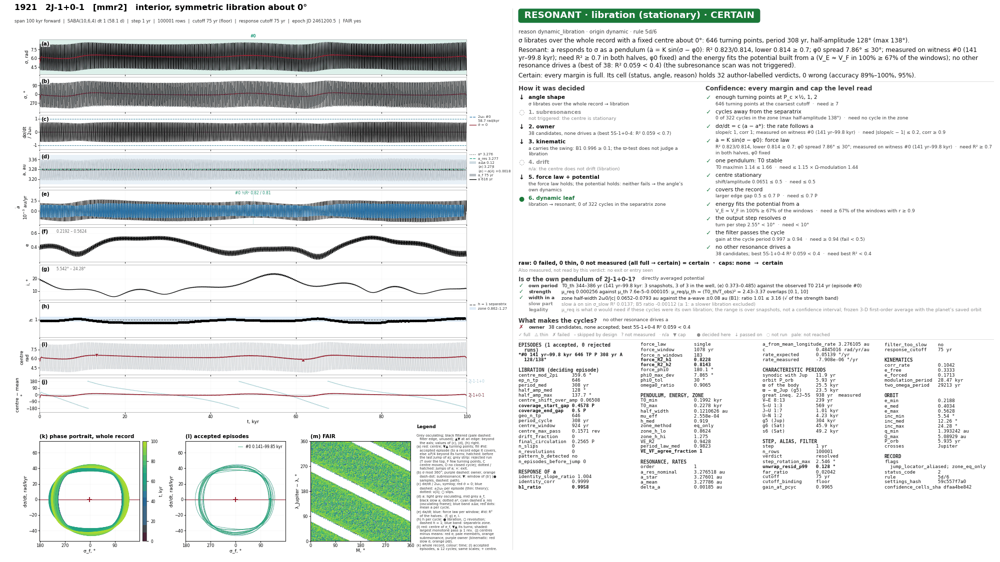

# Plots

Which figures a simulation draws is set by `plots` (default `['combined']`, the one-page verdict figure). Which rows
get them is set by `plot` (a status filter, see [Configuration](config.md#saving-and-plotting)) and `plot_always`.

```python
--8<-- "saved_run.py:plots_config"
```

| kind | resonances | file (`{body}-{key}-…`) | what it shows |
|------|------------|-------------------------|---------------|
| `combined` | MMR, secular, ZLK | `combined/…-combined` | the one-page verdict figure: time panels left, the verdict and every number of the decision right (below) |
| `evolution` | all | `{body}-{key}.png` | angle, a, e, i and periodograms against time (`PLOT_CONFIG` preset) |
| `recurrence` | MMR | `-recurrence` | recurrence of the state $(\sigma, \dot\sigma)$ |
| `fair` | prograde two-body MMR | `-fair` | FAIR plane: mean anomaly against the longitude difference to the planet |
| `portrait` | MMR, secular, ZLK | `-portrait` | phase portrait: $\sigma$–$\dot\sigma$ (or $\sigma$–a) for an MMR, $(r\cos\sigma, r\sin\sigma)$ for a secular angle |
| `angle` | secular, ZLK | `-angle` | $\sigma(t)$: osculating, filtered, turning points |
| `rate` | secular, ZLK | `-rate` | the rate of the filtered $\sigma$, with the divisor |
| `cycles` | MMR | `-cycles` | oscillation cycles of $\sigma$ and of a, stacked on one period |
| `ecc_vector` | all | `{body}-ecc-vector.png` | the $(k, h) = (e\cos\omega, e\sin\omega)$ plane |
| `cross_spectrum` | all | `-coherence-{pair}` | coherence and cross-phase ([Cross-spectral coherence](coherence.md)) |
| `free_omega` | Lidov-Kozai | `-free-omega-…` | the free argument of pericentre ([Free elements](free-elements.md)) |
| `clones` | all, a body with clones | `{body}-{key}-clones.png` | the ensemble: every clone's angle by status, status against initial a, the status shares with Wilson intervals (also drawn with `combined`; [Clones](clones.md)) |

An unknown name is an error; a kind is drawn only for the resonance types it lists. The image format is `image_type`
(`png` or `pdf`). Combined figures go to `plot_path/combined/`, the others to `plot_path/figures/`, both split by
`plot_layout` (`confidence/status` by default: `combined/high/resonant/…`; [Output data](output.md#layout)). Every
time colour bar uses the same map (viridis without its palest yellow). Time is in yr, kyr or Myr, whichever suits the
span. None of these figures feeds a status.

## The combined figure



How to read it, with one example for every status: [Gallery](physics/gallery.md). In short, for an MMR:

- **Right column.** The plaque `STATUS · angle_status (subtype) · CONFIDENCE` (and `ends: circulation` when the
  record ends in another regime), the verdict in words, the steps of the decision, the margins and caps of the
  confidence with the other reading each cap leaves open, and the numbers a reader needs. A physics block answers
  two questions: is $\sigma$ the own pendulum of its resonance (the period and strength the cycles need against the
  averaged potential's), and what makes the cycles (owner, forced wave, second capture).
  `plot_options={'combined': {'numbers': 'all'}}` prints every number of the decision instead.
- **Time panels.** (a) $\sigma$ raw (grey) and filtered (black) with turning points and the accepted episodes;
  (b) $\sigma$ wrapped; (c) $\dot\sigma/2\omega_0$ on a symlog axis (±1 is the speed at the separatrix);
  (d) a: osculating, filtered, the slow a, with $a_*$ and the catalogue $a_{\rm res}$; (e) $\dot a$ with the fitted
  force law; (f) e; (g) i; (h) the energy h of each cycle against the separatrix ($h = 1$); (i) the slowly moving
  centre of $\sigma$; (j) the centres of the other members of the multiplet, of an accepted subresonance and of the
  owner (a flat line librates).
- **Bottom row.** (k) the portrait of the whole record, (l) the portrait of the accepted episodes, (m) FAIR for a
  two-body angle.

One palette gives a quantity the same colour in every panel, MMR and secular/ZLK figures alike: black filtered, grey
osculating, red the centre and $\dot\sigma = 0$, blue the model (force law, $\pm 2\omega_0$, $\pm\Delta a$), cyan
$a_{\rm res}$. Wrapped angles are labelled in [0°, 360°). Within `FILTER_EDGE_TRIM_CUTOFFS` cutoffs of either end the
filter spreads; the analysis does not read that stretch, and the filtered lines are pale and dashed there.

The secular and Lidov-Kozai rows get the same layout (`draw_long_period_combined`). For a secular row, (f) is the
rate of the element the angle contains, $\dot e_f$ for an angle with $\varpi$, ${\rm d}\sin(i_f/2)/{\rm d}t$ for an
angle of $\Omega$ alone (ν16 = s − s6), each with its fit $A\sin\sigma_f + B\cos\sigma_f + C$ and its $R^2$; (i) is
$\sigma_f$ against $\dot\sigma_f$. For a Lidov-Kozai row, (f) instead compares the free argument of perihelion with
the osculating one (no response fit), and (i) is the free eccentricity vector when the
[forced/free split](free-elements.md) is available. (h) is $(e\cos\sigma, e\sin\sigma)$, or
$(\sin\frac i2\cos\sigma, \sin\frac i2\sin\sigma)$ for an angle of $\Omega$ alone.

`plotting.mmr_combined.draw_combined(analysis, series)` draws the MMR figure from an analysis. After a restore without
recomputation the analysis is run again on the saved series and checked against `summary.csv`; a difference is
logged and stamped in red in the header.

## MMR diagnostics

The standalone panels of `MMRPlotter` (`recurrence`, `fair`, `portrait`, `cycles`) are computed from the saved arrays
and the filtered angle of the analysis. They help to read a figure; they are not decision rules.

- **Recurrence**: $D(t_1, t_2) = \sqrt{(\Delta\sigma/s_\sigma)^2 + (\Delta\dot\sigma/s_{\dot\sigma})^2}$ on the
  unwrapped angle, so a full circulation never returns. Dark means the state comes back close to itself. The scales
  are the object's own ($s_\sigma$ half the median cycle diameter, $s_{\dot\sigma}$ half the 5–95 % spread of
  $\dot\sigma$), so D compares within one figure, not between objects.
- **FAIR** (Forgács-Dajka, Sándor & Érdi 2018): M against $\lambda_P - \lambda$ for an inner asteroid,
  $\lambda - \lambda_P$ for an outer one. Two-body prograde angles only. It needs the planet's series (kept by the default
  `save_planets='analysis'`) and a step well within one orbit: above `fair.max_step_fraction` of the period (¼) a warning says the plane is aliased.
- **Portrait**: $\sigma$ against $\dot\sigma$ (or $a - a_0$ with `portrait.y='axis'`), coloured by time; one cutoff
  period is dropped at both ends, where the zero-phase filter is distorted.
- **Cycles**: a cycle runs from one maximum of the filtered unwrapped $\sigma$ to the next, stretched to [0, 1]; a is
  shown minus each cycle's median. A cycle is a candidate oscillation, not a confirmed libration.

`MMRPlotter.from_body(..., focus=(t0, t1))` restricts cycles, portrait and recurrence to an interval in years.

## Options

`plot_options` (or `PLOT_OPTIONS` in `.env` as JSON) is merged over the defaults. Unknown keys and invalid values raise
an error.

| option | default | meaning |
|--------|---------|---------|
| `style` | `screen` | standalone diagnostics only: `screen` (11 pt sans-serif, 150 dpi, a title) or `paper` (8 pt STIX serif, 300 dpi, no title; panels 88 mm, rows up to 180 mm). The width depends on the kind. The `combined` verdict figures keep their 24 × 13.5 in layout and header in either style (MMR at 120 dpi; secular/ZLK saved at the style's dpi) |
| `raw` | `line` | raw series next to filtered ones: `line`, `markers`, `none` |
| `series` | `auto` | time series as `lines`, min–max `envelope` bands, or `auto` (bands only when lines would merge) |
| `recurrence.max_points` | `None` | display decimation of the recurrence matrix; `None` = about 8 samples per cycle, within 700–2500 |
| `recurrence.exclude_samples` | `2` | blank band around the diagonal, in decimated steps |
| `portrait.y` | `rate` | `rate` ($\dot\sigma$) or `axis` ($a - a_0$) |
| `cycles.prominence` | `None` | peak prominence in rad; `None` = 5 % of the range of $\sigma$ within [0.005, 0.1] |
| `fair.max_step_fraction` | `0.25` | warn when the output step exceeds this share of the orbit |
| `combined.osculating_a` | `full` | panel (d): `full` holds the osculating a in view, `clipped` fits the view to the filtered a, `hidden` also hides the osculating a beyond that view |
| `combined.numbers` | `explained` | the right column: `explained` (the verdict in words, steps, margins, numbers) or `all` (every number of the decision) |

## Redrawing after a run

Nothing needs to be integrated again. Restore the run, then draw in any style:

```python
--8<-- "saved_run.py:redraw"
```

`MMRPlotter.plot` draws the standalone kinds only (`recurrence`, `fair`, `portrait`, `cycles`); the combined MMR
figure is redrawn by `sim.data_manager.plot_body(body, sim)` or `draw_combined(analysis, series)`.
Only bodies that passed the `save` filter have series on disk. `MMRDiagnostics(...)` builds the same figures from
plain arrays (times in years). A backward integration is put in time order internally; the axes show the actual
negative times.

## Secular diagnostics

`SecularPlotter` (`resonances.plotting.secular_plots`; kinds `angle`, `rate`, `portrait`, `combined`) draws the angle
the classifier read (the reduced proper angle by default, see [Secular resonances](secular.md)) next to the angle of
the osculating elements.

- **angle**, $\sigma(t)$ in degrees: grey osculating, black filtered at the analysis' cutoff, red circles the turning
  points. A libration oscillates; a drift is a monotonic ramp of less than a turn; a single U is half a cycle (both
  `insufficient_time`); circulation is a ramp of several turns.
- **rate**, ${\rm d}\sigma/{\rm d}t$ in ″/yr: a libration swings about zero, a drift runs parallel to it.
- **portrait**, $(r\cos\sigma, r\sin\sigma)$ with r = e when $\sigma$ contains $\varpi$, else i from the invariable
  plane. A libration draws closed loops around the resonance centre: a ring off the origin, or a crescent when the
  libration is wide and the centre close to the origin. A ring around the origin is circulation.

A bounded angle is a libration only after at least `LIBRATION_MIN_TURNING_POINTS` = 3 turning points, which is one
full cycle (maximum, minimum, maximum). Examples: 1020 Arcadia in z1 is resonant over 10 Myr
([Gallery](physics/gallery.md#secular-z1-resonant)); 3701 Purkyne, also in z1 with a period of about 8 Myr, turns
back only twice in 10 Myr and is `uncertain` (`insufficient_time`).

## Eccentricity vector

`ecc_vector` draws one figure per body: the (k, h) plane coloured by time, in a square window centred on the origin. A
cloud that does not enclose the origin keeps $\omega$ bounded whatever the dynamics. The numbers `e_forced` and
`e_free` are in `summary.csv` ([Cross-spectral coherence](coherence.md)).

```python
--8<-- "saved_run.py:ecc_vector"
```

`plot(limit=...)` fixes the half-width, which is how the free-vector figure of [Free elements](free-elements.md) is
drawn on the scale of the osculating one.
