# How to read the figures

The package draws figures to help a person check a verdict by eye. This page explains every panel, line and mark,
in plain words first; the formulas are in the folded "The maths" blocks, with links to the pages that explain each
quantity in depth. Nothing drawn on a figure changes a status: the verdict is decided before anything is drawn. The
numbers in the right column are columns of the [output files](output.md); a few annotations in the data panels (the
$R^2$ of each force window in (e)) are computed for the drawing and have no column of their own.

## Which figures there are

| figure | when it is drawn | section |
|---|---|---|
| the combined figure: one page per body and resonance, the verdict and its evidence | by default (`plots=['combined']`) | [MMR](#the-combined-mmr-figure), [secular and Lidov-Kozai](#the-secular-and-lidov-kozai-figure) |
| standalone figures: `evolution`, `recurrence`, `fair`, `portrait`, `cycles`, `angle`, `rate`, `ecc_vector`, `cross_spectrum`, `free_omega`, `clones` | when listed in `plots` | [Standalone figures](#standalone-figures) |

Which rows get figures is set by the status filter `plot` (by default every row except a plain non-resonant one).
The file names, folders and drawing options are on the [Plots](plots.md) page. One combined figure for every status
is in the [Gallery](physics/gallery.md).

## Shared conventions

These hold for the combined figures; most hold for the standalone ones too.

- **Black and grey.** Grey is the osculating series, exactly as integrated; black is the same series with the
  short periods filtered out. When the samples are too dense to draw one by one, grey becomes a band between the
  smallest and the largest value.
- **One colour per quantity.** Red is the centre of the angle and the line $\dot\sigma = 0$; blue is a fitted or
  model quantity; dark grey marks references (turning points, jumps, $h = 1$); cyan is the catalogue resonant
  semi-major axis. The full palette: [Plots](plots.md#colours-and-units).
- **Time** runs left to right in yr, kyr or Myr, whichever suits the span (below $10^4$ yr: yr; below $10^6$ yr:
  kyr). Time colour bars use one colour map (viridis without its palest yellow): dark is early, yellow-green late.
- **Angles** folded into one turn are labelled from 0° to 360° (270°, not −90°). The unwrapped angle of MMR panels
  (a) and (i) is in radians; (j) shows offsets in degrees (radians in its kinematic version).
- **▲ and ▼ at the edge of a panel** mean "beyond the axis". The view holds 99 % of the osculating samples; the rare
  samples outside it are grouped in time, and each group is one small triangle at the time it goes furthest out (at
  most 8 per edge). A reference level outside the view (for example the resonant semi-major axis) is a triangle in
  the level's colour.
- **The ends of the record.** A filter spreads near the ends of a record, so the analysis does not read the first
  and last `FILTER_EDGE_TRIM_CUTOFFS` cutoff periods. In panels (c), (d), (e) of the MMR figure and (c), (f) of the
  secular figure, the filtered line is pale and dashed there; a filtered line that would leave the view there is a
  black triangle. The other panels draw their filtered lines solid to the ends: do not read them near the ends either.
- **No words in the panels.** The panels hold only data and a few data numbers. What a line means is in the
  legend at the bottom of the figure; the values of the reference lines of (c), (d) and (h) are printed right of
  those panels.

??? info "The maths: the filter and the cutoff"
    $\sigma_f$ is $\sigma$ passed forward and backward through a Butterworth low-pass filter of order
    `FILTER_ORDER`: a period $P$ keeps a share $G(P)$ of its amplitude, $G(P_c) = \tfrac12$ at the cutoff $P_c$ and
    $G \to 1$ for $P \gg P_c$. For a mean-motion resonance $P_c$ is the larger of a multiple of the longest synodic
    period of the angle's planets and a share of the shortest libration the analysis allows. Details:
    [the cutoff](physics/signal.md#the-cutoff-what-is-libration-and-what-is-noise) and
    [the filter](physics/signal.md#the-filter).

## The combined MMR figure

*(1921) Pala in the 2:1 resonance with Jupiter, a textbook libration ([Gallery](physics/gallery.md#resonant-two-body)).
Click the image to open it at full size.*

The page is 24 × 13.5 inches. The left half holds ten time panels (a)–(j) on one time axis and, below them, two
phase portraits (k), (l), the FAIR plane (m) and the legend. The right half explains the verdict.

### The header

The first line names the body, the resonance key, its type (`mmr2`, `mmr3` or `mmr2 retrograde`) and the kind of
orbit in the librating episodes (for example `tadpole L4`, `horseshoe`, `interior asymmetric libration about 72°`).
For a non-resonant or uncertain verdict whose episodes come from somewhere else it reads
`episodes about X° (not this resonance)`. A row found as a subresonance adds `subresonance of <parent>`.

The second line describes the record: its span and direction, the integrator and its step, the output step and
number of rows, the filter cutoff and what set it, the cutoff used for rates, the epoch, and whether the FAIR
plane (m) could be drawn.

A red stamp in the top right corner, `recomputed != summary`, appears only when the figure had to run the analysis
again (after a restore) and got a different answer from `summary.csv`.

### (a) The angle over the whole record

The resonant angle $\sigma$, unwrapped: a circulation runs off upwards or downwards, a libration stays in a band.

- grey: the osculating angle; black: the filtered angle $\sigma_f$; red: its slowly moving centre;
- ▼ and ▲: the turning points of $\sigma_f$ (a maximum, a minimum), marked only when there are at most 80;
- coloured fills labelled `#1`, `#2`, …: the accepted librating episodes. A fill runs to a record edge the episode
  covers, else a quarter period beyond its first and last turning points. A hatched fill is an episode before the
  last jump of the semi-major axis; `#3 wave` is a forced wave, not a libration of this angle;
- a grey strip along the bottom: runs of turning points that were rejected, with a letter for the reason:
  **T** over the top of the well, **F** too few turning points, **C** the centre moves, **O** no closed cycle;
- dotted lines (or a hatched band with "N jumps of a"): jumps of the semi-major axis; a shaded half-cycle with
  "action step (G2a)": a sudden change of the libration's amplitude, treated like a jump;
- ×: where the analysis places the exit from the resonance. It may be only suspected: then the right column shows
  `check_mmr_exit` failed, and the cap `exit_suspected` when the verdict rests on that edge.

What to look for: fills that cover the whole record are a libration; fills in part of it are episodes.

??? info "The maths: angle, turning points, episodes"
    $$
    \sigma = k\lambda + \sum_j k_j\lambda_j + p\varpi + \sum_j p_j\varpi_j + v\Omega + \sum_j v_j\Omega_j
    $$

    (body without index, planets with index $j$). Turning points are the extrema of $\sigma_f$ that stand out by at
    least a prominence set from the noise of $\sigma_f$. Three alternating turning points close a cycle when the angle
    comes back by less than its swing ($Q_i < 1$, [cycles and their closure](physics/geometry.md#cycles-and-their-closure)).
    An episode normally needs at least three turning points and one closed cycle; two opposite turning points also
    make one cycle when the angle and $a$ come back to the same state on either side of them (closure by phase
    return, confidence at most `medium`). The centre is $\sigma_f$ smoothed again over a few libration periods.
    Details: [turning points](physics/geometry.md#turning-points),
    [runs and episodes](physics/geometry.md#runs-and-episodes),
    [jumps and action steps](physics/geometry.md#a-step-of-the-libration-action).

### (b) The angle modulo 360°

The same angle folded into one turn, in a 360° window around the centre: grey dots are the osculating samples,
black is $\sigma_f$, red the centre (the lines are left out when the cycles are too dense to draw). An accepted owner
resonance is drawn purple dashed, an accepted subresonance orange dash-dot.

A red boxed note `ALIAS step … ≈ P_σ …` means that the output step is close to a multiple of the angle's own fast
period: the samples, like a stroboscope, make a fast circulation look slow
([Gallery: alias](physics/gallery.md#alias)).

**The strip (b′).** When the cycles are too dense to see in (b), a strip below it shows about five cycles from the
middle of the deciding episode on their own time axis (in yr): ● the samples, a grey dashed line the path the
analysis' unwrap assumes between them (a whole turn may pass between two samples), black $\sigma_f$. A ▼ on the top
edge of (b) marks where the strip was taken; a second strip (b′2) shows the last regime after a jump.

??? info "The maths: sampling"
    With the output step $\Delta t$, a rate $\nu$ is seen as $\nu - 2\pi m/\Delta t$ for a whole number $m$: the
    sampled angle cannot tell them apart. The analysis follows the angle sample to sample with a predicted rate, so a
    turn per step is still counted. Details: [what the step can resolve](physics/signal.md#what-the-output-step-can-resolve),
    [the predictive unwrap](physics/signal.md#counting-the-turns-the-predictive-unwrap).

### (c) The rate of the angle

How fast $\sigma$ moves, in units of the speed a pendulum has at the bottom of its well on the separatrix. A
libration swings between positive and negative values and changes sign at every turning point; a clean circulation
keeps one sign. Brief reversals do not rule out a circulation: what decides it is the centre in (i), which completes
a turn or keeps advancing over several. The axis is linear between −1 and +1 and logarithmic outside, so a slow
libration and a fast circulation are both in view.

- red line: $\dot\sigma = 0$;
- blue dashed: $\pm 2\omega_0$ of each accepted episode, over its span, with the episode's own $\omega_0$ (they need
  not sit at ±1, since the axis uses one reference); without an episode, a thin pair from the theoretical $\omega_0$;
- dotted: the rate the mean motion predicts in each regime between jumps;
- ○ on the zero line: a slip, where the angle's midpoint steps by a full turn.

When no $\omega_0$ is known at all, the panel shows $\dot\sigma$ in rad/kyr on an ordinary axis.

??? info "The maths: the separatrix speed"
    The black line is $\dot\sigma / 2\omega_{0,\rm ref}$, with $\dot\sigma$ taken at the rate cutoff
    $\max(P_c, 0.1\,P_{\rm cyc})$. $\omega_{0,\rm ref}$ is the deciding episode's $\omega_0$, else the longest
    other accepted episode's, else the theoretical $\omega_{0,\rm th} = \lvert k\rvert\, n\sqrt{3\mu_{\rm eff,th}}$,
    with $\mu_{\rm eff,th}$ the resonance's effective strength (the three-body strength scale for a three-body angle;
    [how strong must the resonance be](physics/pendulum.md#how-strong-must-the-resonance-be)). An episode's
    $\omega_0$ comes from its cycles: a cycle of period $P_i$ and amplitude $A_i$ gives the small-amplitude period
    $T_{0,i} = P_i / F(A_i)$ with

    $$
    F(A) = \frac{2}{\pi}\,\mathsf K\!\left(\sin^2\frac A2\right), \qquad \omega_0 = \frac{2\pi}{\operatorname{median} T_0},
    $$

    $\mathsf K$ the complete elliptic integral of the first kind. For the cosine pendulum $\dot\psi^2 =
    4\omega_0^2(h - \sin^2\frac\psi2)$, so the separatrix ($h = 1$) passes the bottom at $\dot\psi = \pm 2\omega_0$:
    ±1 on this axis. This is a cosine-equivalent scale: a well of another shape has its own separatrix speed
    $\sqrt{2(E_{\rm sep} - V_{\min})}$, so ±1 bounds a libration exactly only for a cosine well. The dotted rate is
    $\nu = \nu(\langle a\rangle) + k\,(\dot\lambda - n(\langle a\rangle))$ with $\dot\lambda$ measured in the
    regime. Details: [the pendulum](physics/pendulum.md#the-pendulum).

### (d) The semi-major axis

Three levels of $a$ in au: light grey the osculating $a$, mid grey $a$ filtered at the cutoff, black a slower
version that shows the resonant swing when the filtered one is a dense band (when there is no slower version, the
filtered $a$ itself is black).

- dotted: $a_*$, where the angle would stand still; dashed cyan: $a_{\rm res}$, the value of the resonance catalogue;
- light blue band: $a_* \pm \Delta a$, the half-width of the resonance measured from the episodes;
- red dots: the mean of $a$ over each cycle of $\sigma_f$ (maximum to maximum), drawn when there are 2 to 200 maxima.

$a_*$ and $a_{\rm res}$ are mean-motion values, while the curves are osculating. To compare like with like, both
lines are moved by the difference between the mean osculating $a$ and the $a$ that the measured mean motion gives,
separately in each regime between jumps. The margin to the right prints the unshifted values and the shift.

What to look for: in a libration $a$ swings around $a_*$ in step with $\sigma$, inside the band.

The option `combined.osculating_a` (`full`, `clipped`, `hidden`) chooses how much of the osculating $a$ stays in view
([Plots](plots.md#options)).

??? info "The maths: exact resonance and half-width"
    $a_*$ solves $\nu(a_*) = 0$, where $\nu(a) = k\,n(a) + \sum_j k_j n_j + p\dot\varpi + \dots$ and $n(a) =
    2\pi a^{-3/2}$ (yr, au). The shift uses $a(\dot\lambda) = (GM_\odot/\dot\lambda^2)^{1/3}$. The half-width is

    $$
    \Delta a = \frac{2\omega_0}{\lvert c\rvert}, \qquad c = \frac{\partial\nu}{\partial a} = -\frac{3kn}{2a},
    $$

    the median over the accepted episodes, and a libration of amplitude $A$ swings by $\delta a = \Delta a\sin\frac
    A2$. Like (c), $\Delta a$ is the cosine-equivalent width. Details:
    [the resonant angle and its rate](physics/pendulum.md#the-resonant-angle-and-its-rate),
    [the pendulum](physics/pendulum.md#the-pendulum).

### (e) The response of the semi-major axis

Black: the rate $\dot a$ (scaled by the power of ten in the label). Blue: the force law fitted in short sliding
windows, $\dot a$ as a sine of the angle; the blue numbers along the bottom are each window's $R^2$, written only
when there are at most 12 windows (close numbers merge into a range such as `0.74–0.81`). For each accepted episode
a dotted line at its middle carries `#id` and the $R^2$ of its two halves.

What to look for: when the resonance itself drives $a$, $\dot a$ follows the sine of $\sigma$ and the $R^2$ are
high. A low $R^2$ with a clear libration in (a) suggests that something else bounds the angle.

The black $\dot a$ and the blue curve are both at the response cutoff: each window's sine is evaluated on $\sigma$
smoothed at that cutoff, the angle the fit read. When several harmonics decided (column `rsp_force_law = harmonic`)
no blue curve is drawn, since the single sine is not the law that was tested; the panel prints
`harmonic law N=k: R² … (single …)`, the deciding law's $R^2$ against the single sine's. The fit that decided may
still differ from the blue curve in other ways: a raised cutoff (the line rule), the angle in the frame of a moving
well, a multiplet, or one episode. Then the blue curve is only a guide; the deciding law and its numbers are in the
right column.

??? info "The maths: the force law"
    In each window of about 3.5 cycles,

    $$
    \dot a_f = R\sin(\sigma_f - \phi_0) + C, \qquad R^2 = 1 - \frac{SS_{\rm res}}{SS_{\rm tot}},
    $$

    fitted as a linear model in $\sin\sigma_f$, $\cos\sigma_f$ and 1. Lagrange's equation gives this law for a
    resonance with one dominant term. Details: [the force law](physics/response.md#the-force-law).

### (f), (g) Eccentricity and inclination

Grey the osculating value, black the filtered value, $i$ in degrees. The grey numbers in the top left corner are the
smallest and largest filtered values in the analysed window.

### (h) The energy of each cycle

One point per cycle of $\sigma$: its energy $h$ in the pendulum fitted to the angle, on a logarithmic axis. $h = 0$
is the bottom of the well, $h = 1$ the separatrix (dashed).

- ● a libration cycle, ○ a revolution (a full turn);
- light blue band: the separatrix zone, where trial orbits in the fitted potential may stay trapped or go over the
  top: a cycle there can cross the separatrix;
- triangles at the bottom or top: $h$ below $10^{-3}$, or no top to the potential.

What to look for: a deep libration sits well below 1; points in or near the band mean the orbit is at the border of
the resonance.

??? info "The maths: energy and the separatrix zone"
    The potential $V$ is fitted to $\dot\sigma^2 = 2E - 2V(\sigma)$ cycle by cycle; each cycle's energy is

    $$
    h = \frac{E - V_{\min}}{V_{\max} - V_{\min}}, \qquad \text{for the cosine well } h = \frac{\dot\psi^2}{4\omega_0^2} + \sin^2\frac\psi2 .
    $$

    The zone $[h_{\rm lo}, h_{\rm hi}]$ comes from trial orbits in the fitted potential. With two harmonics a
    well's own separatrix can lie below $h = 1$. Details: [energy and potential](physics/response.md#energy-and-potential),
    [the separatrix zone](physics/geometry.md#the-separatrix-zone).

### (i) The centre of the angle

Grey: $\sigma_f$ in the analysed window; red: its centre, $\sigma_f$ smoothed over a few libration periods; large
red ▼▲: turns of the centre; light red shading: the centre's longest one-way run, drawn only when it reaches a full
turn.

What to look for: a centre that runs a full turn one way is a circulation, however the angle swings around it.

??? info "The maths: the centre"
    $\sigma_c = \mathrm{lowpass}_{W_c}(\sigma_f)$ with $W_c = 3P_{\rm cyc}$ (`LIBRATION_CENTRE_CYCLES`), and the
    centre's turns are found with a larger prominence than those of $\sigma_f$. Details:
    [the centre and circulation](physics/geometry.md#the-centre-and-circulation).

### (j) The centres of related angles

Each line is the centre of an angle minus its mean, in degrees, with its key at the right end: red the catalogue
angle, pale colours other members of its multiplet (the same commensurability with other perihelion terms), orange
an accepted subresonance, purple dashed the owner resonance.

What to look for: **a flat line is the angle that librates.** If the catalogue angle wanders while a member's line
is flat, the libration belongs to that member.

For a kinematic case the panel shows instead the slow part of $\sigma$ (red) and $p\varpi$ (orange dashed), each
with its own straight-line trend removed, in radians: compare their swings, not their mean rates. When $\sigma$
follows $p\varpi$, the perihelion's own precession bounds the angle, not the resonance.

??? info "The maths: the members' centres"
    A member $\sigma_s$ differs from the catalogue angle $\sigma_0$ by perihelion terms, $\Delta_s = \sigma_s -
    \sigma_0$, computed from the smoothed $\varpi$ of the body and the planets; its centre is drawn as
    $c_s = c_0 + \mathrm{smooth}_{W_c}(\Delta_s)$. Details: [subresonances](physics/response.md#subresonances),
    [another resonance owns the oscillation](physics/response.md#another-resonance-owns-the-oscillation),
    [kinematic origins](physics/response.md#kinematic-origins).

### (k), (l) Phase portraits

(k) is the whole record, (l) the accepted episodes (the five longest, each in its episode colour, up to 12 cycles
each, a dot at its first sample). Both show $\sigma_f$ (modulo 360°) against $\dot\sigma$ in rad/kyr, with the same
scales; colour is time in (k). Red line: $\dot\sigma = 0$; red +: the centre of each accepted episode.

What to look for: a libration draws closed loops around the +; a circulation draws a band across the whole width.
A frame crossed out says why the samples cannot be drawn (an aliased step). When (k) is much wider than the
episodes, it uses the episodes' view and marks the clipped part with ▲▼.

### (m) The FAIR plane

The mean anomaly $M$ against the longitude difference to the planet, coloured by time (Forgács-Dajka, Sándor &
Érdi 2018). A libration draws slanted bands with empty gaps between them, since the body avoids some phases
relative to the planet; a circulation fills the square over time. It is drawn only for a prograde two-body angle, with the planet's longitudes saved and an output step of at
most 1/4.2 of the orbital period; otherwise the header says `FAIR no (reason)` and the legend takes the slot.

??? info "The maths: FAIR coordinates"
    $x = M \bmod 360°$, $y = (\lambda_P - \lambda) \bmod 360°$ for a body inside the planet's orbit and
    $(\lambda - \lambda_P) \bmod 360°$ for one outside.

### The right column

The right column says in words what was decided and why. From top to bottom:

1. **The plaque**: `STATUS · angle_status (subtype) · CONFIDENCE`, coloured by the status; a tag `ends: …` beside
   it when the record ends in another regime (for example a capture, then circulation). The status is printed only
   here. The line under it gives the reason, the origin of the libration, the owner and the deciding rule.
2. **Sentences**: what $\sigma$ does, the rule that decided, how sure the verdict is, and what to do next.
3. **How it was decided**: the steps of the [status tree](physics/status-tree.md#the-tree) in their fixed order.
   ● decided here, ↓ passed on to the next step, ◌ not run; a pale step was not reached.
4. **Confidence: every margin and cap the level read**:
   ✓ full, ⚠ thin, ✗ failed, – skipped by design, ? not measured, · not applicable, ▼ a cap.
   A cap that lowers the level names the other reading it leaves open and what on the figure would decide between
   them. The margins are explained on the [Confidence](physics/confidence.md#margins) page.
5. **The physics block**: A, "Is σ the own pendulum of …?" (the period and strength the cycles need against what
   the averaged potential gives, and the width in $a$); B, "What makes the cycles?" (the owner resonance and its
   evidence, or why there is none).
6. **The arithmetic line**, for example `raw: 0 failed, 1 thin, 0 not measured (thin or not measured → high) = high ·
   caps: none → high`: two or more failed margins give low, one gives medium, any thin or unmeasured one high, all
   full certain; the caps can then only lower the level ([from margins to a level](physics/confidence.md#from-margins-to-a-level)).
   "Also measured, not read by this verdict" lists the numbers that exist but did not count.
7. **The numbers**, in monospaced columns: the episodes table (`*` marks the deciding episode, ✗ a rejected run with
   its reason) and groups such as LIBRATION, RESPONSE OF a, PENDULUM ENERGY ZONE, SUBRESONANCES OWNER, RESONANCE
   RATES, STEP ALIAS FILTER, STRENGTH, KINEMATICS, ORBIT, RECORD. A bold number was compared by the decision; a grey
   one marked "(not used)" belongs to a test skipped by design. When the column is full it ends with "… N more
   lines: every number is in summary.csv".

With `plot_options={'combined': {'numbers': 'all'}}` the right column lists every number of the decision in blocks
instead of the explanation.

## Co-orbital (1:1) figures

*2002 AA29, an Earth co-orbital alternating between horseshoe and quasi-satellite motion
([Gallery](physics/gallery.md#resonant-coorbital)).*

The figure is the same, with these differences:

- the header names the regime (`tadpole L4`, `horseshoe`, `quasi-satellite`, or `compound: …`);
- (e) draws no sine windows: a co-orbital is judged by its own force law, and the panel prints its $R^2$ (with the
  two halves) and $K/K_{\rm th}$, the fitted strength over the planet's (1 means the planet's own mass);
- block A of the right column names the 1:1 force law; block B is left out, and the owner step says that a 1:1 angle
  has no owner;
- FAIR is drawn when the output step allows it.

??? info "The maths: the co-orbital force law"
    $$
    \dot a = 2\mu n a\,\tilde F(\theta), \qquad \dot a_{\rm data} = K\,\dot a_{\rm model} + C,
    $$

    with $\tilde F$ from the averaged direct and indirect potential of the planet. Details:
    [co-orbital force law](physics/response.md#co-orbital-force-law), [co-orbitals](physics/pendulum.md#co-orbitals-11).

## The secular and Lidov-Kozai figure

*(1222) Tina in the ν6 secular resonance ([Gallery](physics/gallery.md#secular-nu6)).*

The page and the right column follow the MMR figure, but the time panels are fewer and **their letters differ**.
The header gives the span, step, number of rows, the cutoff $P_c$ and what set it, and the scale the verdict rests
on (`fine`, or `centre` when the slower centre scale decided).

| panel | what it shows |
|---|---|
| (a) | $\sigma$ in degrees: grey the angle the classifier reads (the reduced proper angle by default), black the angle filtered at the scale the verdict rests on, a thin grey line the angle at $P_c$ when the centre scale decided, red the centre, ▼▲ turning points, fills the librating episodes, grey strips with letters the other runs (as in MMR (a)) |
| (b) | $\sigma$ modulo 360° around the centre: grey dots and black $\sigma_f$ |
| (c) | ${\rm d}\sigma_f/{\rm d}t$, in ″/yr for a secular angle and °/kyr for Lidov-Kozai; red line at 0 |
| (d), (e) | $e$ and $i$ (degrees): grey osculating, black filtered at $P_c$, with min – max |
| (f) | secular: the rate of the element the angle contains against a sine of $\sigma_f$ (below); Lidov-Kozai: the drift of the free and the osculating $\omega$ in turns (below) |
| (g) | the centre of $\sigma_f$, its turns, and its longest one-way run when it reaches a full turn (as MMR (i)) |
| (h) | the portrait $(e\cos\sigma, e\sin\sigma)$, or $(\sin\frac i2\cos\sigma, \sin\frac i2\sin\sigma)$ for an angle of $\Omega$ alone; colour: time; red + at the origin |
| (i) | secular: $\sigma_f$ against ${\rm d}\sigma_f/{\rm d}t$; Lidov-Kozai: the free eccentricity vector, or $\sigma_f$ against its rate when the free elements were not built (the axis labels say which) |

What to look for: in (a) a libration needs at least three turning points, one full cycle
(`LIBRATION_MIN_TURNING_POINTS`); a drift is a ramp of less than a turn; a single U is half a cycle; circulation is
a ramp of several turns. In (h) a libration draws loops around the resonance centre: a ring off the origin, or a
crescent when the libration is wide and the centre close to the origin. A ring around the origin is circulation.

**(f) for a secular angle.** Black is $\dot e_f$ for an angle with $\varpi$, or ${\rm d}\sin(i_f/2)/{\rm d}t$ for an
angle of $\Omega$ alone (both, $i$ dashed on a right axis, when the angle has both); blue is the fit
$A\sin\sigma_f + B\cos\sigma_f + C$, with its $R^2$ written in blue. That $R^2$ is a column of the output and changes
no status. Black, blue and $R^2$ are one fit, the analysis' own: the element and $\sigma_f$ filtered at the decisive
cutoff, on its window. When the centre scale decided (header `scale centre`) that cutoff is the centre's, longer
than the $P_c$ of (d) and (e), and the panel says `at the centre scale … kyr` after the $R^2$.

**(f) for Lidov-Kozai.** The drift of $\omega$ from its first value, in turns (as the standalone
[free-ω drift](#free_omega-lidov-kozai) figure), with a legend: grey the osculating $\omega$, blue the free $\omega$
with the forced terms of the planets removed; the free $\omega$'s net turns are written top right (the panel says
`free elements not built` when there are none). A free $\omega$ that winds through full turns while the osculating
one stays near zero points to a kinematic libration: the planets' forcing holds $\omega$, not the Lidov-Kozai
mechanism (591986: 83 turns; [Gallery: kinematic](physics/gallery.md#zlk-kinematic)); one that stays within a
fraction of a turn supports Lidov-Kozai. The picture is not the verdict: the right column states the free-ω gate's
outcome (confirmed, kinematic or no verdict) with $T/P_{\rm cyc}$, the cycles of the osculating $\omega$ in the
record, and the minimum needed. Too short a record, an undefined phase, a planetary frequency left in the free
elements or a co-orbital of Mercury to Mars give no verdict, and an angle that does not librate throughout is demoted
only under the extra condition $\rho_{\max} < 1$ ([the free-ω gate](physics/secular-zlk.md#zlk-free-omega)).

**The ZLK lines of the right column** ("Also measured, not read by this verdict"), each only when it was measured:
the $e$–$i$ coupling at the decisive period (`zlk`: antiphase at the constant-$H$ amplitude; `forced beat`: in phase
at the amplitude of a forced-eccentricity beat; with the phase of $i$ against $e$, the band correlation $r$ and the
amplitude over each law; coupling is not libration), the forced mode that holds a kinematic libration (or "forcing not
attributed" and why), and the slow line of the centre with its origin (591986: 53.8 kyr, ±21.6°, the g6−g5 beat of
the forced vector). What they mean: [Free elements: beyond the gate](free-elements.md#beyond-the-gate).

The margins of the right column are N, S, F, P and G ([secular and Lidov-Kozai margins](physics/confidence.md#secular-and-lidov-kozai-margins)).

??? info "The maths: the secular angle and the free ω"
    A secular angle combines the body's proper longitudes of perihelion and node with the planets' mode phases,
    $\sigma = p\varpi + q\Omega + \sum_j(p_j\ell_{g_j} + q_j\ell_{s_j})$, on the body's vectors with the forced terms
    at the other planetary frequencies removed ([the secular angle](physics/secular-zlk.md#the-secular-angle)). The
    cutoff is the largest of the great-inequality term, the forced waves near the angle's frequency and half the
    shortest libration allowed ([secular signal](physics/secular-zlk.md#signal-what-is-not-the-libration)).

    For Lidov-Kozai, $z_e = e\,e^{i\varpi}$ and $z_i = \sin\frac i2\,e^{i\Omega}$ are split into forced parts (fitted
    at the planets' frequencies) and free parts, and $\omega_{\rm free} = \varpi_{\rm free} - \Omega_{\rm free}$
    ([what is computed](free-elements.md#what-is-computed), [the gate](free-elements.md#the-gate),
    [why a bounded ω is not enough](physics/secular-zlk.md#zlk-free-omega)).

## Standalone figures

Each kind below is drawn when it is listed in `plots`. The examples are drawn by the package from the saved
benchmark series.

### evolution

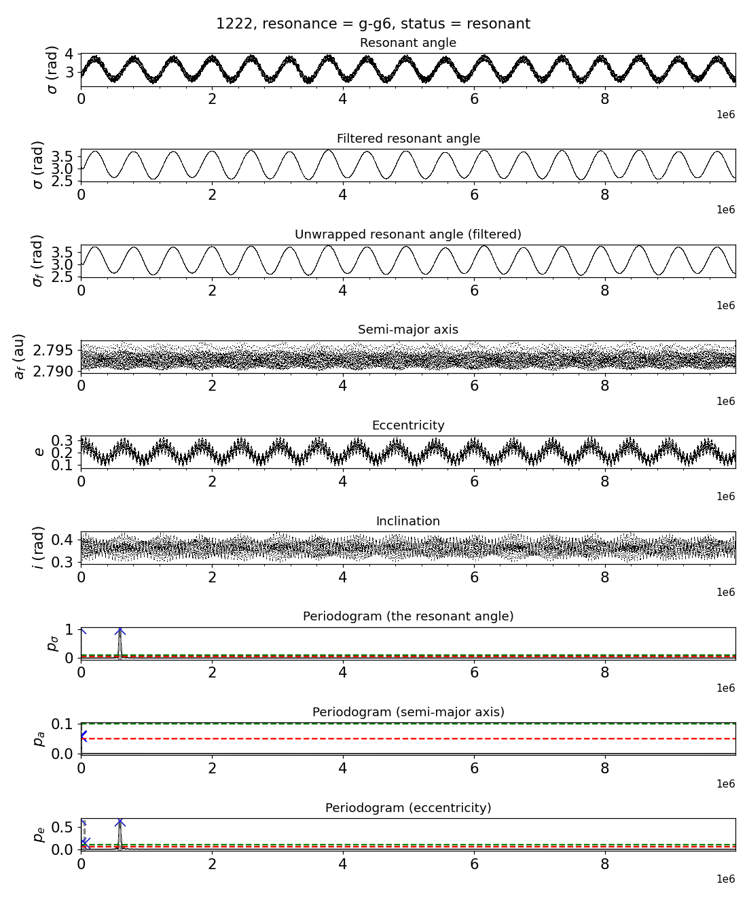

Stacked panels (preset `PLOT_CONFIG`, `full` by default): the angle as integrated and filtered (wrapped and
unwrapped, radians), the filtered $a$ (au), $e$, $i$ (radians), then Lomb-Scargle periodograms of the filtered
angle, $a$ and $e$. The time axes are in years; **the periodograms are drawn against period**, from 0 to the length
of the record, not against time. Blue × marks a peak, grey dashed lines its width; the red and green dashed lines
are the power levels 0.05 and 0.1. The semi-major axis here is smoothed by the body-level filter
(`LIBRATION_FILTER_CUTOFF`: by default periods shorter than 2000 yr are removed), not at the analysis' cutoff.

### recurrence (MMR)

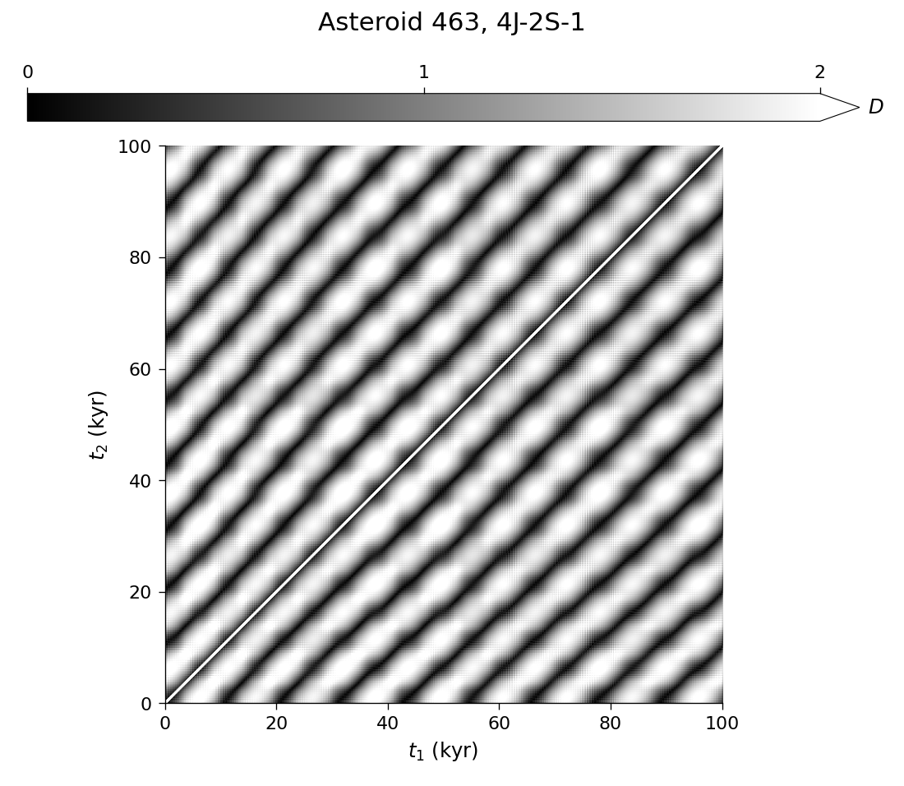

Each pixel compares the state of the angle at two times $t_1$ and $t_2$: dark means the angle and its rate are
almost the same at both times. A libration gives a pattern of dark diagonal stripes, one per period, as here for
(463) Lola (period about 10 kyr); a circulation never returns to a state it left, so it stays light away from the
diagonal. The white band along the diagonal is left out on purpose.

??? info "The maths: the recurrence distance"
    $$
    D(t_1, t_2) = \sqrt{\left(\frac{\Delta\sigma}{s_\sigma}\right)^2 + \left(\frac{\Delta\dot\sigma}{s_{\dot\sigma}}\right)^2}
    $$

    on the unwrapped $\sigma_f$, with $s_\sigma$ half the median diameter of a cycle and $s_{\dot\sigma}$ half the
    5–95 % spread of $\dot\sigma$. These are the object's own scales: D compares states within one figure, not
    between objects. The matrix is thinned to about 8 samples per cycle (700–2500 points).

### fair (MMR)

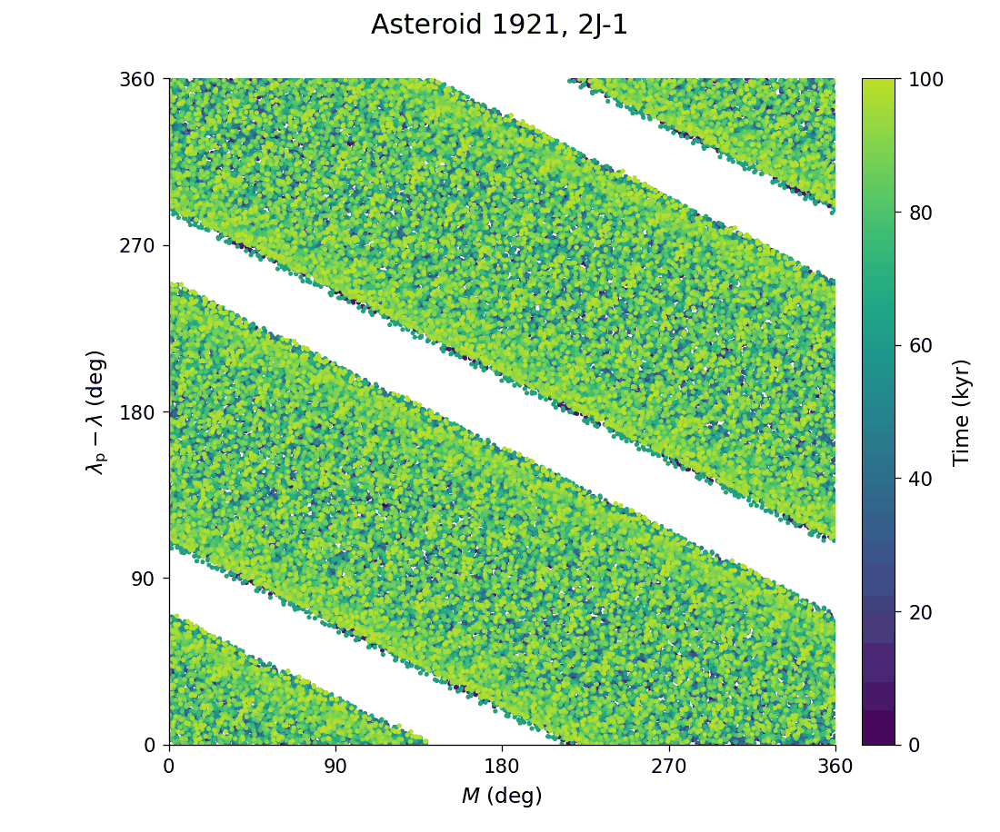

The same plane as panel (m) of the combined figure, for a prograde two-body angle. A libration leaves empty gaps
between slanted bands, as for (1921) Pala in the 2:1 resonance here; a circulation fills the square over time. Unlike (m), this figure is drawn even when the output step
is too coarse: above `fair.max_step_fraction` (¼) of the orbital period it warns that the strips are aliased.

### portrait (MMR)

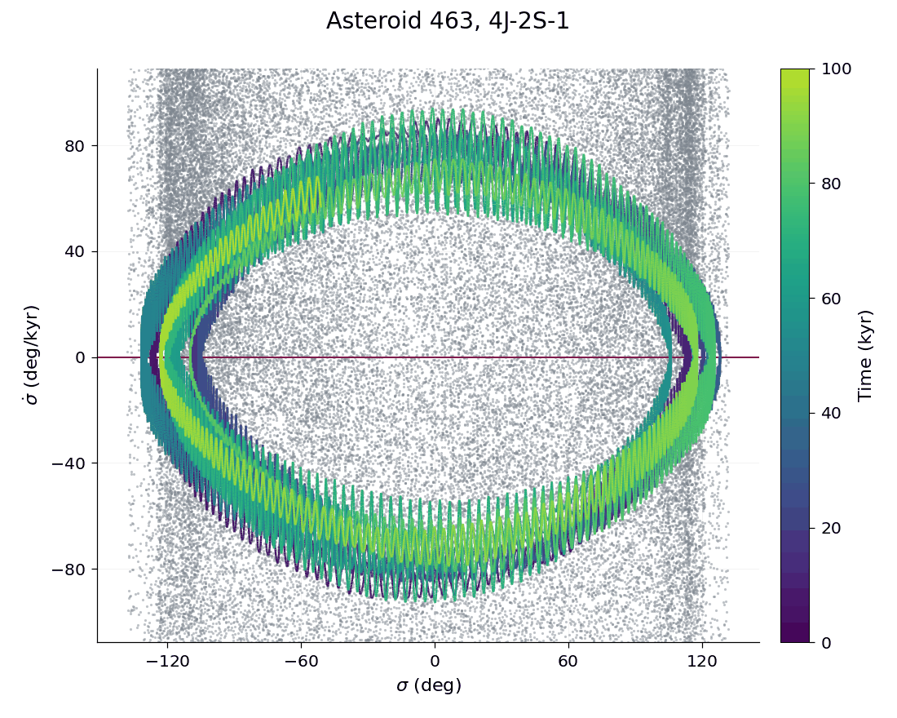

$\sigma_f$ (shifted by whole turns only) against $\dot\sigma$ in degrees per display unit, coloured by time; grey
dots are the osculating values; red line: $\dot\sigma = 0$. With `portrait.y='axis'` the y axis is $a - a_0$ in
$10^{-3}$ au. A libration draws a closed loop. The first and last 1/`LIBRATION_FILTER_CUTOFF` years (2000 yr by
default) are left out, where the filter is distorted.

### cycles (MMR)

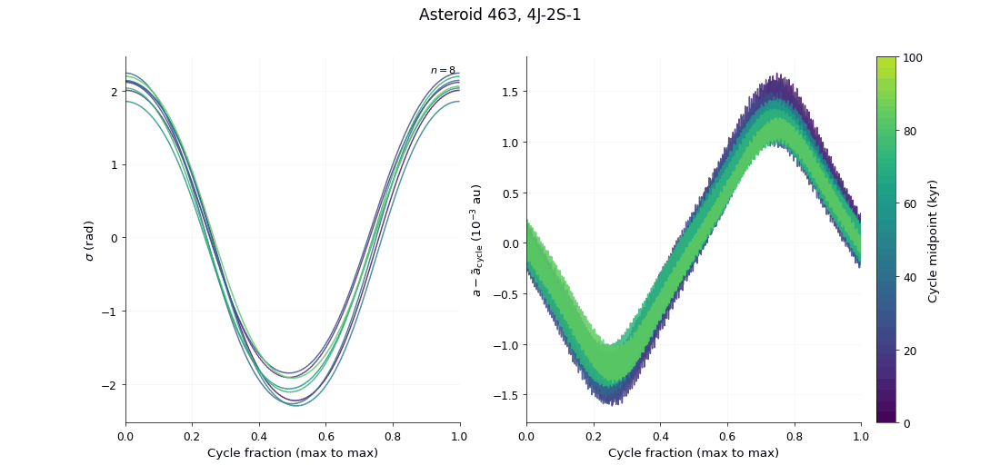

Every cycle of $\sigma_f$ from one maximum to the next, stretched to [0, 1] and laid on top of each other (left),
and $a$ over the same cycles minus each cycle's median (right, $10^{-3}$ au), coloured by the cycle's midpoint; $n$
is the number of cycles. Cycles that lie on top of each other are a steady libration, and $a$ swings in step with
$\sigma$, a quarter cycle apart. A cycle here is a candidate oscillation, not a confirmed libration. The right panel
uses the analysis' own filtered $a_f$ (at the angle's cutoff, as panel (d) of the combined figure); when the
analysis' arrays are not held (a row not selected for plotting) it uses the osculating $a$, never the body-level
filter of `evolution`, which would erase a libration faster than 1/`LIBRATION_FILTER_CUTOFF` (2000 yr by default).

### angle, rate, portrait (secular and Lidov-Kozai)

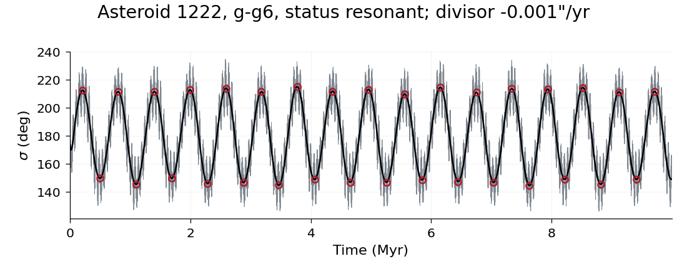

**angle**: $\sigma(t)$ in degrees; grey the osculating angle (folded into the band of the black curve when that one
is bounded), black the angle at the scale the verdict rests on ($P_c$, or the centre scale), red circles the turning
points. Read it as panel (a) of the combined figure: (1222) Tina librates through 33 turning points in 10 Myr. A
slow libration needs a long record: (1020) Arcadia in z1 turns back three times in 10 Myr and is resonant
([Gallery](physics/gallery.md#secular-z1-resonant)); (3701) Purkyne, also in z1 with a period of about 8 Myr, turns
back only twice in 10 Myr and is `uncertain` (`insufficient_time`).

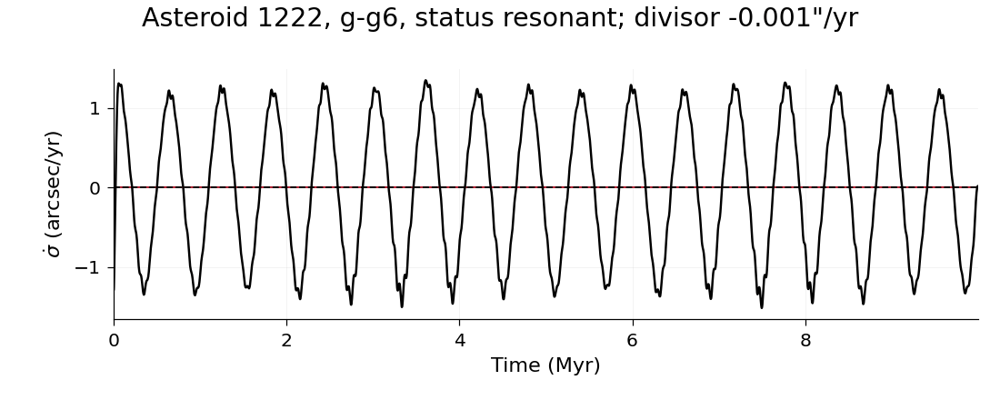

**rate**: the rate of the black curve in ″/yr (also for Lidov-Kozai, unlike the combined figure), the red line at
zero and a dashed line at the mean rate, the "divisor" printed in the title. A libration swings about zero; a drift
runs parallel to it.

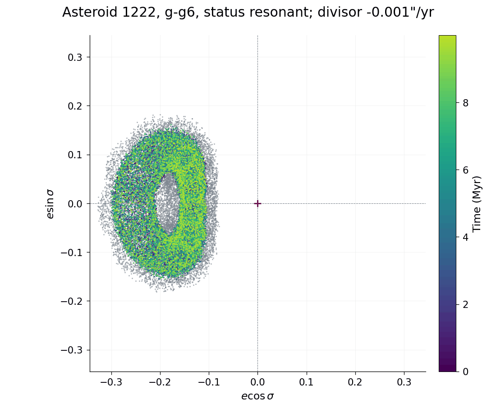

**portrait**: $(r\cos\sigma, r\sin\sigma)$; grey from the osculating elements, coloured by time from the classified
angle; red + at the origin. Here $r$ is $e$ when the angle contains $\varpi$, otherwise $i$ in degrees from the
invariable plane (the combined figure's (h) uses $\sin\frac i2$ instead). Tina's ring sits off the origin: a
libration.

### ecc_vector

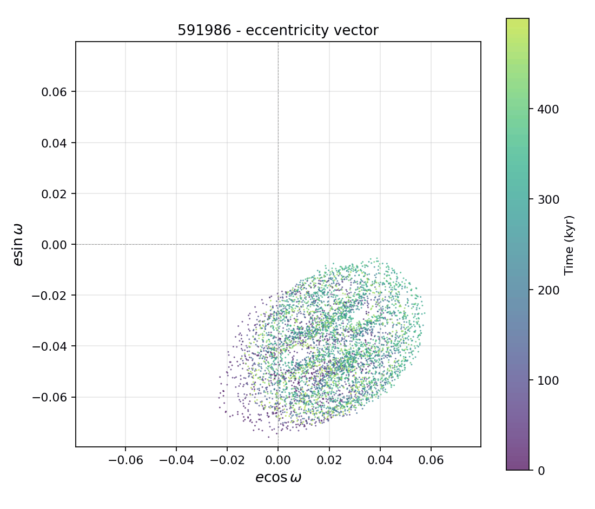

The plane $(k, h) = (e\cos\omega, e\sin\omega)$, coloured by time, in a square window centred on the origin; one
figure per body. A cloud that does not enclose the origin keeps $\omega$ bounded whatever the dynamics: it explains
why $\omega$ librates, not whether the libration is a resonance. Here (591986)'s cloud is off the origin, yet its
libration is kinematic (below).

??? info "The maths: forced and free eccentricity"
    The cloud's centre is offset from the origin by $e_{\rm forced}$ and its radius is about $e_{\rm free}$, the
    columns `e_forced` and `e_free` of summary.csv
    ([forced and free eccentricity](coherence.md#forced-and-free-eccentricity)).

### free_omega (Lidov-Kozai)

Three figures from the forced/free split ([Free elements](free-elements.md#files-and-figures)).

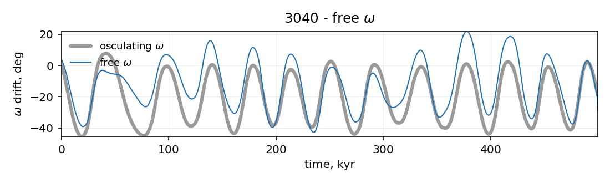

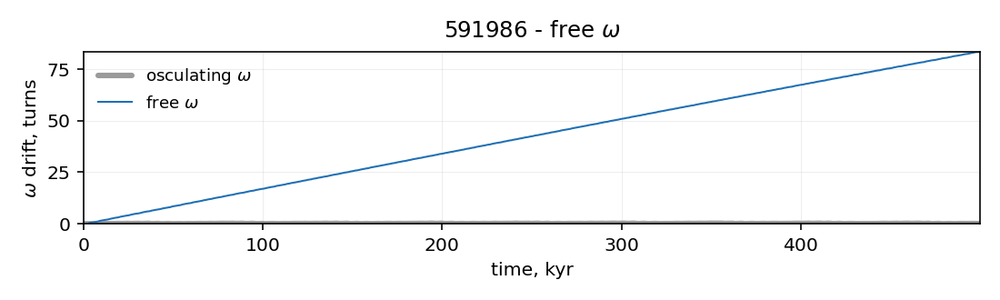

**drift**: how far $\omega$ has moved since the start: blue the free $\omega$, a thick grey line the osculating one,
in degrees, or in turns when the drift exceeds three turns. A confined band is a libration, a ramp a circulation. Top:
(3040) Kozai, where both stay within a band of some 70°: a Lidov-Kozai libration. Bottom: (591986), where the osculating
$\omega$ stays bounded but the free $\omega$ winds about 80 turns in 500 kyr: kinematic.

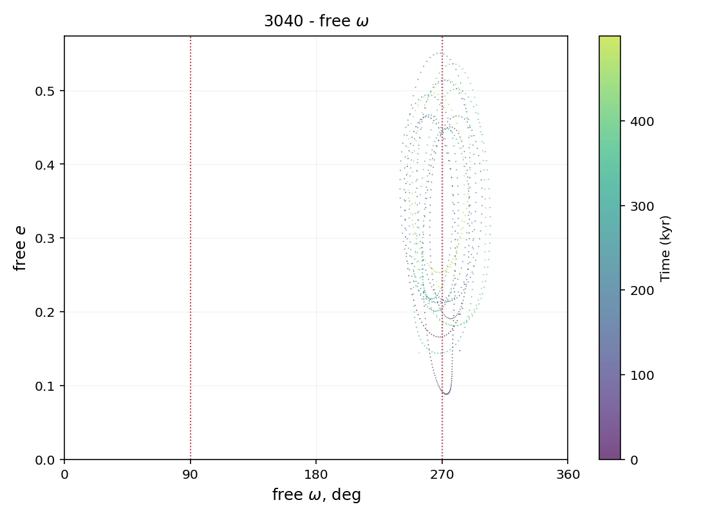

**portrait**: free $e$ against free $\omega$ (0°–360°), coloured by time, with red dotted lines at 90° and 270°. A
librator draws closed loops around one of them (the centre can shift inside a mean-motion resonance); a circulator
draws a wave through every $\omega$.

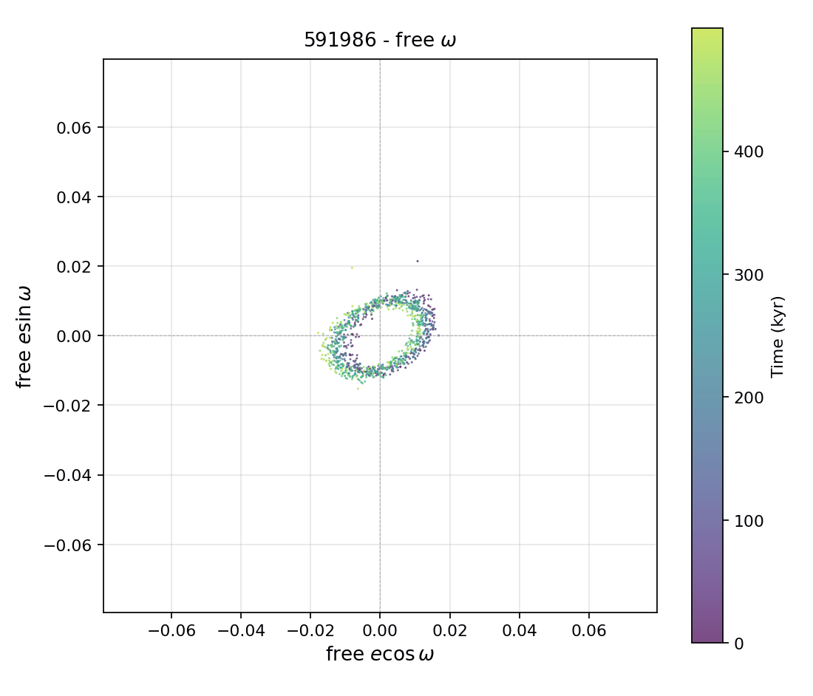

**vector**: the free eccentricity vector $(e_{\rm free}\cos\omega_{\rm free}, e_{\rm free}\sin\omega_{\rm free})$
on exactly the window of the osculating `ecc_vector` figure, so the two can be compared by eye. For (591986) the
free vector circles the origin while the osculating cloud is offset from it: the forced eccentricity, not a
resonance, kept the osculating $\omega$ bounded.

### cross_spectrum

Coherence and phase of two series (for example $e$ and $i$) against period on a log axis, and below them the two
series band-passed at the decisive line over 16 of its cycles. Everything is cropped to the search band, and the
axes pick their own unit (yr, kyr, Myr).

- **Coherence panel.** Each segmentation level has its own shade of blue: its full spectrum faint, a dotted line at
  its significance threshold, and a stem at each detected line; open red rings mark up to five strongest lines of
  each level. A red dashed vertical line marks the decisive line (the strongest at the coarsest valid level; it
  need not lie in a yellow band).
- **Yellow bands** mark where to look: every level whose validity band covers that period is above its own
  threshold (at least two such levels; a level that cannot see the period abstains), and the band holds one of the
  decisive level's three strongest lines. Agreement alone would not be selective: when the Kozai integral
  $\sqrt{1-e^2}\cos i$ is conserved, $i$ is a smooth function of $e$ and the two are coherent at every period with
  power, so a highlight of all agreement would say only that the integral holds.
- **Phase panel.** Each line is a marker sized by its cross-amplitude, filled when every level agrees; light green
  bands are the expected phase ± tolerance (180° ± 30° for the exchange of $e$ and $i$).
- **Band-passed panel.** This one settles it: two curves in antiphase are an exchange, two curves drifting past each
  other are not.

The method: [Cross-spectral coherence](coherence.md#how-it-is-measured). No example image: the benchmark examples
are saved without coherence.

### clones

Three panels for a body integrated with clones ([Clones](clones.md)): (a) the angle (0°–360°) of every clone,
coloured by its status, the nominal orbit in black; (b) each clone's status against its initial $a$ (minus the
nominal's), the nominal a black ★, with the catalogue resonant axis $a_{\rm res}$ of an MMR (dotted, `a_res
(catalogue)`: from the mean motions, not moved into the osculating frame of the x axis) and $a_{\rm res}$ ± the
median half-width of the clones' episodes (blue dashed); (c) the share of each status
with its Wilson 95 % interval, ★ at the nominal's status. The title gives the number of clones, the source of the
orbit solution, its epoch and the most common status. No example image: drawing it needs an integration of the
clones.

## What to look at first

Start from the plaque, then check the panels the verdict rests on. The [Gallery](physics/gallery.md) has a figure
for each case below.

- **resonant** ([two-body](physics/gallery.md#resonant-two-body), [three-body](physics/gallery.md#resonant-three-body)):
  in (a) the fills cover the record from edge to edge; in (c) the line changes sign at each turning point and stays
  near its episode's blue dashed limits (not necessarily ±1, and only roughly for a well that is not a cosine);
  in (h) the dots lie below 1; (k) and (l) show closed loops around the +; (e) shows high $R^2$.
- **transient** ([capture and release](physics/gallery.md#transient-recurrent),
  [after a jump](physics/gallery.md#transient-before-jump)): fills in part of (a) only; circulation or a drift between
  them; hatched fills and jump lines when a jump of $a$ ended the libration; the tag `ends: …` says how the record ends.
- **a subresonance** ([example](physics/gallery.md#transient-subresonance)): in (j) a member's line is flat while the
  catalogue angle wanders.
- **near_separatrix** ([example](physics/gallery.md#near-separatrix)): no accepted episode, but the angle stalls: ○
  slips on the zero line of (c), or revolutions in (h) close to the separatrix zone
  ([near the separatrix](physics/geometry.md#near-the-separatrix)).
- **non_resonant, circulation** ([example](physics/gallery.md#circulation)): the centre in (i) runs a full turn
  one way (shaded); the recurrence figure stays light away from its diagonal.
- **non_resonant with a libration** ([kinematic](physics/gallery.md#kinematic-libration),
  [induced](physics/gallery.md#induced-owner-librates)): the angle librates in (a), but in (j) $\sigma$ follows $p\varpi$
  (kinematic) or the owner's purple line is the flat one (induced); the header reads `episodes about X° (not this
  resonance)`.
- **an alias** ([example](physics/gallery.md#alias)): the red ALIAS note in (b), and the portraits crossed out.
- **uncertain** ([too short](physics/gallery.md#insufficient-time), [origin unknown](physics/gallery.md#uncertain-origin)):
  the sentences and the action say what is missing (a longer record, a finer step) and how long to integrate.
- **secular** ([ν6](physics/gallery.md#secular-nu6), [z1](physics/gallery.md#secular-z1-resonant)): read (a) with the
  turning-point rule above and (h) for a ring off the origin.
- **Lidov-Kozai** ([confirmed](physics/gallery.md#zlk-resonant), [kinematic](physics/gallery.md#zlk-kinematic)): in
  (f) a free $\omega$ that winds points to kinematic, a confined one supports the libration; the gate's outcome in
  the right column is the verdict. An offset eccentricity-vector cloud alone proves nothing.
