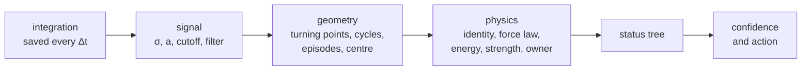

<!-- Generated from docs/physics/overview.md by docs/tools/build_skill.py (make skill). Edit the docs, not this file. -->

# How the status is determined

The package integrates the orbit of a small body together with the planets, builds the resonant angle
$\sigma(t)$ of every resonance it checks, and gives each angle a **verdict**. This section explains, in physical
terms, how that verdict is reached. Each test is stated as the physical question it answers, then as a formula,
then as the threshold that decides it, with the name of the setting that holds the threshold
([Configuration](../config.md)).

The verdict answers two separate questions:

1. **What does the angle do?** Does $\sigma$ librate (oscillate about a centre), circulate, drift, or do both in
   turn? This is pure geometry of the filtered angle ([What the angle does](geometry.md)).
2. **Is the body in this resonance?** A libration of $\sigma$ alone is not enough. For a mean-motion resonance
   the test is whether the resonant term drives the oscillation of the semi-major axis $a$: $a$ must oscillate
   with $\sigma$ in a definite way ([The resonant pendulum](pendulum.md), [Is it this resonance?](response.md)).
   Secular and Lidov-Kozai angles have their own tests ([Secular and Lidov-Kozai](secular-zlk.md)). An angle can
   also look bounded because of the perihelion precession, another resonance nearby, or a too coarse output step.

!!! note "What a verdict claims"
    A verdict describes **the saved interval** of the integration, at the saved output step, for the model of
    the run (the planets that were integrated, the integrator, the initial elements). A longer integration, a
    finer step or another epoch can give a different answer. The thresholds are conventions, chosen and tested
    on a benchmark of examples labelled by eye ([Benchmark](https://smirik.github.io/resonances/benchmark/)); all of them are settings.

## The verdict

| field | values | meaning |
|---|---|---|
| `status` | `resonant` | $\sigma$ librates over the whole record. Whether its dynamical origin was established is in `reason` and `libration_origin`: `dynamic_libration`/`dynamic` is a measured explanation, `geometric_libration` with origin `unknown` a geometric classification whose force was not measured |
| | `transient` | $\sigma$ librates in one or more episodes that do not cover the record as one libration (a capture, an escape, a drift or another regime separates them) |
| | `near_separatrix` | no full libration cycle, but $\sigma$ repeatedly stalls or slips at the top of its own potential well while $a$ responds |
| | `non_resonant` | $\sigma$ circulates, or it is bounded by something other than this resonance |
| | `uncertain` | the record cannot decide: too short, an unexplained drift, or contradicting physics |
| | `invalid` | the record cannot be measured at these settings: an aliased or too coarse output step, an unphysical orbit |
| `angle_status` | `libration`, `episodic`, `near_separatrix`, `circulation`, `drift`, `insufficient_time`, `undefined` | the geometry of $\sigma$ over the whole record ([What the angle does](geometry.md#from-geometry-to-angle_status)) |
| `angle_subtype` | `stationary`, `modulated`, `moving_centre`, `regime_change`; `recurrent`; `pattern_a`, `pattern_b`; `alias`; `arc`, `stall`, `few_cycles`; `unphysical`, `undefined_phase` | the kind of `angle_status` |
| `final_regime`, `final_regime_start_yr` | `libration`, `circulation`, `drift`, `near_separatrix`, `insufficient_time`, empty | how the record ends (a capture, an exit) and from when |
| `orbit_type` | `tadpole L4`, `horseshoe`, `interior, symmetric libration about 0°`, … | the header of the figure; descriptive, decides nothing |
| `reason` | e.g. `dynamic_libration`, `kinematic_libration`, `alias` | the one main explanation of the status ([every reason](status-tree.md#every-reason)) |
| `libration_origin` | `dynamic`, `induced`, `subresonance`, `kinematic`, `unknown` | who makes the bounded oscillation |
| `origin_detail` | `varpi_term`, `secular_cycle`, `planet_ripple`, `owner_libration`, `owner_forced_wave`, `fixed_subresonance`, `composite_multiplet`, `free_omega_winds` | the concrete cause ([Is it this resonance?](response.md)) |
| `owner` | e.g. `11M-20+0+9` | the resonance that carries the oscillation (induced, subresonance) |
| `confidence`, `confidence_raw` | `certain`, `high`, `medium`, `low` | how well the evidence supports the status, after and before the caps ([Confidence](confidence.md)); empty for `uncertain` and `invalid` |
| `action` | `none`, `spot_check`, `review`, `extend`, `resample` | what to do next with this body ([Actions](confidence.md#actions)) |
| `check_mmr_*` | `pass`, `fail`, `not_measured`, `not_applicable` | each physical test: `pass` supports the resonant reading, `fail` refutes it |
| `flags`, `caps`, `thin_margins`, `failed_support` | `;`-separated lists | what lowered the confidence and why |

A body can therefore be `non_resonant` while `angle_status = libration`: the angle librates, but not because of
this resonance. The origins of such a *kinematic* or *induced* libration are explained in
[Is it this resonance?](response.md). Every column of the output files is listed in [Output data](../output.md).

## The pipeline

1. [**Signal**](signal.md). Is the output step fine enough? The angle is unwrapped and low-pass filtered so that
   the short-period terms (orbital and synodic periods) are removed and the libration is kept.
2. [**Geometry**](geometry.md). Turning points of the filtered angle, closed cycles, librating episodes, the
   centre of each episode, jumps of $a$. This gives `angle_status`.
3. [**Physics**](response.md). Does $a$ follow $\sigma$ as the pendulum of this resonance requires? Is the
   strength needed for the observed period available? Does another resonance own the oscillation?
4. [**Status tree**](status-tree.md). The geometry and the physics are combined, in a fixed order, into
   `status`, `reason` and `libration_origin`.
5. [**Confidence**](confidence.md). Every comparison of the analysis has a margin; the margins and a few caps
   give the confidence level and the suggested action.

??? info "The exact order of the steps (MMR)"
    `analyse_mmr` (`resonances/resonance/analysis/mmr/analyse.py`) runs in a fixed order: input check → context
    (rates, $a_*$, $c$, synodic periods, the great inequality) → sampling (predictive unwrap, alias) → preprocessing
    (ripple, cutoff, filter) → geometry → slow parts → response of $a$ → energy and zone → kinematics →
    `angle_status` → filter guard → subresonances → strength → owner (with that strength) → the verdicts of derived
    members → status → margins, caps, confidence.

    The analysis reads only the saved series, so a run can be classified again without integrating
    (`SimulationSerializer.restore(..., recompute_librations=True)`, `benchmark/tools/reclassify.py`). Every
    comparison is written to a ledger (`decision_path`, the right-hand column of the combined figure), and every
    threshold is a setting. The rule IDs used in the figure and the output columns (G0, L4, 5u, …) are listed in the
    [Rule index](../libration-analysis.md).

Secular and Lidov-Kozai angles go through the same geometry with their own signal step and physics
([Secular and Lidov-Kozai](secular-zlk.md)). The [Gallery](gallery.md) shows one benchmark example of every
status with its one-page figure.

## Notation

| symbol | meaning |
|---|---|
| $\lambda, \varpi, \Omega$ | mean longitude, longitude of perihelion, longitude of the node of the body |
| $\lambda_j, \varpi_j, \Omega_j$ | the same for planet $j$ |
| $k, k_j$ | integer coefficients of $\lambda$ and $\lambda_j$ in the resonant angle |
| $q$ | the order of an MMR: $q = \lvert k + \sum_j k_j\rvert$ (prograde two- and three-body); $p' + q'$ for a retrograde $p'/{-q'}$ resonance |
| $n, n_j$ | mean motions; $n(a) = 2\pi\,a^{-3/2}$ rad/yr with $a$ in au |
| $\nu = \dot\sigma$ | the rate of the angle; $a_*$ the exact resonance, $\nu(a_*) = 0$ |
| $c = \partial\nu/\partial a$ | how fast the angle's rate changes with $a$; $c = -3kn/(2a)$ |
| $\sigma_c(t)$, $\psi = \sigma - \sigma_c$ | the centre of libration and the angle measured from it |
| $\omega_0$ | the small-amplitude libration frequency; $T_0 = 2\pi/\omega_0$ |
| $A$ | the libration amplitude (half the peak-to-peak swing of $\sigma$) |
| $P$, $P_i$ | the libration period, the period of cycle $i$ |
| $\Delta t$ | the output step of the integration |
| $P_c$ | the cutoff period of the low-pass filter |
| $\mu$, $\mu_j$ | planet-to-Sun mass ratios |
| $\mathsf K(m)$, $\mathsf E(m)$ | complete elliptic integrals of the first and second kind, with parameter $m$ |

Time is in years, angles in radians (degrees in the output columns whose names end in `_deg`), $a$ in au.
