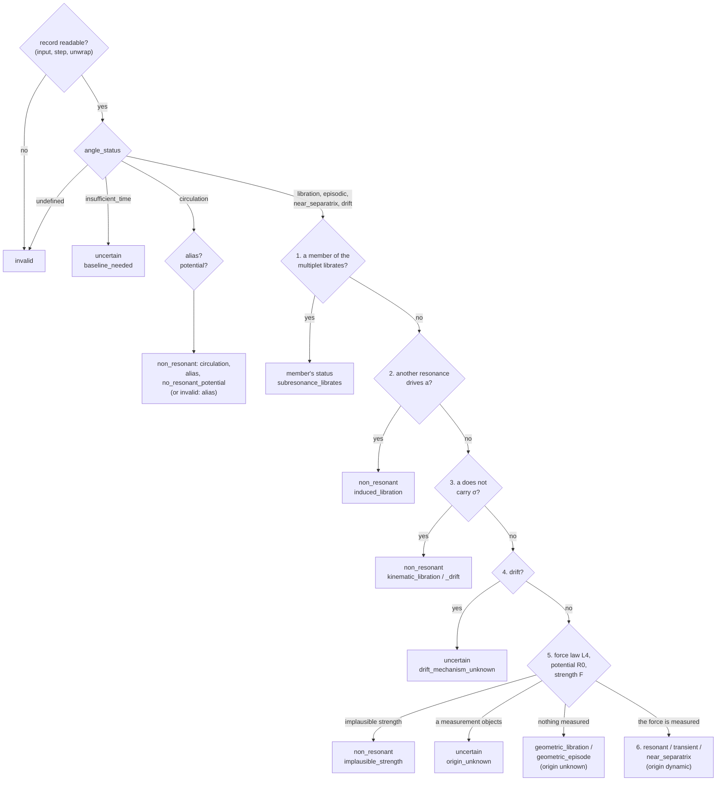

<!-- Generated from docs/physics/status-tree.md by docs/tools/build_skill.py (make skill). Edit the docs, not this file. -->

# The status tree

The geometry ([What the angle does](geometry.md)) says what $\sigma$ does over the record: `angle_status`. The
physics ([Is it this resonance?](response.md)) measures whether $a$ answers $\sigma$ as the pendulum of this
resonance requires. The status tree combines the two, always in the same order, into `status`, `reason` and
`libration_origin`. The first question that has an answer decides; the later ones are not asked.

The order follows one principle: **a cause outside this resonance is looked for before the libration is credited to
it.** A bounded $\sigma$ is first checked against the sampling (can the record be read at all?), then against
other resonances (a member of the same multiplet, another commensurability), then against pure geometry (the
perihelion term), and only then is its own force law measured.

This page describes mean-motion resonances (two-body, three-body, retrograde, co-orbital). Secular and Lidov-Kozai
angles use a shorter tree, given [at the end](#secular-and-lidov-kozai-angles).

## The tree

## Before the tree: can the record be read?

These checks come before any geometry. A record that fails one of them gets `status = invalid`: the run says
nothing about the resonance at these settings, and the action says how to repair it.

| question | test | reason | action |
|---|---|---|---|
| Is the angle a resonance of this body at all? | the coefficient of the body's $\lambda$ is $k \ne 0$ | `invalid_input` | review |
| Is the orbit an ellipse? | $a > 0$, $0 \le e < 1$, all values finite | `unphysical` | review |
| Can the filter keep the shortest libration? | $P_c > 2\,\Delta t$ ([signal](signal.md)) | `undersampled` | resample |
| Can the angle be unwrapped without guessing turns? | unwrap residuals at most `MMR_UNWRAP_MAX_RESID_P99_DEG` = 45° (99th percentile) and `MMR_UNWRAP_MAX_RESID_DEG` = 135° (largest) | `alias` (`angle_status = undefined`) | resample (review when no finer step helps) |
| Is $\varpi$ defined? (very small $e$) | the $p\varpi$ part jitters by more than `MMR_JITTER_MAX_RAD` = 0.785 rad, the full angle cannot be unwrapped, and $\varpi$ is undefined over more than `MMR_VARPI_UNDEFINED_MAX_SHARE` = 0.5 of the record | `undefined_phase` | review |

## Steps in order

The tree reads the angle *as the status reads it*: a record that librates in episodes and then circulates, or
librates before a jump of $a$, or is captured after one, is judged as the episodic angle its episodes show. The
reported `angle_status` may then differ from the word the tree read; see [below](#the-reported-angle-word).

**G6. Too short.** `angle_status = insufficient_time` (too few turning points, an arc, a stall): `uncertain`,
`baseline_needed`, action `extend` ([Confidence](confidence.md#actions) gives the length asked for).

**C. Circulation.** The centre of $\sigma$ runs through a full turn.

- If the sampled angle is an *alias* (the true rate $\nu$ folded by the output step), the record can still exclude
  a libration when the alias branch is the same over the whole range of $a$ and the body is far from the
  resonance: the distance $|\langle a\rangle - a_*|$ in units of the $a$-range is at least `MMR_C5_FAR_RATIO_MIN` = 3.
  Then `non_resonant / alias`; otherwise a libration may hide behind the step: `invalid / alias`, action `resample`.
- If a member of the multiplet has a librating verdict of its own, the row takes the member's status (as in step 1
  below).
- If $\sigma$ turns back at times but the energy measured from $a$ does not follow a potential of $\sigma$ (R0 fails):
  `non_resonant / no_resonant_potential`.
- Otherwise `non_resonant / circulation`; an owner found for a circulating angle only names its origin.

**1. Is a member of the multiplet librating instead?** A resonance $k\lambda + \sum k_j\lambda_j + p\varpi + \dots$
comes with members that differ by $m(\varpi_P - \varpi)$ or by node terms (Morbidelli 2002, §9.3–9.4). If one
member has a fixed centre while $\sigma$'s centre moves with $\varpi_P - \varpi$, the libration belongs to that
member: the catalogue row takes **the member's own status** (an `invalid` member makes it `uncertain`),
`reason = subresonance_librates`, origin `subresonance`, `owner` = the member, and also the member's confidence
([Confidence](confidence.md)); its `angle_status` stays its own. An accepted member without a verdict of its own gives
`non_resonant / subresonance_librates`. When the catalogue angle and the member both librate over the record, each
keeps its own verdict. Example: [82831 13M-24](gallery.md#transient-subresonance).

**2. Does another resonance drive $a$?** The owner search looks for another commensurability $\phi_o$ whose force
explains $\dot a$ better than $\sigma$'s own term. Since $\dot\sigma \simeq c\,(a - a_*)$ holds for any oscillation of
$a$, an $a$ driven by $\phi_o$ makes $\sigma$ oscillate too: an *induced* libration. The owner is accepted only if its
intervals cover at least `MMR_OWNER_COVER_MIN` = 0.5 of $\sigma$'s decisive episode; then `non_resonant /
induced_libration`, origin `induced`. The detail says whether the owner librates (`owner_libration`) or circulates
at the oscillation's period (`owner_forced_wave`). Examples: [117306](gallery.md#induced-forced-wave),
[1997 GK3](gallery.md#induced-owner-librates).

**3. Does $a$ carry the oscillation at all?** In a resonance the swing of $a$ follows from the swing of $\sigma$:
$\delta a \simeq \delta\dot\sigma/|c|$. If $a$ carries less than `MMR_B1_RATIO_MIN` = 0.1 of that (test B1), or the
cycle runs at a secular period of the body (the $e$-cycle $2\pi/|g - g_5|$ or the $2\omega$ cycle, within
`MMR_KIN_PERIOD_TOL` = 0.1) while the identity and every force law fail, the bound comes from the geometry of the
angle (its $p\varpi$ part, a secular cycle): `non_resonant / kinematic_libration`, origin `kinematic`. When the slow
centre itself follows the $\lambda$ part plus the secular part (correlation of rates ≥ `MMR_KIN_CORR_MIN` = 0.9),
$a$ does not answer and the librating stretches are only a ripple on it (their swing below
`MMR_KIN_RIPPLE_SHARE_MAX` = 0.5 of the centre's range), or a kinematic libration's centre moves more than
`MMR_KIN_DRIFT_SHIFT_RATIO` = 1 amplitude: `non_resonant / kinematic_drift`. If a libration slower than the record
cannot be excluded and the centre's rate is consistent with an exact commensurability (within
`MMR_B5_EXACT_SIGMA` = 2 standard errors): `uncertain / baseline_needed`. Examples:
[285637](gallery.md#kinematic-libration), [62243](gallery.md#kinematic-drift).

**4. A drift without a cause.** `angle_status = drift` with no kinematic explanation: `uncertain /
drift_mechanism_unknown`. Example: [142694](gallery.md#uncertain-drift).

**5. Is the libration this resonance's own force?** Three measurements can show it
([Is it this resonance?](response.md)): the force law L4 ($\dot a$ follows $\sin(\sigma - \varphi_0)$), the potential
R0 (the energy $\tfrac12\dot\sigma^2 + V(\sigma)$ built from $a$ is conserved cycle by cycle) and the strength F (the
force needed for the observed period against the force the disturbing function gives). Their combinations:

| leaf | measurements | status / reason | origin |
|---|---|---|---|
| 5f | L4 cannot be told from a forced line of the angle's lattice at the same period, and the $\sigma$-only potential test does not fail | uncertain / origin_unknown (flag `force_law_contaminated`) | unknown |
| 5s | L4 and R0 do not pass, and the period needs ≥ `MMR_STRENGTH_IMPLAUSIBLE_RATIO` = $10^3$ × the strength computed from the disturbing function | non_resonant / implausible_strength | unknown |
| 5a | L4 fails, R0 does not pass | uncertain / origin_unknown | unknown |
| 5b | L4 passes, R0 fails | uncertain / origin_unknown (flag `force_law_disagrees`) | unknown |
| 5e | R0 fails, L4 not measured | uncertain / origin_unknown | unknown |
| 5g | L4 and R0 not measured, the identity fails on an episode and passes on none | uncertain / origin_unknown | unknown |
| 5c → 6 | L4 fails, R0 passes | by the behaviour (below), cap `force_law_disagrees` | dynamic |
| 5d → 6 | L4 passes and R0 does not fail; or R0 passes and L4 is not measured; or (a `near_separatrix` angle) neither is measured and nothing objects | by the behaviour (below) | dynamic |

A failed $\sigma$-only potential test (period law or fixed well, no $\dot a$ in it) stays an objection even when L4 is
contaminated: the tree then skips 5f and goes on through 5s and the other leaves.

For an angle of the `near_separatrix` type, the leaves 5a, 5e and 5g give `non_resonant` instead:
`no_resonant_potential`, or `modulated_circulation` when the angle only slows down periodically (pattern B).

On an output step that folds short periods into slow ones, a failed L4 or identity is read as *not measured* when
the directly averaged strength F passes and the short-period scatter of $a$ exceeds
`MMR_SHORT_PERIOD_A_RATIO` = 0.5 of the libration's half-swing in $a$: the folded terms, not the dynamics, spoil the
fit.

**The unmeasured branch.** When neither L4 nor R0 could be measured (a small amplitude, one force window) and
$\sigma$ librates, the first leaf that holds:

| leaf | condition | status / reason | origin |
|---|---|---|---|
| 5d → 6 | the strength computed by direct averaging passes, required / theory within [1/x, x], x = `MMR_STRENGTH_CHECK_RATIO` = 10 | by the behaviour | dynamic |
| 5s | the period needs ≥ $10^3$ × the strength (two-body: direct averaging; three-body: $\mu_i\mu_j e^q$ even after the small-divisor envelope) | non_resonant / implausible_strength | unknown |
| 5s* | three-body ratio ≥ $10^3$, but the envelope could close the gap | uncertain / origin_unknown | unknown |
| 5o | a measured objection: an episodic angle, whose episodes do not lie in the separatrix zone, with a strong $a$-wave already before the episode (O1 ≥ `MMR_O1_RATIO_FAIL` = 0.5, [O1](response.md#onset-of-an-episode-o1)); or F fails | uncertain / origin_unknown | unknown |
| 5n | the decisive episode has fewer than `LIBRATION_CENTRE_MIN_ESTIMATES` = 2 independent cycles | uncertain / origin_unknown | unknown |
| 5u → 6 | nothing measured | by the behaviour, reason `geometric_libration` / `geometric_episode`, cap ≤ low (`geometry_only`) or ≤ medium (`strength_scale_only`, when the order-of-magnitude strength agrees) | unknown |

**6. By the observed behaviour.** When the force is measured, or nothing objects, the angle's own behaviour gives
the status:

| angle (as the tree reads it) | status | reason (force measured) | reason (geometry only, 5u) |
|---|---|---|---|
| `libration` | resonant | `dynamic_libration` | `geometric_libration` |
| `episodic` | transient | `dynamic_episode` | `geometric_episode` |
| `near_separatrix` | near_separatrix | `separatrix_zone` | — (the branch applies to librating angles only) |

The separatrix zone and the energies of the cycles add flags here (`libration_in_separatrix_zone`,
`episodes_in_separatrix_zone`) and confidence evidence; the zone never relabels a geometric libration as
`near_separatrix`. It has one indirect effect on the status: episodes in the zone bypass the O1 objection (leaf 5o)
of the unmeasured branch.

**6u. A union of episodes.** Librating episodes that together cover the record, with no circulation between them,
are read first as episodic. Only if that reading reaches `transient / dynamic_episode` with a measured force (leaf 6,
origin dynamic) is the record promoted to `resonant / dynamic_libration`. Every other outcome stays as it is. (For a
co-orbital 1:1 angle the union is a libration directly: its episodes are the tadpole, horseshoe and quasi-satellite
regimes of one resonance.)

**After the tree.** A non-resonant verdict next to a run of turning points one turn short of an episode
(`LIBRATION_NEAR_EPISODE_TP_DEFICIT` = 1) gets the flag and cap `near_episode`; an owner search run on catalogue
planet longitudes caps the level (`catalogue_longitudes`). These change the confidence, not the status.

## Every reason

| reason | status | origin | physical meaning | example |
|---|---|---|---|---|
| `dynamic_libration` | resonant | dynamic | $\sigma$ librates over the record and a measured force (L4, R0 or F) is this resonance's | [1921 2J-1](gallery.md#resonant-two-body) |
| `dynamic_episode` | transient | dynamic | librating episodes with a measured force, circulation elsewhere | [52356](gallery.md#transient-recurrent) |
| `geometric_libration` | resonant | unknown | librates over the record; no force could be measured, nothing objects | [2348](gallery.md#geometric-libration) |
| `geometric_episode` | transient | unknown | as above, in episodes | [24820](gallery.md#geometric-episode) |
| `separatrix_zone` | near_separatrix | dynamic | stalls and slips at the top of its own well, $a$ responds | [523899](gallery.md#near-separatrix) |
| `circulation` | non_resonant | — | the centre of $\sigma$ runs through full turns | [42355](gallery.md#circulation) |
| `alias` | non_resonant | — | the sampled angle is an alias; one branch, far from $a_*$: no libration possible | [1999 UQ](gallery.md#alias) |
| `alias` | invalid | — | an alias that could hide a libration | [1864](gallery.md#invalid-alias) |
| `no_resonant_potential` | non_resonant | — | $\sigma$ turns back at times but no potential of $\sigma$ explains the energy | — |
| `modulated_circulation` | non_resonant | — | a near-separatrix pattern B (periodic slowing) with no resonant potential | — |
| `kinematic_libration` | non_resonant | kinematic | bounded by geometry ($p\varpi$ term, secular cycle); $a$ does not carry it | [285637](gallery.md#kinematic-libration) |
| `kinematic_drift` | non_resonant | kinematic | the slow centre follows the secular part; librations are a ripple on it | [62243](gallery.md#kinematic-drift) |
| `induced_libration` | non_resonant | induced | another resonance drives $a$; $\sigma$ follows by the identity | [117306](gallery.md#induced-forced-wave) |
| `subresonance_librates` | the member's | subresonance | a member of the same multiplet holds the fixed centre | [82831](gallery.md#transient-subresonance) |
| `implausible_strength` | non_resonant | unknown | the observed period needs a force $\ge 10^3$ times the available one | [2897](gallery.md#implausible-strength) |
| `baseline_needed` | uncertain | — | too few cycles to decide; integrate longer | [385458, 100 kyr](gallery.md#insufficient-time) |
| `drift_mechanism_unknown` | uncertain | unknown | the angle drifts and no mechanism is identified | [142694](gallery.md#uncertain-drift) |
| `origin_unknown` | uncertain | unknown | it librates, but a measurement contradicts this resonance's own pendulum | [2003 TX9](gallery.md#uncertain-origin) |
| `unphysical` | invalid | — | the orbit left the elliptic domain (or $e > 1.3$ for secular/ZLK) | [2010 HY22](gallery.md#zlk-invalid) |
| `undefined_phase` | invalid | — | $\varpi$ is undefined at very small $e$ | — |
| `undersampled` | invalid | — | the output step is too coarse for the filter, $P_c \le 2\Delta t$ | — |
| `invalid_input` | invalid | — | the angle does not contain the body's $\lambda$ ($k = 0$) | — |
| `gate_unavailable` | uncertain | unknown | Lidov-Kozai: the free-$\omega$ gate could not judge ([Secular and ZLK](secular-zlk.md)) | [1981](gallery.md#zlk-gate-unavailable) |
| `unusable_series` | uncertain | — | secular/ZLK: too few samples or non-finite values in the angle | — |

The columns `libration_origin`, `origin_detail` and `owner` are described in [Output data](../output.md); the leaf
that decided is the column `rec_rule` of `mmr_numbers.csv` (5d/6, 5u/6, 3k2, C5, …).

## The reported angle word

The tree reads the angle as the status needs it; the reported `angle_status` describes what $\sigma$ did over the
whole record. They differ in four cases:

- **Episodes, then another regime.** Librating episodes followed by a circulation, by a regime after a jump of $a$,
  or a capture after a jump: reported `episodic` (`recurrent` with two or more episodes); how the record ends goes
  to `final_regime` (`circulation`, `libration`, …).
- **A union of episodes.** Episodes covering the record together are reported `libration` (subtype
  `regime_change`) whatever the status: $\sigma$ never went round.
- **A kinematic drift of the slow centre.** The word follows the mechanism, not the ripple: `drift`, or
  `circulation` when the centre's largest monotone pass reaches a full turn or its net shift reaches
  `LIBRATION_CIRCULATION_NET_REV` = 2 turns (`MMR_KINEMATIC_DRIFT_WORD` = True).
- **Forced waves.** Runs that are forced waves of another argument are not episodes for the status. If the record
  would otherwise be reported `circulation` or `drift` while $\sigma$ loops in those runs, the librating word is
  reported.

Only the output changes; the margins and the confidence read the angle as the tree did.

## Secular and Lidov-Kozai angles

The secular and ZLK tree has no owner, subresonance or force law step:

| angle_status | secular | Lidov-Kozai (with the free-$\omega$ gate) |
|---|---|---|
| `libration` | resonant / dynamic_libration | confirmed: resonant; kinematic: non_resonant / kinematic_libration; no verdict: uncertain / gate_unavailable |
| `episodic` | transient / dynamic_episode | transient, or non_resonant / kinematic_libration when the gate is kinematic and $\rho_{\max} < 1$ |
| `drift`, `insufficient_time` | uncertain / baseline_needed | the same, or non_resonant / kinematic_libration as above |
| `circulation` | non_resonant / circulation | non_resonant / circulation |
| `undefined` | invalid / unphysical, or uncertain / unusable_series | the same |

The gate and $\rho_{\max}$ are explained in [Secular and Lidov-Kozai](secular-zlk.md).

## Legacy integer codes

Old runs stored one integer per angle. The column `status_code` keeps it for comparison only:

| code | MMR | secular / ZLK |
|---|---|---|
| 2 | resonant | resonant |
| 1 | transient | transient |
| 0 | non_resonant | non_resonant (circulation) |
| −2 | — | non_resonant / kinematic_libration (ZLK: the gate measured a kinematic libration) |
| −3 | near_separatrix | near_separatrix (old files) |
| −4 | — | uncertain / insufficient_time |
| −5 | — | near_separatrix, read from an old file (flag `probable_near_separatrix`) |
| −6 | uncertain / baseline_needed | uncertain / drift |
| −9 | other uncertain | other uncertain (ZLK: gate_unavailable) |
| −99 | invalid | invalid |

!!! warning "−2 and −9 are different"
    −2 is a measurement (the free $\omega$ was found to wind: the libration is geometry); −9 is the absence of one
    (the gate could not judge). Never merge them in a statistic.
